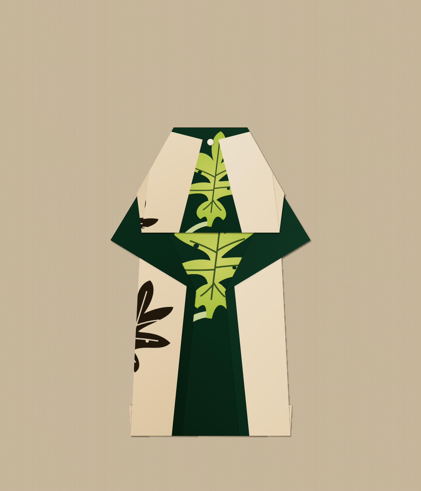
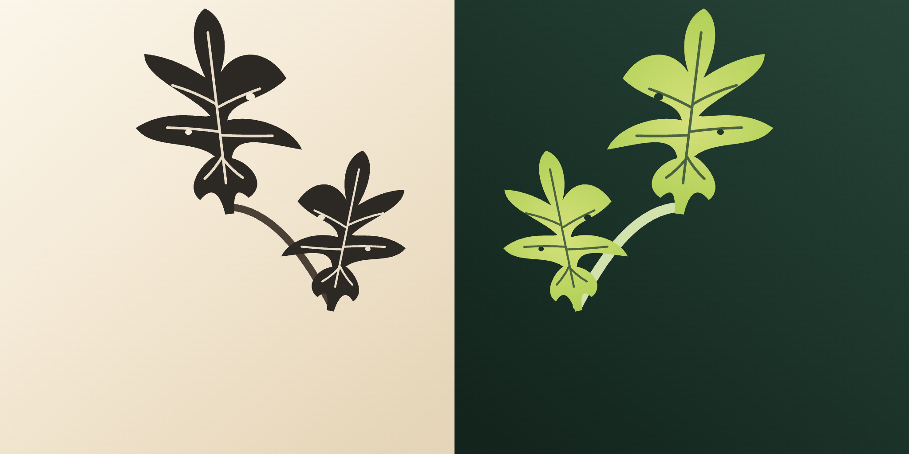

# Afternoon fig — one commissioned two-sided paper

Branch `cursor/afternoon-fig-paper-8c14` from `b522124`, after the three guest papers
were already published. One paper, styled on two existing pieces. No garment, fold
engine, renderer, default or existing paper changes. Draft PR only; not merged or deployed.

`pinboard.png` is the app's own Save photograph output, 1800 × 2100, unedited.

## The paper

Left: the front. Right: the reverse, as seen when the sheet is turned over
side to side. Both are the app's own textures at 1024 px, grain included.

**Afternoon fig** (`afternoon-fig`, Experimental) is one branch, read twice.
The front is the shadow it throws on a plaster wall. The reverse is the same
branch held up to the light: the wall goes dark and the leaves go luminous.
Both faces are drawn in one place and the reverse is mirrored once, so a point
on the sheet carries the same leaf on both sides. A fold that turns paper over
shows the other reading, not a second pattern.

The other three guest papers are all-over: a dye lattice, a mended glaze, a
block repeat. This one is a single picture, placed for the swing coat's shoulder.

- **Front:** warm plaster, two soot figs on one stem. The larger leaf sits high,
  near the centre. The smaller leaf sits lower and to one side.
- **Reverse:** deep green, the same branch in yellow-green, veins darker where
  the leaf is thicker. The stem is pale so it can still be seen on the lining.
- **Why the reverse earns its place:** the swing coat's shoulder yoke is the
  reverse of the top of the sheet, and the capelet's open centre is the reverse
  of the half it keeps. Both of those places wear the large leaf as light.

Implementation: `src/papers/afternoonFig.ts`, registered after Sardine run.
Fixed placement, no print sliding.

## The two pieces

| | Piece | Fold choice | Starting square | Sheet turn |
| --- | --- | --- | --- | --- |
| Below | Swing coat | (none) | 24 cm | 0° |
| Above | Open-front capelet | (none) | 18 cm | 0° |

24 cm is the coat's larger offered square (its suggestion is 20 cm). 18 cm is the capelet's suggestion.

**Swing coat: where the artwork lands.** The shoulder is a field of the reverse, so the large fig is worn as light, cut by the two shoulder folds, with its lower lobe hanging into the opening. One front panel keeps the smaller fig as shadow. The other panel stays plaster.

**Capelet: what the fold did.** It folds the lower half of the sheet away. The shadow leaf goes with that half. What remains is the lining, and the large fig sits in that window, between two plain plaster panels. The same leaf the coat wears on its shoulder is the only leaf the capelet keeps.

### Recreate the board

Start from an empty pinboard (this browser has no earlier captures).

1. `npm ci && npm run dev`, then open
   `/?design=swing-coat&paper=afternoon-fig&turn=0&step=99&view=display`.
   Pinboard → Starting paper **24 cm square** → Pin current piece.
2. Open `/?design=capelet&paper=afternoon-fig&turn=0&step=99&view=display`.
   Pinboard → Starting paper **18 cm square** → Pin current piece.
3. On the board (Standard size): select the coat, Reset selected, **Move down × 7**.
   Select the capelet, Reset selected, **Move up × 7**. No tilt.
4. Finish & photograph: Surface **Linen cloth**, Pins **Slim white**, Light
   **Clear daylight**, no guide. Photograph → Save photograph.

By hand instead of by link: choose Afternoon fig at the end of the paper scroll,
under Experiments, then choose the design. Both pieces stay at 0°.

## What folding changed

The swing coat. The first drawing set both leaves on the openings, the way the
coat's front panels and lining meet. Folded, the shoulder yoke — the reverse of
the top of the sheet — was an empty green field, and each panel caught only a
scrap of a leaf.

The larger leaf moved up into that top band, so the yoke wears a whole fig as
light. The smaller leaf stayed lower, where a panel can crop it as shadow.
Nothing else in the app changed. The veins were also drawn finer, before that
move, because the first flat sheet read as spokes rather than a fig.

The capelet was the piece that confirmed the move. Because it folds the lower
half away, it keeps the light and loses the shadow. 180° emptied the coat's
shoulder again, so both pieces stayed at 0°.

## Checks

Run on Node 24.11.1 in a cloud container. Browser checks used headless Chromium
with software WebGL. **No real phone and no physical paper.**

- `npm run typecheck`, `npm test`, `npm run build`: see the PR notes for the run
  on this head.
- `scripts/check-design-pass.ts` (in `npm test`) lists the paper after the three
  earlier commissioned papers, Experimental, fixed placement, and checks that the
  high leaf sits in the top band and the low leaf sits in the half the capelet
  folds away.
- `scripts/check-afternoon-fig-browser.cjs`, against the running app
  ([result](evidence/browser-checks.json)): paper chosen from its swatch under
  Experiments; swing coat folded with the real Fold button, two Back, refolded;
  four quarter-turns on the finished coat; capelet folded with one Back and
  refolded; both pinned at their sizes; arranged with the board's buttons;
  photographed and saved at 1800 × 2100; page reloaded; board restored; second
  PNG **byte-identical** to the first; no page exceptions or console errors.
  The script is optional and not in CI.
- `scripts/check-guest-papers.cjs` includes the new card and its two looks.

Limits: an older build cannot read a board that holds this paper. Colours in the
workshop and display views are darker than on the board because those scenes are
lit differently; the board is closest to the flat sheet.
