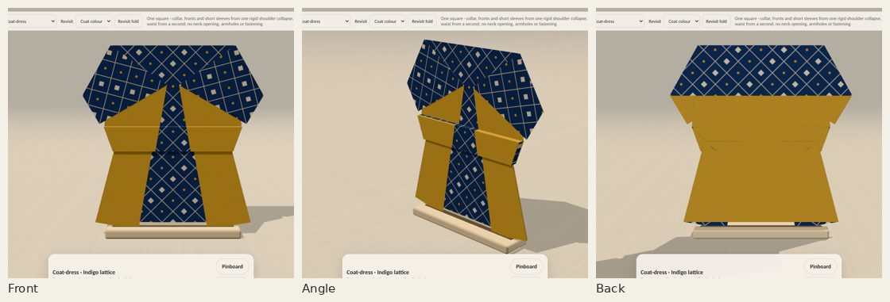
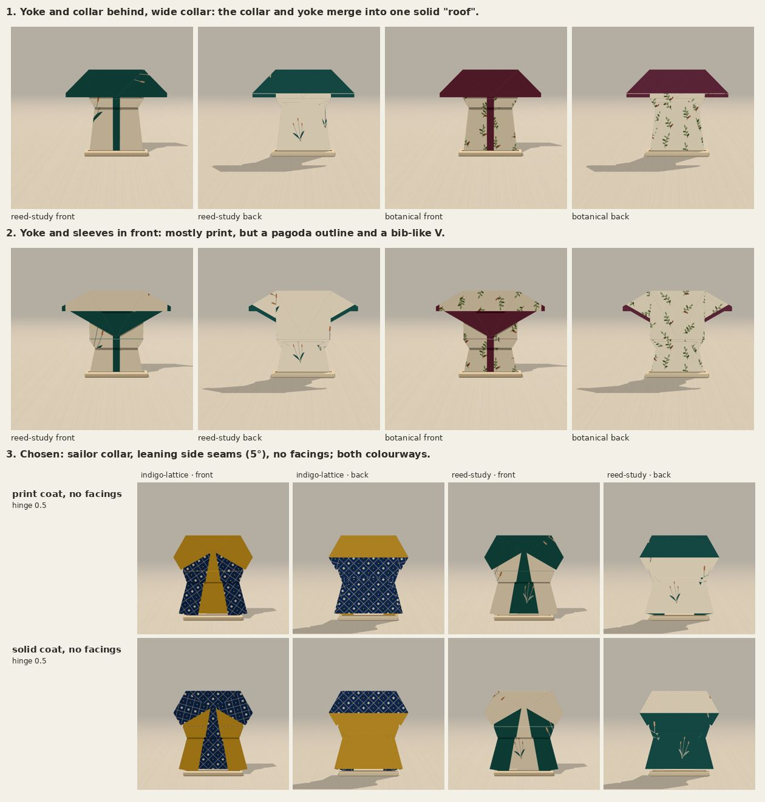
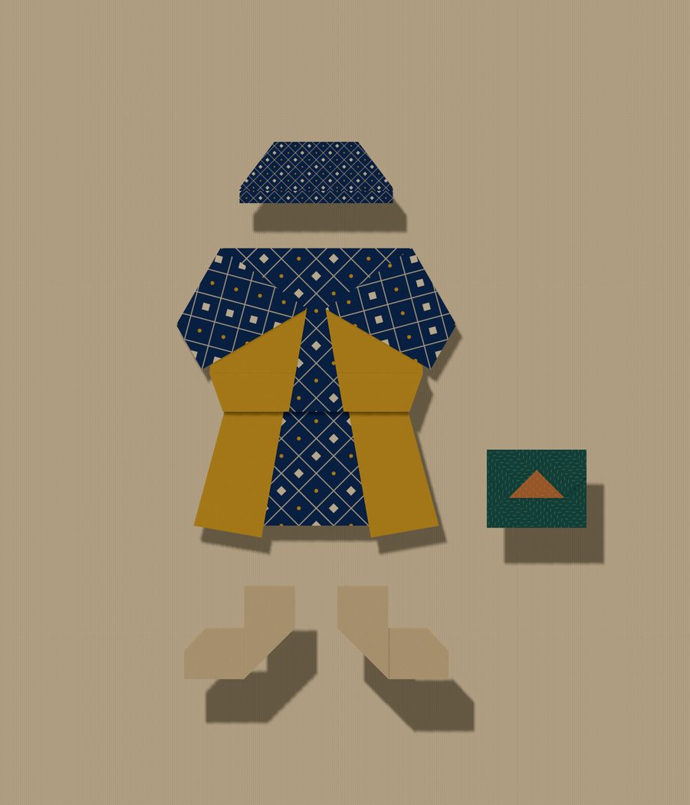

# Coat-dress

One uncut square becomes a coat-dress with a pointed sailor collar in front that
turns into a square cape across the back, fronts that meet under the collar and
open over an underskirt, short sleeves under the collar, a pleated waist and a
flared skirt. Choose **Coat-dress** under Design, or open `?design=coat-dress`.
The one choice, **Coat colour**, is offered before the shoulders fold:

- **Reverse-colour coat** (default): the coat shows the paper's reverse; the
  collar, the underskirt and the back yoke show the print.
- **Printed coat** (`&coat=print`): the other way round.

[Every curated paper, both colourways, front and back](evidence/papers.jpg) ·
[the app: the choice, a phone, the angle view](evidence/app.jpg) ·
[crease pattern](../crease-patterns/coat-dress.svg) ·
[sheet map](../paper-studies/sheet-map-coat-dress.png) ·
[printable folding sheet (PDF)](coat-dress-folding-sheet.pdf)

## Why this construction

A square has four free corners. A gate-fold coat front has exactly one of them at
the neck, so it can become a lapel or a sleeve but not both: the lapel vest picks
lapels, the box jacket and dress pick sleeves, and the swing coat has a yoke.
Here neither the collar nor the sleeves come from a corner.

**One rigid step does both shoulders.** At each shoulder point V four creases
meet: the shoulder line (across the back), the side seam (down, leaning out by
5° so the skirt can widen), and two collar creases (120° and 205° from the
shoulder line). Counter-clockwise from the shoulder line the sectors are 120°
(back yoke and sleeve), 85° (the collar wedge), 60° (front) and 95° (back).
Opposite sectors sum to 180°, so the vertex is flat-foldable (Kawasaki) and
folds rigidly with one degree of freedom. Its fold angles are locked together:
tan(ρ/2) of the shoulder line and the neck crease is a fixed multiple of the
side seam's and the upper collar crease's,

    rate = |cos((a − b)/2) / cos((a + b)/2)|,  a = 120° (collar), b = 90° − 5° (collar wedge)

(4.406 here; `shoulderRate`). The check closes every crease loop to 1.4e-15
over 199 samples and over a grid of collar angles 110–140° and flares 0–7°.

In that one move the fronts fold in across the side seams, the strip above the
shoulders folds behind as the back yoke, and the wedge between the two collar
creases turns through the shoulder and lies on top: the collar. The outer part
of the strip above each shoulder comes down with the yoke as a short sleeve,
under the collar. No engine change was needed: it is an ordinary `collapse` step.

**The trade-off it imposes.** The collar wedge is fixed at 90° − flare by
flat-foldability, so the sleeve's angle below horizontal and the V-neck's angle
add up to that wedge: a deeper V means flatter, wing-like sleeves. True notched
lapels with set-in sleeves are not available from this vertex; statement
collars are. The sleeves are short and mostly under the collar.

**The waist** is the fit-and-flare's mechanism (a pleat across the body and a
hidden gusset each side, `fitFlare.ts`), solved against the leaning side seam.
Its side creases start at A, just below the collar and sleeves (with 0.02
clearance), so those never fold with the sides. The fit-and-flare's plain
fixed-point iteration oscillates once the seam leans out, so the swivel tilt is
found by a scan for the first sign change and bisection: the shallowest pleat
that closes. With no lean it reproduces `fitFlareGeometry` to 7e-13.

**Colour comes only from folding.** The fronts are folded once; the collar,
back yoke and the underskirt are folded an even number of times. So the coat
and its collar always show opposite sides of the paper, and the choice only
decides which. The reverse-colour coat folds both collapses mirrored (every
crease the other way), worked from the back, then turns over to reveal. Both
colourways fold the same paper to the same place; the check asserts it.

## Selection

1. Yoke and collar behind with a wide collar: correct geometry, but the collar
   and yoke merged into one solid trapezoid in the real app. The flat-colour
   preview had looked fine; this is why every choice here was judged in the app.
2. Yoke and sleeves in front: mostly print, but a pagoda outline and a bib.
3. Chosen: the sailor collar (collar crease 120°), side seams leaning out 5°
   (the hem is about 30% wider than the waist), no facings.

Narrow facings (side edges turned first) gave a contrast placket, print piping
on the collar and contrast cuffs, all from parity. They were dropped: the extra
layer ran through the whole waist pleat (14 rendered layers against the 12 the
fit-and-flare established, and one more real layer to fold through) and the
centre contrast already comes from the underskirt.

## The fold

Reverse-colour coat: turn over; collapse both shoulders from the back; pleat the
waist from the back; turn over to reveal (4 steps). Printed coat: turn over;
collapse both shoulders; pleat the waist (3 steps). [Every step and both
collapses mid-motion, for both](evidence/steps-and-motion.jpg).

For paper, the [folding sheet](coat-dress-folding-sheet.pdf) has the crease
pattern at actual size on a 190 mm square (fits Letter and A4), a 50 mm scale
bar, reference points for 190 mm and 8.5 in squares, and the sequence: precrease
everything, collapse both shoulders together, then collapse the waist.
`npm run coat-dress-pattern && python3 scripts/coat_dress_sheet.py` regenerates
it from the engine's own crease pattern.

## Scale

At the suggested 20 cm square the finished coat-dress is 14.6 × 15.1 cm (the
fit-and-flare is 13.4 × 15.1, the swing coat 14.25 × 17.8).

The [outfit](evidence/outfit.jpg) pins the coat-dress (indigo lattice, 20 cm)
with the hat (8 cm), clutch (8 cm) and a pair of ankle boots (8 cm each). The
[lineup](evidence/lineup.jpg) puts it beside the fit-and-flare and the swing
coat, all at 20 cm. Both are real board captures exported by the pinboard;
placement only, no auto-arrangement.

## What paper has to cope with

`npm run fold-metrics` measures every design the same way: paper layers stacked
at a point of the finished model (not rendering offsets), the sharpest angle
between neighbouring creases, the shortest crease and the narrowest facet, in
millimetres at each design's suggested square.

| design (square) | layers | sharpest | shortest crease | narrowest facet |
| --- | ---: | ---: | ---: | ---: |
| coat-dress (20 cm) | 12 | 10.1° | 0.96 mm | 7.6 mm |
| fit-and-flare (20 cm) | 12 | 16.5° | 0.28 mm | 5.6 mm |
| pleated skirt (20 cm) | 8 | 11.4° | 8.4 mm | 8.0 mm |
| necktie (7 cm) | 21 | 11.3° | 2.3 mm | 2.3 mm |
| ankle boot (8 cm) | 6 | 43.0° | 0.43 mm | 0.29 mm |

The 12 layers are at the waist corners (0.45% of the outline). The 10.1° angle
is a sliver at each hem corner, between the leaning seam and the skirt's side
crease (the fit-and-flare's equivalent is 16.5°; the lean takes 5° off it). The
0.96 mm crease is where the two gusset creases nearly meet at the side seam, as
in the fit-and-flare. The waist pleat is 7.6 mm deep, the collar 63 mm. Nothing
locks: both collapses are one-degree-of-freedom mechanisms and can spring open a
little. `check-coat-dress.ts` bounds these by what the collection already asks
of paper, not by a proof.

## Verification

Node 22.22 locally (the repo asks for 24; the CI workflow uses 24).

- `npm run typecheck`, the full `npm test` (now including `check:coat-dress`)
  and `npm run build` pass.
- `check.ts` (both colourways): no tears or lost area, crease loops close, the
  finished crease pattern passes Maekawa and Kawasaki at every vertex, paper
  stays above the table, hinge gaps within the existing guard (worst 0.0605
  against 0.066, 11 rendered layers).
- `check-coat-dress.ts`, both colourways: 161 poses per step, no strict facet
  piercing, facets rigid to 1.3e-15, continuous between steps; what shows where
  (fronts, collar over a sleeve, underskirt in the opening, yoke and coat on the
  back); the two colourways fold the same paper to the same place;
  registration, the choice's step and shared prefix; forward, back, cancelled
  and repeated controls. [Metrics](evidence/geometry.json).
- `check-collection.ts` now covers 49 constructions and 180 decision
  transitions, including switching coat colour.
- `check-coat-dress-browser.cjs` on the production preview (Chromium,
  SwiftShader): the design list; the choice at the shoulder step (thumbnails,
  `aria-pressed`, URL); every step by the buttons, back and forward; revisiting
  the choice from the finished piece; Display front/angle/back; a board capture
  at 20 cm with the exact live geometry; 390 × 844 and 320 × 568 with emulated
  touch, no horizontal scroll; no console errors. [Results](evidence/browser/results.json).
  `.github/workflows/coat-dress.yml` runs it on pull requests.
- The legacy design-list assertion in `check-fit-flare-browser.cjs` now lists
  21 designs including `coat-dress`.

**Not tested:** a real phone or mobile Safari, and physical paper. The pattern
passes the local flat-foldability tests and rigid-motion sampling; nobody has
folded it.

## Changes outside the new design

- `garmentOptions.ts`: a `coatSide` option and decision. `sharedFoldPrefix` now
  compares a collapse step by its whole spec, not only its id: two collapses can
  share an id and move the paper differently (the coat-dress's mirrored ones),
  and the old signature would have counted the second as already folded. No
  existing design's prefixes change (verified by `check-collection`).
- `scripts/foldMetrics.ts`: the physical-risk measurements, reusable for any
  design.

## For review

- The shoulder vertex's branch and rate formula (`shoulderRate`), and whether
  the shoulder collapse is comfortable in real paper (precrease, then collapse
  both shoulders at once).
- The leaning-seam waist solve (`coatDressGeometry`), and whether the hem-corner
  sliver and the 0.96 mm crease fold cleanly.
- The `sharedFoldPrefix` change.

## Knobs

`DEFAULT_COAT_DRESS` in `src/fold/coatDress.ts`: `hinge` (body half-width at the
shoulder), `flare` (seam lean), `shoulder` (shoulder line height; more paper
above it means longer sleeves and a shorter body), `collar` (upper collar
crease; with the flare it fixes the V and the sleeve angle), `waistNip`,
`waistDrop`, `swivel`, `clearance`. Too much nip or flare has no closing pleat
and throws. The fronts must not overlap at the centre (the collapse cannot tell
which is on top and refuses). Run `npm test` and `npm run crease-pattern` after
any change.
