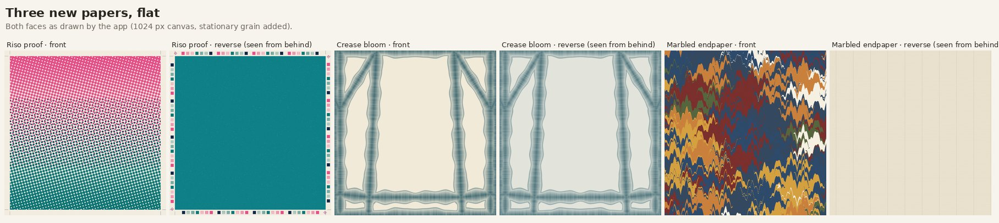
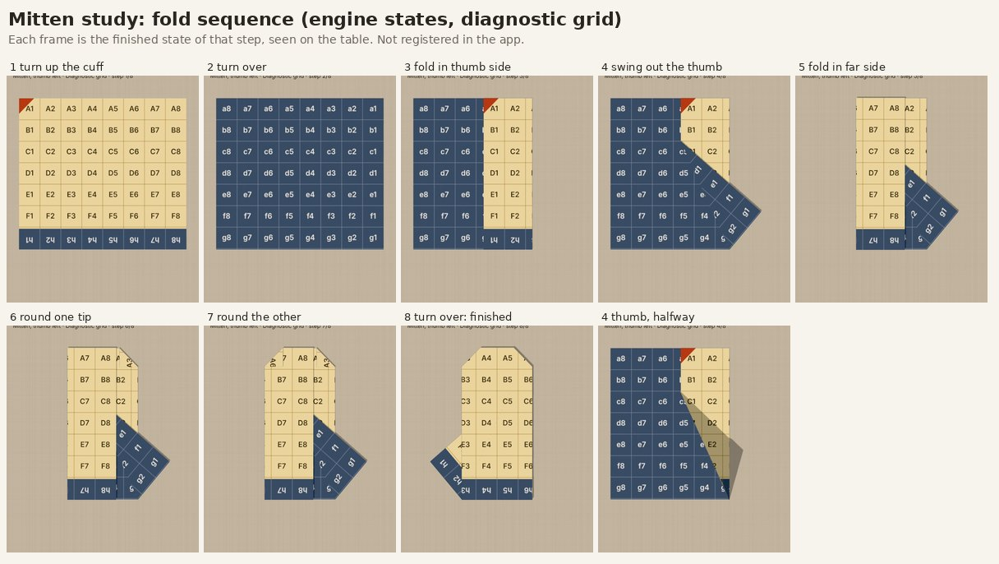
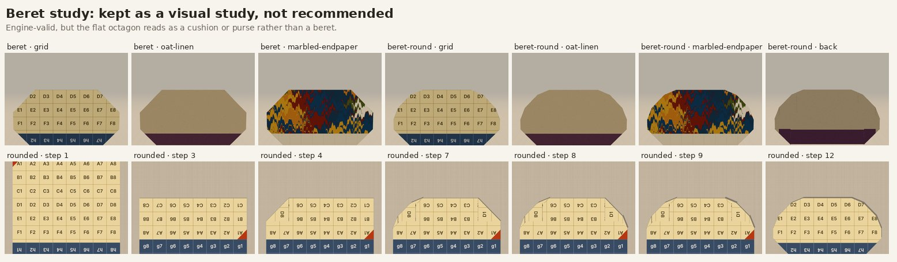

# Design pass 2026-10: three papers, two origami studies

Draft on `claude/stoic-fermi-oopgag`, built on source main `cedf65c` (merged PR31,
Swing coat and Reed suite). Nothing is merged or published, and no live site is
touched. Existing garments, papers, IDs, defaults, captures and geometry are
unchanged. The [commission brief](../outfit-papers/COMMISSION-BRIEF.md) inventory
was refreshed against `cedf65c` first.

What this draft adds:

- **Three experimental papers** in `src/papers`, listed after Compass lining and
  before the hidden grid. All three use fixed placement.
- **Two origami studies** under `origami/`: a mitten pair and a beret. They are
  not registered in Design. `origami/study.html` renders them with the app's own
  Stage, SheetView and textures.
- **`scripts/check-design-pass.ts`**, now part of `npm test`.
- One line in `scripts/check-companion-papers.cjs`, which lists every paper
  added since PR24; the three new IDs join that list. Every old raster and
  ordering assertion is unchanged.

## Papers

### Riso proof: artwork that targets the edge turns

The face is a two-drum stencil print: a pink halftone falls from the top and a
teal halftone rises from the bottom. The screens sit at 15° and 75°, and the teal
drum is slightly out of register. They overprint to dark violet in the middle.
The reverse is a teal flood inside an unprinted **proof margin** that carries the
printer's colour patches and registration targets.

**How it uses the folds.** The margin is 0.068 of the half-width (0.68 cm on a
20 cm square), just inside the edge turns that several garments already make.
On the Swing coat (0.07) and the Camp-collar shirt (0.08), the turned facings and
cuffs show the whole patch strip, with a hairline of teal at the fold. Other
edges that fold onto the front show the strip at their raw edge: the dress and
jacket collars, the pleated skirt waistband, the capelet and vest edges, and the
inner edge of the Framed brooch's frame, where it reads like a print mat. The
margin runs round all four sides, so this holds at every quarter-turn. Turning
the paper changes only the direction of the pink-to-teal fade.
[Ten garments, front/back, 0° and 90°](evidence/riso-proof-garments.jpg).

**Limits.**
- The face has a matching plain margin. Where a front raw edge stays visible,
  it becomes pale piping: good on the capelet and vest, slightly gap-like on the
  pleated skirt's sides.
- At a small scale, the overprinted screens produce a regular rosette moiré.
  That is honest to halftone, but it is busy beside a fine print.
- Large reverse areas, such as the coat's lining and yoke, are flat teal.

### Crease bloom: artwork engineered to one garment's folds

This is fold-and-dye (itajime). Petrol dye wicks in from every crease of the
**Swing coat** and from the raw edges of the square, then stops in a feathered
tide line. The dye at a point depends only on two things: its distance from the
nearest crease, and its position along that crease. A fold over that crease
preserves both, so every fold edge of the finished coat carries **one halo that
wraps round it**, and the 0.07 facings dye solid. Both faces carry the same dye in
the same material places (dyed-through); the reverse ground is a shade cooler.

The crease list is kept outside the fold code, in `src/papers/coatMarks.ts`, as
Sunray pleats does with `dressMarks.ts`. `check-design-pass.ts` fails if it ever
differs from the crease pattern of `buildSwingCoat()`.

Why it is engineered to one garment: I first considered a generic mirror-grid
fold-dye. Measured against the collection, a grid of mirror lines every 0.25
(including 45° diagonals) coincides with only **9%** of all crease length.
Spacings of 1/3 and 1/2 do worse (5% and 4%). A "registers on any garment" claim
would therefore be false, so this paper is specific to the coat.

What the renders show
([Swing coat at all four turns, plus six other garments](evidence/crease-bloom.jpg)):

- **0° is exact.**
- **180° is close but not exact.** The facings and sheet-edge halos are
  symmetric under a half-turn; the gate and yoke halos drift by up to about 0.1
  of the half-width.
- **90° and 270° do not register.** The halos cross the panels as an abstract
  lattice.
- **Capelet and Cross-wrap top at 0° look well matched**, because their sloping
  panels resemble the coat's gates, but they are not registered.
- **On the dress, jacket and shirt** the halos read as a dyed frame or lattice.

**Limits.** The dye is computed per pixel at 512 px and scaled, which takes
about 0.2–0.25 s for each face when the paper changes. It is drawn for the coat
at the suggested proportions and is not a physical dyeing simulation.

### Marbled endpaper: a craft paper, quiet on the reverse

This is a bookbinder's combed (gel-git, then nonpareil) marbling in oxblood,
ochre, slate, olive and amber, with a few pale "stone" drops, on a slate-flooded
size. The reverse is plain laid paper with chain lines, like the inside of an
old cover.

The pattern is simulated the way the craft works. Ink drops spread and push
earlier ink outward (an area-preserving map), then rakes drag everything along
their strokes. Every step has a closed-form inverse, so each pixel is coloured
exactly by running the steps backwards from a fixed seed.
[Eight garments, front/back, 0° and 90°](evidence/marbled-garments.jpg): the
combing runs vertically at 0° and across at 90°.

**Limits.**
- It is bold. On the board it wants quiet companions (Oat linen, Slate grain,
  Copper fleck).
- It takes about 0.6 s to draw because it is rendered per pixel at 512 px with
  one sample per pixel, so the finest veins step slightly at full zoom. The
  swatch (≤256 px) uses 2×2 samples.
- It has no fold interaction. It is here because it is beautiful and native to
  paper.

### Print positions

None of the three offers sliding, deliberately:

- **Riso proof:** sliding would detach the proof margin from the paper's edges,
  which is what places it on the facings.
- **Crease bloom:** sliding would move the halos off the coat's creases.
- **Marbled endpaper:** sliding would expose bare ground at the edges.

So "position" for these papers means the quarter-turn, compared above, and
`check-design-pass.ts` asserts that they keep fixed placement.

### Outfits

[Two mixed boards](evidence/outfit-boards.jpg) use the real pin controls at each
design's suggested square size:

- **Petrol:** Crease bloom coat, Copper fleck shirt, Marbled wrap skirt and a
  Crease bloom hat.
- **Proof:** Riso proof shirt, Slate grain pleats, Riso brooch, Marbled tie and
  a Riso clutch.

Two things show only at board scale. The Crease bloom coat reads as a finished,
edge-dyed garment. The Marbled wrap skirt is about half plain laid paper,
because that skirt exposes a lot of its reverse; the Pleated skirt or the Dress
show more of the marbling. [Phone-width views (390 px)](evidence/phone-390.jpg)
cover the coat in each new paper and the second board.

## Origami studies (not in Design)

Both studies are built from simple valley folds and turn-overs on one intact
square. They pass the same discrete checks the Swing coat uses: retained area 4,
valid resting states, rigid edges, sampled hinge gaps within the existing
tolerance, table clearance, and no strict triangle piercing over 81 samples per
operation. Every interior vertex of each finished crease pattern also satisfies
Maekawa and Kawasaki
([metrics](evidence/geometry.json)). None of this is a physical-paper trial.

### Mitten pair: recommended for a full implementation pass

Eight steps:

1. Turn up a 0.24 cuff strip onto the print.
2. Turn over.
3. Fold in the thumb side at x = 0.42.
4. Swing the thumb out. This flap fold moves only the thumb-side flap, pivoting
   where its crease meets the cuff, about a hinge to (−0.16, 0.5).
5. Fold in the far side, which closes over the thumb flap's inner end.
6. Fold the first fingertip corner.
7. Fold the other fingertip corner.
8. Turn over.

The second hand mirrors the crease coordinates; it is not a negative-scale
display trick. This is the same approach the ankle boots use.
[Finished pair on five papers, back, angle and the first attempt](evidence/mitten-finished.jpg).

**Feasibility reasoning and what changed.** The thumb has to be a free flap
whose hinge starts at the end of its crease on the paper boundary, or the fold
tears its attachment. With simple folds, that boundary end is the cuff.

- **v1 (shown last in the sheet).** The thumb barely cleared the cuff and read
  as a heel.
- **Narrower, steeper versions.** The engine first rejected these: the far flap
  trapped the thumb. Folding the thumb before the far side fixed that.
- **Side 0.40.** This looked best, but its final turn-over has a corner
  nine layer-gaps deep and exceeds the existing 8-layer hinge tolerance.
- **Side 0.42 (chosen).** This is the narrowest variant that passes. It sits
  exactly at that limit.

The finished thumb shows the reverse, like the cuff, so the mitten reads as two-tone: printed hand, contrasting cuff and thumb. With the Riso proof, the patch strip edges both.

**Honest limits.**
- The thumb starts at the wrist and its tip reaches only about a quarter
  of the mitten's height. A real thumb sits higher.
- A mid-hand thumb needs a swivel or squash (a four-crease vertex), which only
  the rigid `collapse` step can model. That is a bigger piece of work, along the
  lines of the fit-and-flare waist, and I have not attempted it.
- There is no hand opening.

**Size.** The finished outline is 0.61 × 0.88 of the square. A 6 cm square
gives about 3.7 × 5.3 cm, roughly 0.3 of the 20 cm coat's height.

### Beret: kept as a visual study, not recommended

The steps are:

1. Turn up a headband strip onto the print.
2. Turn over.
3. Fold the top down behind.
4. Chamfer the two upper corners.
5. Taper the band corners.
6. Turn over.

The "rounded" variant adds four small corner folds. Both versions are valid in
the engine and pass all the checks above. But judged as a design, the flat
octagon reads as a cushion or purse, not a beret: a beret's character comes from
its soft tilted dome and stalk. A stalk would need material at the top centre,
which these folds cannot supply without a collapse. I am retaining it only as a
study.

## Recommendations

1. **Crease bloom is the strongest idea.** It is the one paper that is clearly
   *about* folding, and on the coat it gives every edge a dyed finish that no
   flat print can. Keep it experimental and coat-specific, and say so in the
   picker (its placement note does). If it is liked, a companion drawn for the
   capelet would be cheap, since the same function would take a different crease
   list.
2. **Riso proof is the most useful across the wardrobe.** It works on almost
   every garment with an edge turn, at every turn. I would consider curating it
   after Charlie has seen the pleated-skirt piping and the moiré in person.
3. **Marbled endpaper is beautiful but not fold-aware.** It is a candidate for
   the experimental list only, unless the owner wants a bold statement paper.
4. **Mitten: take it forward.** The next step is a full implementation (registry
   entry, 6 cm suggested size, browser checks), optionally followed by a
   collapse-based thumb.
5. **Beret: park it.** Do not implement it with simple folds.

## What was tested, and where

- Node **22.22.0**. Node 24 is not installed in this cloud container, so the
  repo's Node 24 requirement was not met here.
- `npm ci`, `npm run typecheck` and `npm test` (all existing checks plus
  `check:design-pass`), and `npm run build`.
- Browser (headless Chromium, software WebGL, isolated contexts):
  - Display Front/Angle/Back renders through URL state at 1180×900, and flat
    paper faces drawn through `paperCanvas`.
  - `scripts/check-design-pass-browser.cjs` draws every face twice at all four
    turns: all three papers are deterministic, with distinct faces
    ([result](evidence/papers-browser.json)).
  - The recorded times there include PNG encoding while another capture was
    running. Canvas-only draws measured about 3 ms (Riso), 0.2–0.25 s (Crease
    bloom) and 0.55–0.8 s (Marbled).
- The pinboard captures are made with the real pin controls, and the PNGs come
  from Save PNG. There are 390 px phone-size screenshots of each new paper on
  the coat, and of the boards, with no document overflow and no page errors
  ([log](evidence/outfit-results.json)). This is browser emulation, not a real
  phone.
- **Not done:**
  - no physical-paper folding of either study, and no real-phone use;
  - `check-companion-papers.cjs`, which needs a separately built PR24 baseline
    server, was not run;
  - the existing per-design browser suites were not rerun;
  - no continuous-collision proof (sampled checks only).

Reproduce: start Vite (`npm run dev -- --host 127.0.0.1 --port 5627`) and open
`/docs/design-pass-2026-10/origami/study.html?design=mitten-left&paper=oat-linen`.
The other options are `design=mitten-right|mitten-v1|beret|beret-round`,
`view=front|angle|back|table`, and `step=`/`progress=`. The app accepts
`?design=swing-coat&paper=crease-bloom&step=99&view=display`.
