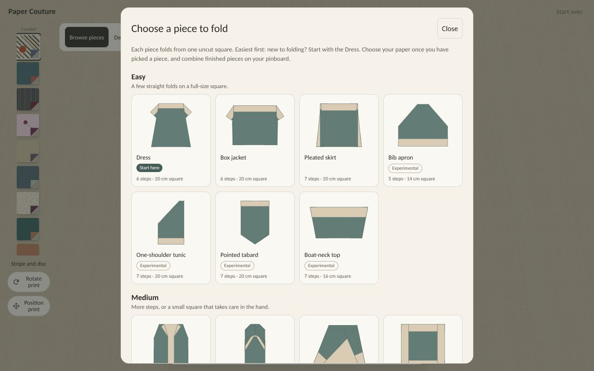
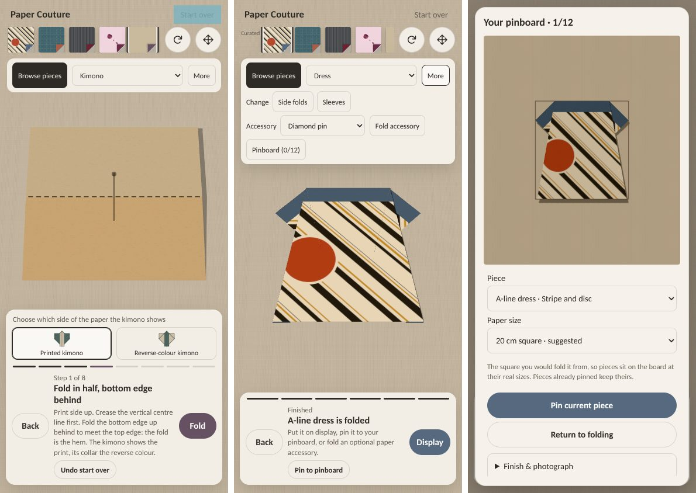

# The first five minutes

Charlie asked for the review's "basics" points (29 October 2026), except telling a
newcomer what to do on arrival, which is kept for later. Branch
`claude/first-impressions`, on top of `claude/phone-layout`. Not merged.

## Choosing a piece

- **Browse pieces runs easiest first**, in three groups with a line each on what
  they mean. The Dress leads, marked **Start here**. Each card gives its steps and
  the square it is suggested for ("6 steps · 20 cm square").
  - **Easy:** a few straight folds on a full-size square.
  - **Medium:** more steps, or a small square that takes care in the hand.
  - **Advanced:** several creases folded at once (a collapse), or 12 steps or more.
- **One rule decides the group**, from each design's own construction, and
  `scripts/check-design-order.ts` (in `npm test`) holds the table to it. Within a
  group: the Dress first, the collection before experiments, fewer steps first.
  This replaces the earlier order, which led with the newest pieces (Kimono,
  Coat-dress, Gown, Fan, Zori). Those are now the Advanced group, except the zori,
  which is Medium.
- **Experimental pieces are tagged.** The list is in one place
  (`src/ui/designOrder.ts`) and follows what the collection notes call experimental:
  clutch, apron, tunic, tabard, boat-neck and cross-wrap tops, hat, capelet, ankle
  boots, framed brooch, camp-collar shirt, necktie, swing coat, fit-and-flare and
  mittens. The kimono, gown, coat-dress, zori, fan and the five original garments are
  not tagged. Edit that list to promote or demote a piece.
- **Mirror pairs share a card:** Ankle boots (Toe left, Toe right) and Mittens (Left
  hand, Right hand). The gallery has 25 cards for 27 designs; the design IDs and
  addresses are unchanged.
- **Started pieces say how far they got** ("3 of 8 steps done", "Folded", or each side of
  a pair).
- **The Design list is grouped the same way** (Easy, Medium, Advanced).

## Keeping your place

- **A visit with a bare address resumes where this device left off:** the piece, its
  paper, rotation, print position, fold choices and step, and how far each design got.
  It is saved on this device (`paper-couture.workshop.v1` in local storage, beside
  the board's own key). An address with its own state still wins, so shared links and
  reloads behave as before. An accessory being folded is not saved, as before.
- **Start over can be undone.** It offers **Undo start over** until the paper next
  moves (a fold, Back, a drag or another design). On a phone, Start over is a little
  taller to tap.

## Labels

- **Turn paper is now Rotate print**, so it no longer sounds like Turn over, which
  flips the sheet. The readout says "print rotated 90°".
- **Change buttons replace Revisit's three controls**: one button per choice already
  made ("Side folds", "Sleeves"; read out as "Change side folds"). Each goes straight
  back to that choice, as before.
- **One name for the board:** the toolbar button is **Pinboard (0/12)**, matching
  Display's Pinboard and the board's title.
- **Developer notes are gone from the toolbar:** "Fold first, then add an accessory"
  and "Accessory optional · left/right as viewed". Left and right "as you look at
  it" moved to the Place control's label. The finished toolbar now fits one row at
  1280 px.
- **The pinboard's words are plainer:** "Piece" for Capture, "Paper size" for Starting
  paper. The note now says why it matters: "The square you would fold it from, so
  pieces sit on the board at their real sizes."

## Paper sizes

- No paper size above **21.6 cm (8.5 in)** is offered: the larger choice is capped
  there and labelled in inches.
- A 20 cm design now offers 16, 20 and 21.6 cm, and every suggested size was
  already 20 cm or less.
- Saved boards keep their sizes. `check-sizing.ts` checks the cap for every design.

## Pinning a finished piece

- **A finished piece offers Pin to pinboard** as a full-size button above Display,
  so keeping the piece is as clear a choice as displaying it.
- **One press pins it and opens the board** with it selected. It uses the size
  chosen earlier for this piece, or else the suggested one, and the message names
  the size it used. Undo takes it off again.
- **Pressing again opens the board without pinning twice.** The button then reads
  "View on pinboard".
- **It goes back to Pin to pinboard** once that item is no longer on the board
  (Undo or Remove), or the paper or accessory changes. A pin made on the board
  itself counts too.
- **An empty board shows only what you can do yet.** The arranging tools (Selected,
  Tilt, the move and layer buttons) appear once something is pinned.

## Instructions for real paper

See [the writing guide](../instructions/STYLE.md). Every fold step says where its
crease goes in terms a folder can find on paper: a landmark ("in half", "to the
centre line") and, where needed, a measurement.

- **Measurements come from the geometry.** They are written with `cm(units)` from
  the same numbers that place the creases (`src/fold/measure.ts`), so they cannot
  drift from the fold. The dock shows them in cm (mm below 1 cm) for the square the
  piece is suggested for, and says which ("Step 3 of 6 · on a 20 cm square").
- **Percentages and reviewer notes are gone from the steps.** What a piece lacks
  stays in its notes.
- **Long instructions wait behind Instructions.** An instruction longer than 240
  characters (15 of 270, mostly collapses) starts with only its title showing as
  the cue, on any screen. The full sequence opens with Instructions, and See this
  fold still highlights what moves. Shorter instructions show in full where there
  is room.
- **`npm run check:instructions`** (in `npm test`) covers every design, every fold
  choice and every accessory square:
  - each fold has a real instruction;
  - none uses a percentage or reviewer wording;
  - every measurement equals a distance that step's creases (or the next step's)
    actually have on the paper as it lies.
- **`npm run fold-measurements -- <design>`** prints those distances, for writing
  more.
- The printable folding sheets (PDFs) are unchanged and keep their own wording.

### Where an instruction is weaker

All 270 fold instructions pass the check, but a few rest on a landmark that is
approximate or awkward, or on a judgement nobody has tried in paper:

- **Ankle boot toe:** the crease is aimed at the leg's top corner. This is within
  0.4 mm of it on an 8 cm square, not exact.
- **Necktie, last two steps:** the creases are placed exactly, but where the point
  ends up is described ("about the middle", "just below the top fold").
- **Cross-wrap top shoulders:** each crease is placed from the corner of the panel
  point that peeks up from behind, because it never reaches the sheet's own top edge.
- **Collapses (coat-dress, gown, fit-and-flare, kimono sleeves):** each is written as
  a short numbered sequence of 400 to 600 characters, longer than the guide's usual
  limit. Their waist creases are given as a start point and a direction, because
  the corner where they bend is not a point the check can confirm.
- **Swing coat hem:** measured down from the top edge, since the panel points stick
  out below the bottom.
- **Kimono sleeves:** the squash is worked from the back, and the order of its moves
  is inferred from the crease directions.

A folder with real paper should try these first.

## After Astra's review of `a79f1ec`

- **The pin shortcut forgot Undo.** It remembered the last pin rather than the item.
  It now tracks the item and checks it is still on the board when the board closes.
- **A release shaped later motions.** The camera remembered where a drag was let
  go until the next motion on that step. So Back after a drag pulled to the end
  jumped wider, and Fold after a fallen-back drag waited for 90% before moving.
  `workshopFrame()` now forgets the release as soon as its motion is over, before
  anything else, and Fold, Back, the arrow keys and a grip tap start afresh.
- **Back jumped when the dock changed height.** Found by the new check rather than
  by the review. Putting long instructions behind Instructions made kimono step 8's
  dock shorter than step 7's, so pressing Back reframed the paper in one frame, 17%
  of the way. The camera now eases over 0.35 s whenever the controls around the
  paper change size in the workshop, as it already did after a release. It does
  not ease at start-up.
- **Quick pinning named the wrong size.** It now names the size it used.
- **Gallery progress** says "3 of 8 steps done", not "Step 3 of 8", which read as
  the step you are on.
- **From her refinements:** long instructions sit behind Instructions with the title
  as the cue, and Pin to pinboard is now a full button beside Display. More
  measurements could also go behind Instructions on every step. That is left until
  someone has folded with the app, since it hides them from people folding real
  paper.

## Checks

- **Older checks keep testing what they were written for.** They now load
  Playwright through `scripts/lib/legacy-playwright.cjs`. It does two things:
  - Every page starts with no saved workshop, as a bare address did before.
  - `openBoard()` opens More first when the Pinboard button sits under it on a
    narrow screen.

  Hosted CI on PR #40 found both problems.

- `scripts/check-design-order.ts`, `scripts/check-instructions.ts` (both in
  `npm test`); `check-sizing.ts` extended.
- `scripts/check-first-impressions-browser.cjs` (CI:
  `.github/workflows/first-impressions.yml`), at 1280 × 800 by mouse and 390 × 844
  by touch:
  - **Gallery:** the groups, order, tags, pairs and progress; the grouped Design
    list.
  - **Your place:** resuming from a bare address and per design; Start over and its
    Undo.
  - **Labels:** Rotate print, the Change buttons, Pinboard (n/12), the toolbar
    without notes (one row at 1280).
  - **Measurements:** shown in cm, with the square named.
  - **Pinning:** Pin to pinboard once and not twice; arranging tools after the
    first pin; sizes capped at 21.6 cm.
  - **After Astra's review:** after Undo the shortcut offers to pin again; a size
    chosen earlier is used and named; Pin and Display are both full-size buttons;
    a collapse's instruction starts behind Instructions.
- `check-phone-layout-browser.cjs`, extended, by mouse and by touch, with no reloads
  between steps: Fold after a fallen-back drag moves the camera from 60% as usual;
  Back after a drag pulled to the end retraces without a jump.
- Existing checks updated for the new names:
  - Rotate print, Pinboard (n/12) and the Change buttons (`[data-revisit]`).
  - The chooser check, for 25 cards and the new order.
  - The zori and fan check, which now reads the measurements instead of percentages.

Run locally on 30 October:
- Typecheck, build and `npm test` passed.
- These browser checks passed: first impressions, design picker, phone layout,
  usability, phone journey, kimono, gown, coat-dress, and zori and fan.
- The phone-layout check now stamps the frames it records with the moment they are
  drawn. One touch run had failed on a frame stamped just before the release but
  drawn just after it.
- Other browser checks were not rerun. Their button names were updated to match.
- The October timeout, the presentation failure and the baseline-build checks are
  still outstanding, as on `claude/phone-layout`.

Browser checks only (Chromium with software WebGL, emulated touch); not tested on a
real phone. No physical folding was done for this pass. The measurements are checked
against the geometry, but not against paper in the hand.
