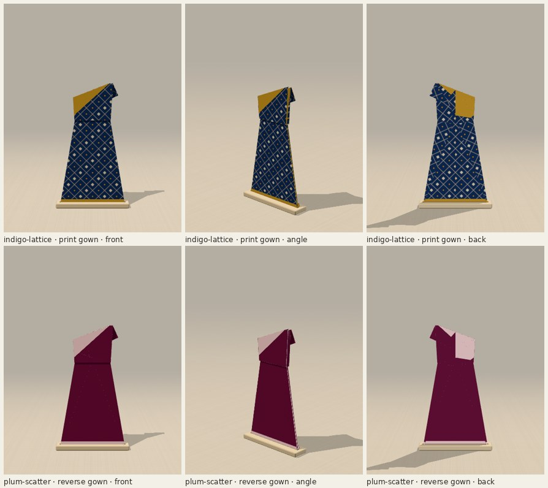
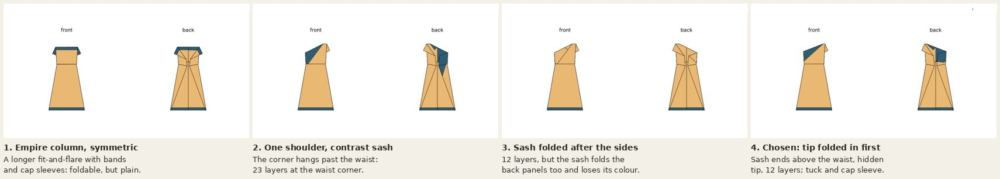
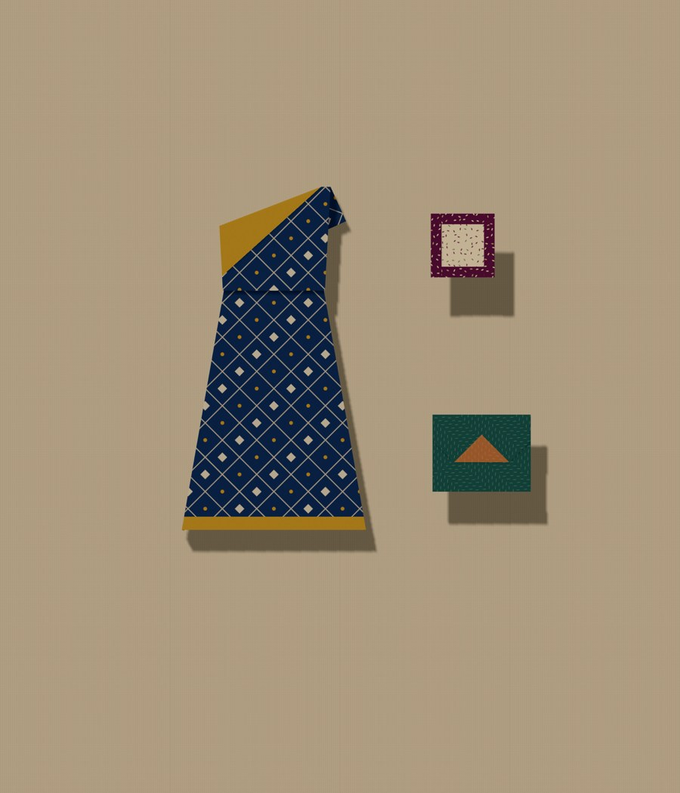

# One-shoulder gown

One uncut square becomes a floor-length gown: a narrow column with an empire
waist, one shoulder, a sash of the paper's other side running from that shoulder
across the bodice, a single cap sleeve and a contrast hem band. Choose
**One-shoulder gown** under Design, or open `?design=gown`. The one choice,
**Gown colour**, is offered at the first fold:

- **Printed gown** (default): the body shows the print; the sash and hem band
  show the reverse.
- **Reverse-colour gown** (`&gown=reverse`): the other way round.

[Every curated paper, both colourways](evidence/papers.jpg) ·
[the app: the choice, a phone, the angle view](evidence/app.jpg) ·
[every step](evidence/steps.jpg) ·
[crease pattern](../crease-patterns/gown.svg) ·
[sheet map](../paper-studies/sheet-map-gown.png) ·
[printable folding sheet (PDF)](gown-folding-sheet.pdf)

## What was asked for, and what was possible

The gown I first pitched had a full skirt from tapered pleats meeting at the
waist. In this collection's waist mechanism (the fit-and-flare's pleat across
the body plus a hidden gusset each side), the pleat has to take up the whole
difference between bodice and hem. A ball-gown flare needs a pleat about 0.6 of
the sheet deep, which leaves a gown about 0.7 sheet-widths tall; a mermaid needs
pleats of 0.45 to 0.87 across the knees; and a visible pleated sash at the waist
is not rigid (only the existing sign pattern and its mirror close). None of those
fold simply, so this gown is a column that widens gently (10° each side), and
the ambition goes into the neckline, where folding is cheap.

## Why this construction

**Length first.** Both side edges fold to the centre (a cupboard fold), so the
body is half the sheet wide and the folded panels become the back. Nothing is
spent on a top band, so the gown is 18.2 cm tall from a 20 cm square (the
fit-and-flare and coat-dress are 15.1).

**The neckline is one straight fold.** The top-left corner folds down across the
bodice along a line from the left edge (24% of the side below the corner) to
the top edge (62.5% from the left). Everything above that line becomes the sash,
in the other colour, and the crease itself is an asymmetric neckline rising 21°
from the left underarm to the right shoulder, which keeps the sheet's full
height.

**The tip is folded in first.** A corner that large hangs its tip past the waist
and into the pleat and gussets: 23 paper layers at the waist corner. Folding the
tip in at 45° first, along a line that meets the sash's fold on the left edge,
removes it: the sash then ends just above the waist on the left side seam, the
folded tip lies under the sash beyond the seam (it never shows, front or back;
the check samples every point), and the most layers anywhere is 12, the same as
the fit-and-flare and the coat-dress.

**The waist** is the fit-and-flare's collapse at an empire height (sheet y 0.45),
solved with the coat-dress's scan and bisection. Its side creases run to the top
edge, so two small flap folds tidy the top: the right-hand back panel would show
above the low side of the neckline and is tucked behind along it, and on the high
side the top of the side flap, which would peek above the shoulder, folds out
behind as the cap sleeve.

**Colour comes only from folding.** The sash and hem band are folded once and the
body not at all, so they always show opposite sides. The reverse-colour gown
folds the hem band behind and turns over; every later fold is the same, in the
same place, and the check asserts both colourways finish with the same paper in
the same place, layer for layer.

## Selection

1. Empire column, symmetric, with a band at the top, cap sleeves and a hem
   band: foldable, but a longer fit-and-flare rather than a gown.
2. One shoulder with the sash folded first: the right look, but 23 layers at
   the waist corner, and the right-hand back panel showed above the low side.
3. Sash folded after the side panels: 12 layers, but the sash then folds the
   back panels too and shows the gown's own colour.
4. Chosen: tip folded in first, sash, then the cupboard fold, the tuck, the
   waist and the sleeve. Of the neckline settings scanned (the sash meeting the
   left edge at y 0.50–0.56, the top edge at x 0.10–0.25), this one keeps 12
   layers and brings the sash closest to the waist; steeper necklines end it
   higher on the side seam.

Everything was judged in the app as well as in flat renders; the browser
captures are in `evidence/`.

## The fold

Printed gown, 9 steps: fold up the hem band; fold the corner tip in; fold the
sash down; turn over; fold both sides to the centre; turn over; tuck the back
panel behind the neckline; pleat the empire waist; fold out the cap sleeve.
The reverse-colour gown folds the hem band behind and turns over first
(10 steps). [Every step](evidence/steps.jpg).

For paper, the [folding sheet](gown-folding-sheet.pdf) has the crease pattern at
actual size on a 190 mm square (fits Letter and A4), a 50 mm scale bar,
reference points for 190 mm and 8.5 in squares, and the sequence. The first six
steps are ordinary single folds; the waist is the one collapse, precreased
through the layers first. `npm run gown-pattern && python3 scripts/gown_sheet.py`
regenerates it from the engine's own crease pattern.

## Scale

At the suggested 20 cm square the finished gown is 9.75 × 18.2 cm. An 8.5 in
square gives about 10.5 × 19.7 cm.

The [outfit](evidence/outfit.jpg) pins the gown (indigo lattice, 20 cm) with the
clutch (8 cm) and the framed brooch (4.5 cm). The [lineup](evidence/lineup.jpg)
puts both colourways beside the coat-dress, all at 20 cm. Both are real board
captures exported by the pinboard; placement only.

## What paper has to cope with

`npm run fold-metrics` measures every design the same way: paper layers stacked
at a point of the finished model, the sharpest angle between neighbouring
creases, the shortest crease and the narrowest facet, in millimetres at each
design's suggested square.

| design (square) | layers | sharpest | shortest crease | narrowest facet |
| --- | ---: | ---: | ---: | ---: |
| gown (20 cm) | 12 | 24.0° | 0.29 mm | 2.4 mm |
| coat-dress (20 cm) | 12 | 10.1° | 0.96 mm | 7.6 mm |
| fit-and-flare (20 cm) | 12 | 16.5° | 0.28 mm | 5.6 mm |

The 12 layers are at the waist corners. The 24° angle is where the tip and sash
folds meet on the left edge. The 0.29 mm crease is where the two gusset creases
nearly meet at the folded edge, as in the fit-and-flare (0.28 mm). The waist
pleat is 5.7 mm deep. Nothing locks: the waist is a one-degree-of-freedom
mechanism and can spring open a little. `check-gown.ts` bounds these by what the
collection already asks of paper, not by a proof.

## Verification

Node 22.22 locally (the repo asks for 24; the CI workflow uses 24).

- `npm run typecheck`, the full `npm test` (now including `check:gown`) and
  `npm run build` pass.
- `check.ts` (both colourways): no tears or lost area, crease loops close, the
  finished crease pattern passes Maekawa and Kawasaki at every vertex, paper
  stays above the table. Hinge gaps: worst 0.088, against a bound of 16 rendered
  levels for this design (see below).
- `check-gown.ts`, both colourways: 161 poses per step, no strict facet
  piercing, facets rigid, continuous between steps; what shows where (the body,
  the sash on top between the neckline and its edge, no paper above the low
  neckline, the full-height right shoulder, the cap sleeve beyond it, the hem
  band front and back, the back, the tip never showing); the two colourways fold
  the same paper to the same place; registration, the choice at the first fold
  and its shared prefix; forward, back, cancelled and repeated controls.
  [Metrics](evidence/geometry.json). Removing the tuck or the sleeve makes the
  neckline check fail.
- `check-collection.ts` now covers 51 constructions and 184 decision
  transitions, including switching gown colour.
- `check-gown-browser.cjs` on the production preview (Chromium, SwiftShader):
  the design list; the choice at the first fold (`aria-pressed`, URL); every
  step by the buttons, back and forward; revisiting the choice from the finished
  piece; Display front/angle/back; a board capture at 20 cm with the exact live
  geometry; 390 × 844 and 320 × 568 with emulated touch, no horizontal scroll;
  no console errors. [Results](evidence/browser/results.json).
  `.github/workflows/gown.yml` runs it on pull requests.
- The legacy design-list assertion in `check-fit-flare-browser.cjs` now lists
  22 designs including `gown`; locally it passes through the design list, the
  collapses, papers and phone widths, then stops at its old-published-source
  board step, which needs a fixture server (port 4472) not available here.

**Not tested:** a real phone or mobile Safari, and physical paper. The pattern
passes the local flat-foldability tests and rigid-motion sampling; nobody has
folded it.

## Changes outside the new design

- `garmentOptions.ts`: a `gownSide` option and decision (URL key `gown`).
- `scripts/hingeCheck.ts`: `hingeProblems` takes an optional rendered-level
  bound for constructions with a collapse (default 12, unchanged for every
  existing design). The gown passes 16: at the left side seam its sash wraps
  from the top of the front stack to the bottom of the back stack, and the
  renderer's overlap levels count 16 between the two, although no point of the
  gown has more than 12 paper layers. In the angle view the seam looks closed
  (see `evidence/views.jpg`); a reviewer may still prefer to fix level
  assignment in the renderer instead.

## For review

- The 16-level hinge bound above.
- Whether the tuck (a flap fold of one back panel along the neckline) and the
  cap sleeve (a flap fold behind the shoulder) are comfortable in real paper;
  both are single folds of one layer that sits behind others.
- The waist collapse precreased through the cupboard-folded layers.
- The 0.29 mm gusset crease, as in the fit-and-flare.

## Relation to the One-shoulder tunic

The existing One-shoulder tunic is a short six-fold study with a diagonal top
edge. The gown shares the idea of one high shoulder but not its construction:
it is floor length, has a waist, a sash in the other colour, a sleeve and a
colour choice.

## Knobs

`DEFAULT_GOWN` in `src/fold/gown.ts`: `bust`, `waist`, `waistY` (empire height),
`swivel`, `edgeFold` (0.5 is the cupboard fold; the folded sides must not cross
behind the waist), `hem`, `drapeLeft` and `drapeTop` (the sash fold; the tip
fold always meets it on the left edge), `sleeve` (degrees below horizontal; too
steep and the sleeve would pull paper still attached to the waist). Run
`npm test`, `npm run fold-metrics -- gown` and `npm run crease-pattern` after any
change.
