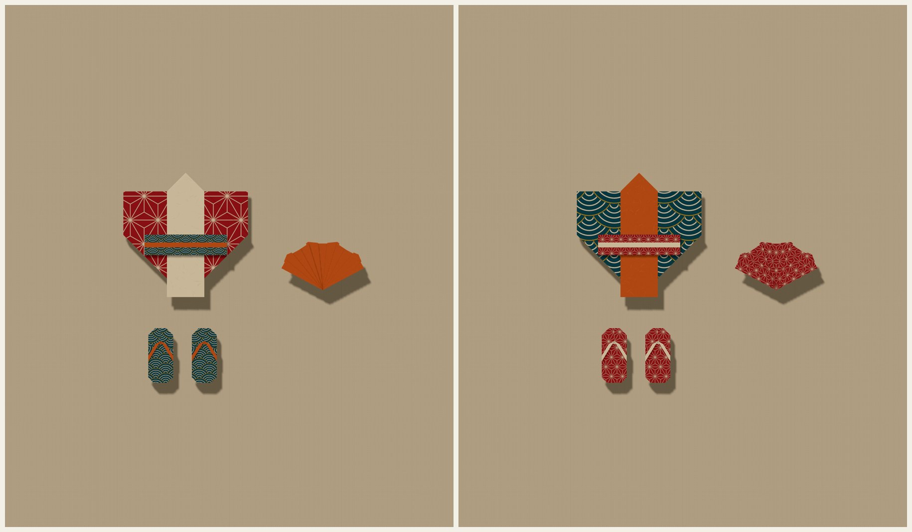
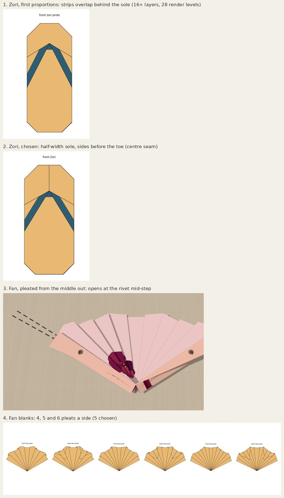

# Zori, folding fan and four classic papers

Two small board pieces to wear with the kimono, and four papers. Choose **Zori** or
**Folding fan** under Design (`?design=zori`, `?design=sensu`). Each has one choice
at the first fold, **Zori colour** (`&zori=reverse`) or **Fan colour**
(`&sensu=reverse`). The papers are **Seigaiha waves**, **Asanoha**, **Polka dot** and
**Houndstooth**, at the end of the curated row.

[Front, angle and back of both, both colourways](evidence/views.jpg) ·
[the four papers on the kimono, zori and fan](evidence/papers.jpg) ·
[every step](evidence/steps.jpg) ·
[houndstooth coat-dress and polka-dot gown](evidence/lineup.jpg) ·
crease patterns: [zori](../crease-patterns/zori.svg), [fan](../crease-patterns/sensu.svg) ·
sheet maps: [zori](../paper-studies/sheet-map-zori.png), [fan](../paper-studies/sheet-map-sensu.png) ·
[printable folding sheet, both, actual and practice size (PDF)](zori-and-fan-folding-sheet.pdf)

Both are my own constructions; I found no traditional diagram for either to follow.

## Zori

A flat sandal seen from above: a sole with a thong (hanao) of the paper's other
side, from a point a quarter of the way back from the toe out to both sides. Zori
are not made left and right, so a pair is two of the same fold: pin it twice.

**The thong is the kimono's collar fold at a shallower angle.** A narrow band is
folded along the top edge and the square folded in half, right half behind. That
half now carries its band on its outside, on the back. Folding both top corners down
from the middle of the top edge, through every layer, brings the back half to the
front with its band along the folded-over edge: two strips of the other colour
leaving the point. In the kimono these corner folds are at 45 degrees, so the edges
lie side by side down the centre (the collar). Here they slope 29 degrees, so the
strips spread 31.5 degrees either side of the centre line. The front half's own band
stays only in a small triangle just under the point, which fills the thong's front
knot.

**Why the strip must start wider than the sole.** Each strap is half the top edge
long and has to reach the sole's side. So the corners are folded while the strip is
the full half-sheet wide, and the sides come in afterwards, carrying the straps'
ends round to the back.

**The toe.** The thong's point is on the paper's edge, but a zori's thong starts in
from the toe. So, worked from the back, the lower part folds up past the point: from
the front, the paper above the point is that layer, showing the sole's colour. Then
the four corners fold in to round the sole, and the model is turned back over.

**Colour.** The sole is folded an even number of times and the thong an odd number,
so they always differ. The reverse-colour zori folds its band behind and turns over
before the half fold, which leaves the paper as if it had started the other side up.

## Folding fan

An open sensu of eleven panels spreading 124 degrees from a rivet point.

**The blank.** The square folds in half; the middle of the fold is the rivet. The
two top corners fold behind so the outline, seen from the rivet, is half an octagon:
everywhere within 8% of one radius, close to a fan's arc.

**The pleats are rigid collapses.** Each is a zig-zag through the rivet: on each
side, a narrow wedge folds over along one crease and the rest of that side folds
back along the next, so the outer paper slides in toward the middle over a tuck.
Both creases meet only at the rivet, on the folded edge, so neither constrains the
other. The wedge and the outer part turn at the same rate in opposite senses, and
the outer part comes to rest turned within the paper's plane by twice the wedge's
2.8 degrees. Each step pleats both sides at once. Done as two plain folds, the
first fold of the inner pleat would throw the whole of one side across the other.

**Outside in.** The pleats are made from the outermost in. Worked from the middle
out, each pleat's creases join paper resting on the growing pleated stack, and the
renderer, which turns bodies about creases at table height, opened a slit at the
rivet during the step (exploration, 3). Outside in, each step's creases lie in paper
that is still flat, and the pleats already made ride along rigidly with the outer
part. The finished fan is the same crease pattern and the same flat state.

**Colour.** The leaf shows one side of the paper. The tucks show the other side only
from behind. The reverse-colour fan folds its half fold up in front instead of
behind.

## Selection

1. Zori, first proportions: a narrower sole made the two side strips overlap behind
   it, 16 or more layers in a strip down the middle, and the renderer stacked them
   28 levels apart.
2. Zori as chosen: the sole is half the folded strip's width, so the side strips
   meet exactly behind it. The sides fold before the toe, so the toe shows one centre
   seam, not an off-centre edge.
3. Fan pleated from the middle out: the slit at the rivet described above.
4. Fan blanks of 4, 5 and 6 pleats a side (9, 11 and 13 panels). Five was chosen.
   Four leaves wide outer panels; six makes 2.3 degree tucks.

Rejected on paper before any code: a thong from a single-layer corner fold. A flap
folded from one layer always shows the other side from the body it lies on, so the
band between them can't contrast with both. The flap has to be two layers of a fold
in half, as in the kimono.

## The folds

- **Zori**, 8 steps: band; fold in half, right half behind; both top corners down
  (the thong); turn over; sides in; bottom up past the top (the toe); round the four
  corners; turn over. The reverse-colour zori folds the band behind and adds one turn
  (9 steps).
- **Fan**, 7 steps: fold in half, bottom behind (up in front for the reverse colour);
  top corners behind; five pleat steps, outermost first.

## Scale

At the suggested 8 cm square the zori is 44 × 20 mm, with a 2.4 mm thong. At
7.5 cm the fan is 66 × 39 mm. Beside the kimono at 20 cm (10 cm tall) both are
larger than true scale. That is a choice for the board, where they have to read, and
a size that can still be folded. The board pins anything at another size.

## What paper has to cope with

| piece (square) | layers | sharpest | shortest crease | narrowest facet |
| --- | ---: | ---: | ---: | ---: |
| zori (8 cm) | 16 | 29.3° | 0.86 mm | 2.4 mm |
| fan (7.5 cm) | 12 | 2.8° | 1.83 mm | 1.49 mm |
| kimono (20 cm) | 12 | 45° | 15 mm | 15 mm |

- **Zori.** The 16 layers are at the heel corners (3% of the sole), where the
  rounding folds go through 8. Half the sole has 8 layers. No crease folds through
  more than 8 paper layers (asserted). Thin paper helps at the heel.
- **Fan.** The 2.8 degree angle is the tucks themselves, wedges that meet at the
  rivet: that is what a pleated fan is, and it is why the folding sheet says to
  pre-crease. Each tuck is 3.7 mm wide at the edge and each panel 7.4 mm.

Nothing locks in either. `check-zori-sensu.ts` bounds these by what the collection
already asks of paper (or states why not), not by a proof.

## The papers

Four regular repeats, each with a reverse chosen for what the folds show of it: the
kimono's collar, the zori's thong, the obi's cord and every lining are the reverse.
Each back is its colour with faint washi fibres (printed texture only).

| paper | front | reverse | the reverse shows as |
| --- | --- | --- | --- |
| Seigaiha waves | wave scales, cream and gilt on deep teal | persimmon | a persimmon collar, thong or fan |
| Asanoha | the hemp-leaf star in ivory on madder red | ivory | the classic red kimono with an ivory collar |
| Polka dot | cherry dots on cream, half-drop | navy | navy collar, sash and thong |
| Houndstooth | charcoal and chalk, woven as a 2/2 twill | camel | a camel collar and lining |

The houndstooth isn't drawn as shapes. It is computed as the cloth is woven: four
dark and four light threads each way in a 2/2 twill, each cell taking the warp's
colour where the warp is on top. That is where the teeth come from. All four are
placement-independent, so I added them to the curated set; that is editorial
guidance only, and easy to move back to Experiments.

## The board

Until now each pinned piece sat above every piece pinned before it, overlapping or
not. The fourth piece of an outfit floated several thicknesses up and cast a shadow
well away from itself (the zori and fan made it obvious). Now a piece stacks only
above earlier pieces it overlaps. Pieces that overlap still occupy disjoint depths,
as before (the board check and the new browser check assert both).

## Verification

Node 22.22 locally (the repo asks for 24; CI uses 24).

- `npm run typecheck`, the full `npm test` (now including `check:zori-sensu`) and
  `npm run build` pass.
- `check.ts` (both colourways of each): no tears or lost area, crease loops close,
  Maekawa and Kawasaki at every vertex, paper above the table, hinge gaps within the
  guards (see below).
- `check-zori-sensu.ts`:
  - registration, both colour choices at the first fold, URL round trip;
  - the fan's pleats: creases through the rivet, rates, the tucks and panels adding up;
  - both pieces, both colourways: 161 poses per step, no strict facet piercing, rigid
    facets, continuous between steps and into both resting poses, controller
    forward, back, scrub and reset;
  - the zori: outline, rounded corners, the thong from the point past both sides
    with the sole either side of each strip, the knot, the toe, the underside, and
    paper layers per crease;
  - the fan: the spread to within a degree, the leaf within 0.92 to 1.09 radii,
    eleven panels of one colour;
  - both colourways fold the paper to the same place.

  [Metrics](evidence/geometry.json).
- `check-zori-sensu-browser.cjs` on the production preview (Chromium, SwiftShader):
  - the design list;
  - each colour choice (`aria-pressed`, URL);
  - every step by the buttons, back and forward, and revisiting the choice;
  - Display front, angle and back;
  - the four papers in the curated group;
  - board pins at 8 and 7.5 cm, resting and overlapping depths;
  - 390 × 844 and 320 × 568 with emulated touch;
  - no console errors.

  [Results](evidence/browser/results.json). `.github/workflows/kimono-companions.yml`
  runs it on pull requests.
- Existing browser checks:
  - `check-board-browser`, `check-kimono-browser` and `check-gown-browser` pass.
  - `check-fit-flare-browser` passes up to its fixture-server step (port 4472, not
    available here, as before). Its design list now has 25 ids, and its accessory
    list gains the obi, which it had missed since the kimono branch.
  - `check-curation-browser` needs a baseline server on port 5184 that isn't
    available here, so it was not run.

**Not tested:** a real phone or mobile Safari, and physical paper. Both patterns pass
the local flat-foldability tests and rigid-motion sampling; nobody has folded them
from the sheet.

## Changes outside the new pieces

- `src/ui/pinboard.ts`: board stacking, as above.
- `garmentOptions.ts`: `zoriSide` and `sensuSide` decisions (URL keys `zori`, `sensu`).
- `garments.ts`, `paperSize.ts`: the two designs (8 cm and 7.5 cm), listed after
  the ankle boots.
- `papers/index.ts`: the four papers, curated.
- `scripts/check.ts`: both pieces in both colourways; the zori's fold allowance.
- `scripts/check-collection.ts`, `scripts/check-fit-flare-browser.cjs`: the new
  options and ids.

## For review

- **The zori's 19-level fold allowance** (`ZORI_FOLD_LEVELS`). Its last folds
  turn whole stacks, and the renderer's overlap levels count chains of facets, not
  layers at a point. The paper there is at most 8 layers. The gown has 16 and the
  kimono 10 for the same reason.
- **The renderer's thickness on pleated pieces.** In the angle view the fan steps up
  panel by panel, and the reverse-colour fan shows thin lines of the print where the
  tucks' edges peek between panels. Both come from exaggerated layer offsets, not
  from the paper.
- **The board stacking change.**
- **Curating all four papers.**
- **A fan tucked into the obi.** The app attaches one accessory at a time and the
  obi takes the waist, so the fan is a board piece you pin beside the kimono or
  over its obi.

## Knobs

`DEFAULT_ZORI` in `src/fold/zori.ts`:

- thong band, corner slope (the thong's angle), sole half-width, toe, rounding;
- the geometry function refuses values that would leave the thong short of the sides
  or cut it with the toe fold.

`DEFAULT_SENSU` in `src/fold/sensu.ts`:

- pleats a side (2 to 8);
- half the spread.

Papers: `src/papers/classicSuite.ts`. Run `npm test`, `npm run fold-metrics -- zori
sensu`, `npm run zori-sensu-pattern`, `python3 scripts/zori_sensu_sheet.py` and
`npm run crease-pattern` (then delete the stray `swing-coat.svg`) after any change.
