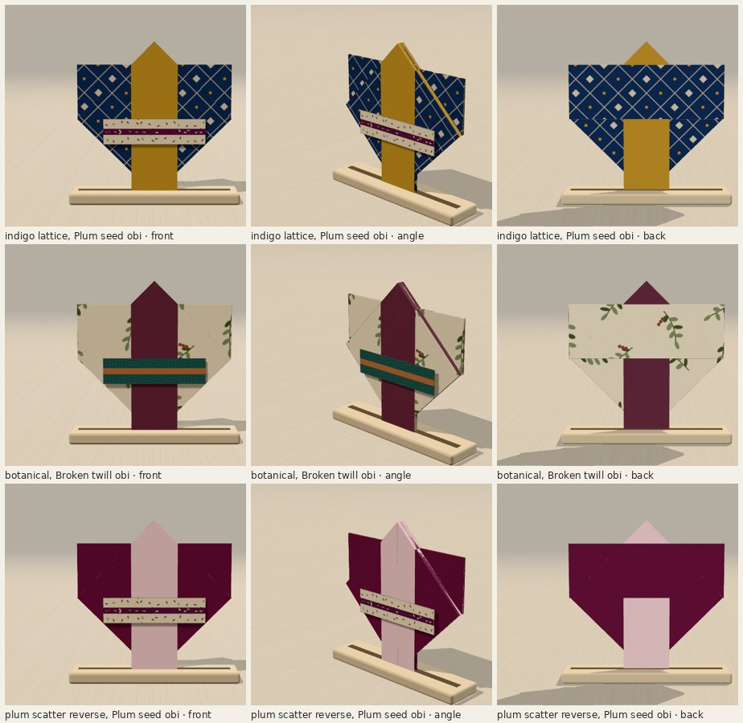
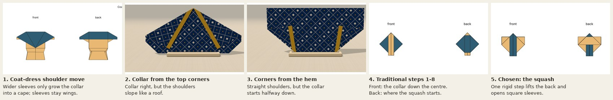
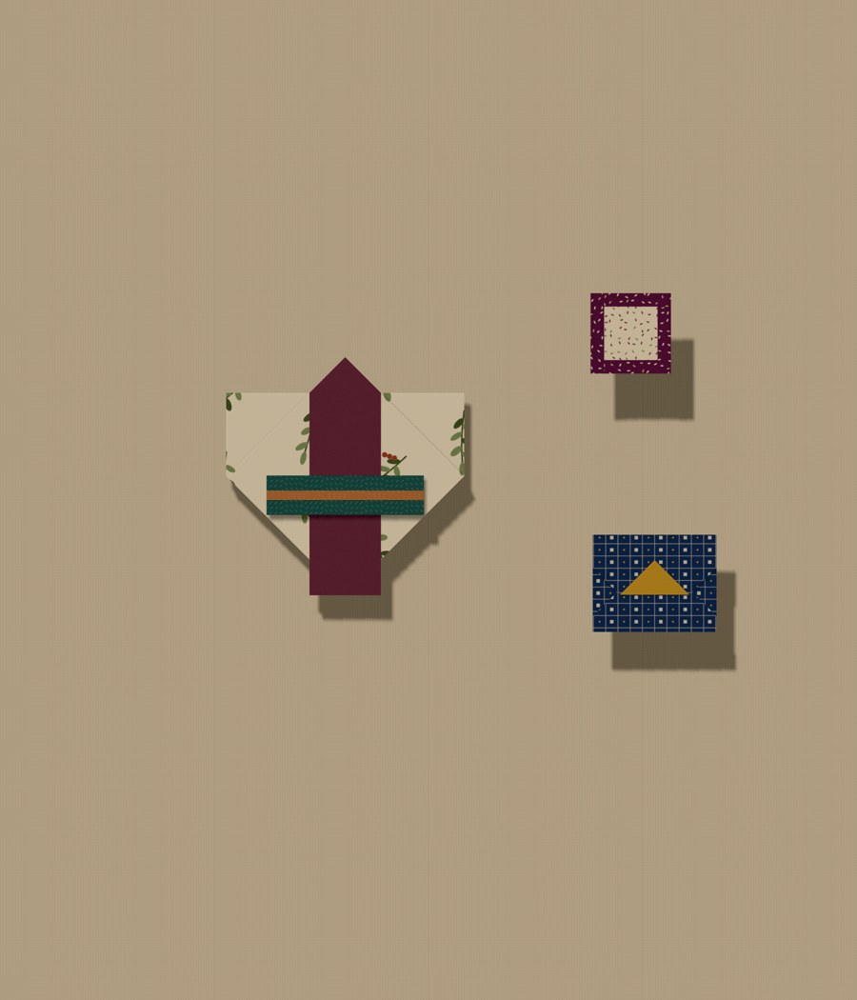

# Kimono and obi

The traditional paper kimono, from one uncut square: square sleeves, a collar of
the paper's other side running down the front from a point at the neck, and a
body that narrows to the hem. An obi folds from its own small square and sits at
the waist. Choose **Kimono** under Design, or open `?design=kimono`; when it is
finished, choose **Obi** under accessories and fold it. The one choice, **Kimono
colour**, is offered at the first fold:

- **Printed kimono** (default): the kimono shows the print, the collar the reverse.
- **Reverse-colour kimono** (`&kimono=reverse`): the other way round.

[Every curated paper, both colourways](evidence/papers.jpg) ·
[every step, kimono and obi](evidence/steps.jpg) ·
[the app: the choice, a phone, the angle view](evidence/app.jpg) ·
[crease pattern](../crease-patterns/kimono.svg) ·
[sheet map](../paper-studies/sheet-map-kimono.png) ·
[printable folding sheet with the obi (PDF)](kimono-folding-sheet.pdf)

## Where it comes from

This is the traditional origami kimono as taught at
[origami.me](https://origami.me/kimono/), which Charlie found and whose step 8 to
10 diagrams he shared. The fold sequence is that model's; nothing here claims a
new model. What is new is writing its squash as a rigid step this engine can
animate and check, and the obi.

## Why this construction

**Front and back from one fold.** The square folds in half with the fold at the
hem, so the kimono has a front and a back joined only there. Both layers get a
narrow band along their open top edge (7.5% of the side): the collar.

**The collar.** The lower corners fold up at 45 degrees until they touch the
band's line; then both top corners fold to the centre line at 45 degrees, through
every layer. That carries the front layer's corners, with their bands, round to
the other side, where the two bands lie side by side down the centre and hang
past the hem. The body is folded once and the bands twice, so the collar always
shows the other side of the paper.

**The sleeves: one squash.** From the side the lower-corner flaps are on, the
lower half of the body (front and back, joined at the hem) lifts up across the
line through the two side points, while each lower-corner flap, by then two
layers hinged on the 45 degree collar fold, opens outward into the empty shoulder
corner. Four creases meet at each side point: the lift, the flap's hinge on the
body, the flap's own fold across the line, and its hinge on the collar fold. They
form one rigid mechanism. The lift and the flap's own fold turn at the same rate,
and the two hinges at sqrt(2) times that rate (tan of half the fold angle). The
check closes every crease loop to 8e-16 over 399 samples, for any band width from
0.08 to 0.25. The sleeves are always square: both sides are half the sheet's width
less the band.

**Why the squash is shown from the collar side.** The traditional diagrams turn
the model over for this step and back afterwards. The paper does the same thing
from either side, but the renderer draws each piece at a depth set by what lies
under it at rest. Seen from the flaps' side, the sleeves arrive from above the
collar pieces but come to rest on nothing, at a lower depth; the renderer's
layer-separation planner (which keeps layers from visibly crossing during a
multi-crease step) found no continuous drawing order for that and refused. Seen
from the collar side, the sleeves stay behind the collar the whole way and rest
there, so the order is consistent. The step's hint tells paper folders to turn
the model over for it.

**The obi** is a separate small square, a third of the kimono's (about 6.6 cm for
a 20 cm kimono): two narrow bands meet across the middle as a cord (an obijime) in
the other colour, on a printed band a quarter of the square tall. It goes only at
the kimono's waist, just under the sleeves, where it spans the body without
passing its sides. It is not tied and has no bow behind.

## Selection

1. The coat-dress shoulder move with no flare: widening its sleeves only grows the
   collar into a cape; the sleeves stay small wings.
2. A T-shaped kimono with the underarm step hidden in a waist tuck: an underarm
   corner in one layer forces a crease across the body, and the tuck that hides it
   under the obi would have to be about two thirds of the sheet deep. Not shown.
3. Collar strips from the front layer's top corners, folded behind: the collar is
   right, but the shoulders slope like a roof.
4. Corners folded from the hem instead: straight shoulders, but the collar starts
   halfway down.
5. The traditional model, from Charlie's diagrams: steps 1 to 8 as simple folds,
   then the squash. Chosen.

## The fold

Printed kimono, 8 steps: fold in half (bottom edge behind); turn over; fold the
lower corners up; fold down the front band; turn over; fold down the back band;
fold the top corners to the centre; open and lift the sleeves. The reverse-colour
kimono folds step 1 up in front and has no turn (7 steps). The obi: two narrow
bands, turn over, both edges to the centre, narrow the band (4 steps).

## Scale

At the suggested 20 cm square the kimono is 10 × 10 cm, the collar bands 15 mm
wide and the sleeves 35 mm square. It is a smaller piece than the dresses because
it uses the square folded in half: beside them, a 30 cm square gives 15 cm, the
coat-dress's size. The traditional model is usually folded from 15 cm chiyogami
(7.5 cm finished).

The [outfit](evidence/outfit.jpg) pins the kimono (botanical, 20 cm) with its obi
attached (Broken twill), the clutch (8 cm) and the framed brooch (4.5 cm). The
[lineup](evidence/lineup.jpg) puts it beside the gown and the coat-dress, all at
20 cm. Both are real board captures exported by the pinboard; placement only.

## What paper has to cope with

| design (square) | layers | sharpest | shortest crease | narrowest facet |
| --- | ---: | ---: | ---: | ---: |
| kimono (20 cm) | 12 | 45° | 15 mm | 15 mm |
| obi (6.6 cm) | 5 | — | 66 mm | 2.0 mm |
| gown (20 cm) | 12 | 24.0° | 0.29 mm | 2.4 mm |
| coat-dress (20 cm) | 12 | 10.1° | 0.96 mm | 7.6 mm |

The kimono is the gentlest garment in the collection to fold: 12 layers only at
the two side points (0.5% of its area), 45 degree angles everywhere, nothing
shorter than 15 mm. The obi's 2 mm facet is its cord band. Nothing locks: the
squash can spring open a little. `check-kimono.ts` bounds these by what the
collection already asks of paper, not by a proof.

## Verification

Node 22.22 locally (the repo asks for 24; the CI workflow uses 24).

- `npm run typecheck`, the full `npm test` (now including `check:kimono`) and
  `npm run build` pass.
- `check.ts` (both colourways): no tears or lost area, crease loops close, the
  finished crease pattern passes Maekawa and Kawasaki at every vertex, paper stays
  above the table, hinge gaps within the guards (see below).
- `check-kimono.ts`:
  - the two engine filters, including that `except` cannot tear a flap off;
  - the squash rigid at every stage, its rates, every band width, square sleeves;
  - both colourways: 161 poses per step, no strict facet piercing, facets rigid,
    continuous between steps and settling continuously into both resting poses;
  - the squash leaves every collar facet exactly in place;
  - what shows where: sleeve tips, straight top, neck point, the body narrowing,
    the collar in the other colour from the neck to below the hem, nothing else
    below the hem;
  - both colourways fold the same paper to the same place;
  - the obi's band, its cord in the other colour, and its placement within the
    body under the sleeves;
  - forward, back, cancelled and repeated controls.
  [Metrics](evidence/geometry.json).
- `check-collection.ts` now covers 53 constructions and 188 decision transitions;
  `check-attachments.ts` covers the obi at the kimono's waist.
- `check-kimono-browser.cjs` on the production preview (Chromium, SwiftShader):
  - the design list;
  - the choice at the first fold (`aria-pressed`, URL);
  - every step by the buttons, back and forward, and revisiting the choice;
  - the obi folded by the buttons from its own square on its own paper and
    attached at the waist, the only position offered;
  - Display front, angle and back with the obi;
  - a board capture at 20 cm;
  - 390 × 844 and 320 × 568 with emulated touch;
  - no console errors.
  [Results](evidence/browser/results.json). `.github/workflows/kimono.yml` runs it
  on pull requests.

**Not tested:** a real phone or mobile Safari, and physical paper. The pattern
passes the local flat-foldability tests and rigid-motion sampling; nobody has
folded this version from the sheet.

## Changes outside the new design

- `engine.ts`: a flap fold may name `except` tags; facets carrying them never
  move (the rest of the stack folds). `mayMove` is the one place both filters are
  read; `timeline.ts` uses it for the crease preview.
- `collapse.ts`: a collapse region may take the same `only` and `except` filters,
  so one rigid step can move one layer and leave another lying in the same place
  (a squash). Regions without filters behave exactly as before.
- `scripts/hingeCheck.ts`: an optional bound for ordinary folds (8 by default,
  unchanged for every existing design). The kimono passes 10: its collar fold
  turns both top corners through the whole stack, and the renderer's levels put
  the two sides of that crease 10 apart, although the crease folds through at most
  4 paper layers (asserted).
- `garmentOptions.ts`: a `kimonoSide` option and decision (URL key `kimono`).
- `garments.ts`: the kimono's one attachment position, the waist, so the obi can
  be placed (other experiments still have none).
- `accessories.ts`: the obi, at the waist only.

## For review

- The two filters in the engine and collapse code.
- The squash shown from the collar side rather than the flaps' side, and whether
  the layer-separation planner should instead learn to ignore the resting order of
  pieces that only touch along an edge.
- The 10-level fold allowance.
- Whether the obi should also be offered on other garments' waists.

## Knobs

`DEFAULT_KIMONO.band` in `src/fold/kimono.ts` sets the collar width (0.02 to 0.3
of the half-sheet; everything else follows from it). The obi's cord, height and
scale are the constants in `src/fold/obi.ts`. Run `npm test`, `npm run
fold-metrics -- kimono` and `npm run crease-pattern` after any change.
