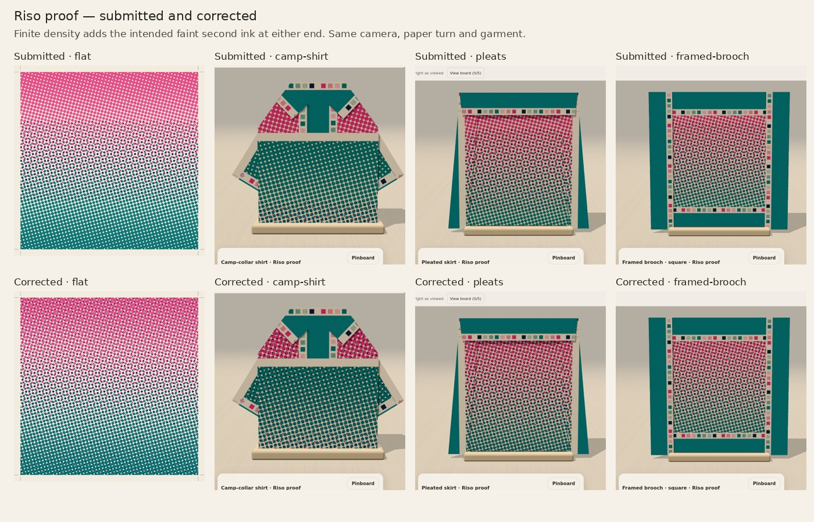
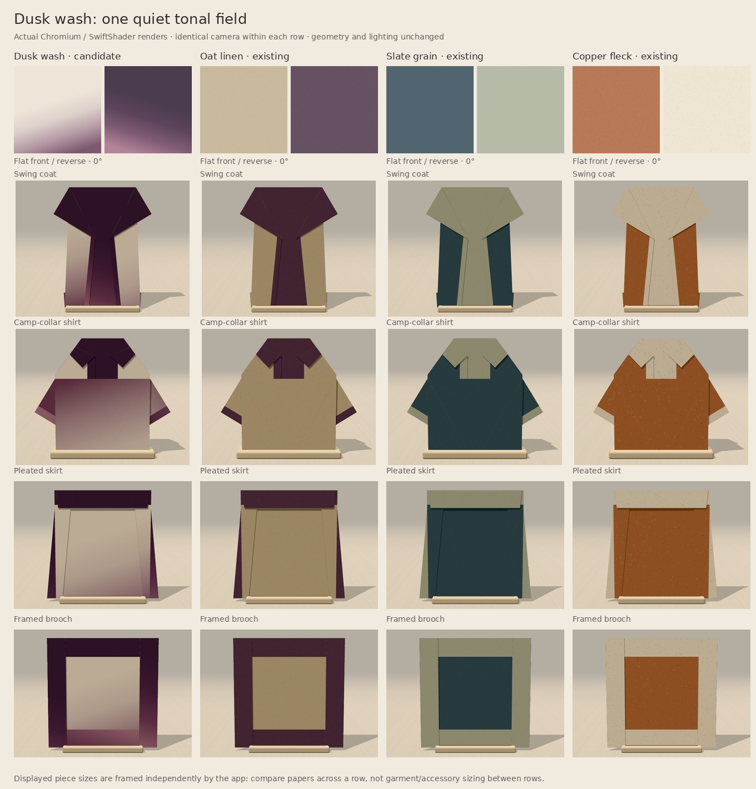
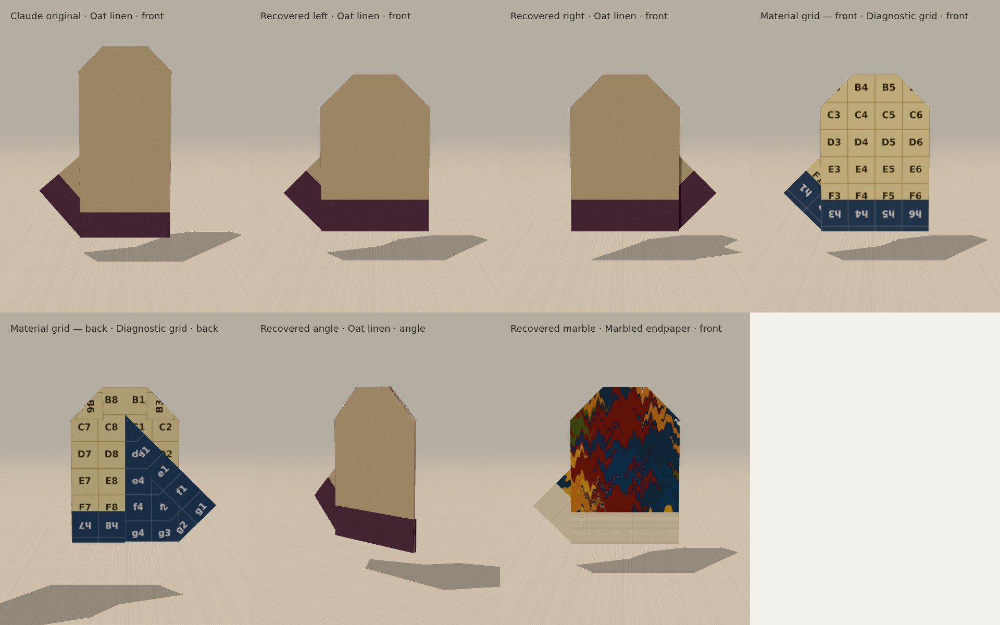

# October integration candidate

Prepared from current source main **`cedf65c8e71624b8d3cdbcd09f3422f21666dec3`**,
with Claude’s original commit **`3c448a9e9bc992e3fae91b42f83cb4e67d213787`**
retained in the history. Main was rechecked during integration. This source
candidate is for Charlie’s review; nothing here authorizes merging or publishing.
The separate `cmish.dev` website repository has not been changed.

## What deserves to go forward

| Candidate | Decision | Reason and limit |
| --- | --- | --- |
| Riso proof | Keep Experimental; strongest general-purpose addition | The proof margin uses existing edge turns well. The corrected face retains the pink/teal fade with a faint second ink at its ends. Halftone moiré and pale skirt side edges remain aesthetic tradeoffs. |
| Crease bloom | Keep Experimental; strongest coat-specific idea | The 0° print follows the coat’s material creases. It is not exactly reflection-symmetric across every seam and is not a physical dye simulation. Other rotations are abstract alternatives. |
| Marbled endpaper | Keep Experimental as a statement paper | Distinct combed artwork and a quiet reverse. Pair it with quieter pieces; it contributes surface character rather than a new fold interaction. |
| Dusk wash | Add as Experimental | A continuous chalk-to-plum field fills a gap among existing small-repeat quiet papers. Coat and skirt are strongest; the actual shirt fold moves much of the darker field toward the body’s top. |
| Recovered mitten pair | Add as Experimental flat ornaments | A retained top fold shortens the hand, and meeting back flaps avoid unnecessary overlap. One intact square per hand. Low wrist-root thumb, no hand opening, and remaining synthetic connector intersections. |
| Original tall mitten | Preserve as a study | Its long hand overwhelms the low thumb. It supplies the recovery’s basic mechanism, but does not need a separate selectable entry. |
| Beret | Park | Numerically valid flat folds still read as a cushion or purse. A convincing dome or stalk requires an unproved construction; no soft deformation has been invented to suggest one. |

No existing curated paper is demoted, and none of these new papers is promoted
without owner review. The candidate has **22 main design entries**, the existing
six optional accessories, and **35 papers: 33 visible, 13 curated and 20 visible
Experimental**. Compass lining and the diagnostic grid remain hidden. Defaults,
old IDs, attachment positions and original ordering are preserved.

## Actual rendered comparisons

These are screenshots of the application’s actual geometry and paper pipeline,
not generated concept pictures. Individually framed pieces establish appearance;
the separate pinboard captures establish relative size.

[Production front/back gallery](browser/registered-front-back.jpg) ·
[Coat at all four turns](browser/registered-coat-turns.jpg) ·
[Both registered mittens, front/back](browser/registered-mittens.jpg) ·
[Five-piece integration size board](browser/outfit-composite.png)

The integration board uses all four new papers to assess capture and sizing:
20 cm coat, 18 cm shirt, 4.5 cm brooch and two separate 6 cm mitten squares.
It is a coverage comparison, not a claim that every new paper belongs in one
recommended outfit.







The mitten [study and sequence](mitten/NOTES.md) include intermediate poses,
worst connector poses, original-versus-recovered metrics, and an actual 6 cm
pair beside a 20 cm coat. The recovered silhouette is approximately **4.06 ×
4.35 cm**, compared with the original’s **3.65 × 5.28 cm**. The pair uses two
pinboard slots. These are starting-square proportions, not wearable sizes.

Dusk wash’s [all-turn and reverse comparison](companion-paper/evidence/turns-and-reverse.jpg)
shows its intentional asymmetry. Claude’s original
[coat comparison](../design-pass-2026-10/evidence/crease-bloom.jpg) and
[marbled wardrobe](../design-pass-2026-10/evidence/marbled-garments.jpg) remain
useful because those artwork pixels are preserved. The old coat-sheet title’s
“registered” means crease-aligned here, not exact mirrored dye.

## Corrections made before integration

**Riso’s missing dots were an arithmetic defect.** Its fade raised negative
numbers to a fractional power before clamping, producing `NaN`. Chromium
silently skipped 2,138 of 7,201 circle calls per front drawing. Clamping the
input before the power preserves the authored 8% second-ink floor. This changes
the previously unpublished front artwork intentionally; the reverse is exact.
The first comparison above is the visual review of that change.

**Crease alignment and mirrored registration are different claims.** The
nearest-source dye field combines multiple creases and raw edges. Individual
sources can be symmetric without the combined field being symmetric about
every crease. The documented reflection witness differs by **0.73585** in dye
strength. Picker copy and source comments now describe the actual behavior.
The same scalar field on both material faces is verified separately through
the real front/back texture matrices.

**Cache the expensive fixed artwork.** Crease bloom and Marbled endpaper use
private caches bounded to four raster entries each. Tests force eviction and
rebuilding. Against frozen Claude, 25 raw rasters are identical across five
sizes: both Bloom faces, both Marble faces, and Riso reverse. The five Riso
fronts change as intended. No published paper renderer is edited.

One local Canvas-only run measured Bloom’s first faces at **164/156 ms** and
Marble’s first front at **430 ms**, versus **0.2–0.4 ms** for warm cached draws.
These exclude grain, texture upload and app rendering, vary by machine, and
do not remove the first-draw cost. See [drawing results](evidence/papers-browser.json)
and [independent preservation evidence](verification-review/README.md).

**Test real material transforms.** Repeating `paperCanvas` with four turn
arguments did not previously prove rotation for these fixed-placement papers;
rotation is applied later by the texture matrices. The revised browser gate
checks those matrices, mirrored backs and drawing-level material correspondence.
Dusk wash additionally samples 39,601 original-material points per turn through
the real gradient and texture path, allowing one 8-bit quantisation level.

## Fold assessment and limits

The mitten adds a simple retained top fold to Claude’s construction, widens the
side creases to meet at the back, and keeps the free thumb flap folded before
the opposite side. Its two hands mirror crease coordinates, not a negatively
scaled final mesh. There is no cut, discarded material, mesh morph or newly
invented collapse mechanism. The fold engine, layer solver, SheetView renderer,
controller and published constructions are unchanged.

Both hands retain material area **4** in **19 connected facets**. Dense checks
sample **161 poses per operation** for rigid edges, hinge continuity, endpoints,
table clearance and strict triangle piercing. Edge error is at numerical noise;
the maximum layer-separated hinge gap is **0.044**, the existing absolute limit.
The rendered-buffer audit separately samples **201 poses per operation** and
finds no strict material-facet crossings.

The synthetic connector strips **do intersect**. A deeper top fold was rejected
after a worst endpoint-to-plane metric of about 0.058. The selected construction
reduces this to about **0.0165 left / 0.022 right**, versus the original’s
0.0055 / 0.011. This metric is not intersection width or physical penetration.
The worst hits lie very close to shared boundaries and the rendered views show
thin layer seams, not a broad facet crossing the palm. They are recorded, not
hidden by deleting strips or relaxing the facet test. See
[worst-pose renders](mitten/evidence/connector-poses.jpg).

These results support an **Experimental flat ornament candidate**. Local crease
criteria, discrete collision samples and ideal rigid transforms do not establish
a collision-free continuous path or the behavior of finite-thickness physical
paper. No physical-paper trial or real-device Safari test has been performed.

## Regression and review

Local **Node 24.19.0 typecheck, full `npm test`, and production build pass**.
An independent reviewer reran the complete typecheck/test commands after final
registration and found no remaining blocker. The
[independent review](verification-review/REVIEW.md) records its judgment and
[tested file hashes](verification-review/independent-regression.json), including
the existing renderer seam limits rather than treating them as absent.

The [production browser pass](browser/README.md) also **passes** on built bundle
`index-bFd0QWb3.js`: 128 actual paper/turn/front/back views with unchanged
geometry and UVs; the coat’s ten-step and both mittens’ nine-step real UI
sequences forward/back/refold; reset during observed motion and cancelled
partial folds. Five explicitly sized captures retain their geometry, UVs and
paper recipes, and reload produces a byte-identical 1800 × 2100 PNG. Move/Undo,
remove/Undo, five-slot cap, 390/320 px emulated touch drag/cancel/Undo, swatch
selection and a published v1 saved-board fixture pass with zero page errors.
The test requests only production assets, no source modules. Full data and
capture hashes are in [browser results](browser/results.json).

The frozen-main check preserves **all 47 published garment variants** exactly:
material states plus 41 sampled poses per operation, zero pose delta.
[Full preservation output](evidence/published-geometry.json).

The integration gate uses Node 24 and the PR’s actual head commit. It runs
TypeScript checks, the full existing suite plus focused mitten checks, a
production build, frozen-main geometry comparison, frozen-Claude raster
comparison, actual paper-transform and Dusk material tests, and production
browser interactions. The browser pass covers desktop and emulated narrow
touch viewports, explicit pinboard square sizes, capture identity, persistence,
Undo, PNG export and an older saved board fixture.

Reproduce with Node 24:

```sh
npm ci
npm run typecheck
npm test
npm run build
BASELINE_DIR=/path/to/main node --import tsx scripts/check-published-geometry.ts
BASELINE_DIR=/path/to/claude node scripts/check-paper-preservation.cjs
```

Browser scripts accept `PLAYWRIGHT_MODULE` and `CHROMIUM_EXECUTABLE_PATH` for
external installations. Use `DEV_URL` for `check-design-pass-browser.cjs`,
`BASE_URL` pointing to Vite for the focused Dusk script, and `BASE_URL` pointing
to production preview for `check-october-browser.cjs`. Exact invocations and
artifact paths are in `.github/workflows/october-integration.yml`.

Owner review should decide whether the recovered mitten’s low thumb and the new
papers’ visible tradeoffs suit the collection. Source integration and any later
website import remain separate decisions; nothing has been merged or published.
