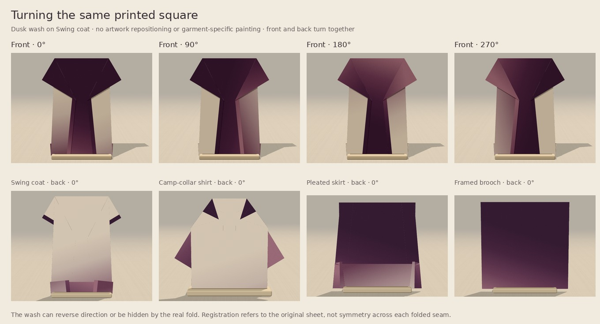

# Dusk wash — one quiet companion candidate

Prepared from Claude's draft `3c448a9`, which is based on main `cedf65c`.
This study changes no existing paper, registry, geometry, renderer, default or
website. The parent integration decides whether to register the new paper.

## Decision

**Keep for owner review.** Dusk wash adds a continuous colour field rather than
another small repeat. Oat linen, Slate grain and Copper fleck already cover the
quiet all-over texture role; adding a fourth fleck paper would contribute little.
The new paper instead leaves the upper sheet largely chalk, shading gradually
into dusty plum near one edge. A deep-plum reverse keeps exposed folded parts
legible without adding a decorative border. Its small sideways lean gives
quarter-turns a visible purpose.

The palette is closest to Oat linen. The rendered difference is the broad wash,
not merely another plum shade: on the coat it darkens the panel hems, on the
skirt it pools toward the hem, and the shirt's real folding puts the stronger
plum field at the *top* of the body. The brooch becomes a quiet tonal centre with
an uneven plum frame. These are consequences of the existing square and folds;
no finished garment is painted separately.

The coat at 0° and skirt are the strongest uses. The shirt is useful but more
contrast-heavy, and the brooch is deliberately subtle. At 90°/270° the coat is
asymmetric; at 180° more of the wash appears at the shoulders and yoke. These
options are retained rather than forcing a hem placement on every construction.

The name is **Dusk wash**, rather than “dip dye”: this is a printed gradient,
not a simulation or claim about real dye diffusion. No physical-foldability
claim is attached to the artwork. It can accompany Riso's pink/teal or marbling's
busy surface, but a particular multi-piece outfit still needs owner judgment.

## Actual browser comparison




These contain actual headless Chromium / SwiftShader renders with the unchanged
app's geometry, lights and material pipeline. Comparisons within each row use
the same camera and crop. Each garment is framed independently by the app, so
the rows **do not establish garment/accessory sizing on a pinboard**. No image
generation or colour correction is used. Source screenshot PNGs are reproducible
outputs; the two compact comparison sheets and raw test results are committed.

## Focused results

- Node **24.19.0**, main TypeScript project: `tsc --noEmit` passed.
- `check-dusk-wash.cjs`: passed, no page exceptions, 24 screenshots plus eight
  flat face captures.
- The actual front/back texture matrices were tested at all four quarter-turns.
  Each turn sampled **39,601 original-material positions**. A shared grayscale
  palette substituted into the real gradient drawing path isolated its position
  from the intentional colour difference: **zero samples differed by more than
  one 8-bit level**. The tolerance accommodates raster quantisation.
- Full grain-overlaid front and back repeat byte-for-byte, differ from each
  other, and ignore unsupported print-position offsets.
- Actual finished fronts: Swing coat, Camp-collar shirt, Pleated skirt and
  Framed brooch, against Oat linen, Slate grain and Copper fleck. The candidate's
  reverse is shown for each piece; the coat is also shown at every turn.

During the study the candidate was inserted only into the browser's in-memory
paper list before calling the existing `paperCouture.setPaper`. This exercises
the real material and rendering pipeline without changing the source registry.
It **does not** test its final picker position, saved-board compatibility or
integration CI. Those belong to the parent integration pass. Browser results
are not real-phone, mobile Safari or physical-paper tests.

Registration here means the two faces use the same original-square wash
positions. It does not mean the artwork becomes mirror-symmetric across every
folded seam. The front and reverse deliberately use different colours.

## Reproduce

Start a Vite dev server at port 5354 (or set `BASE_URL`), then run:

```sh
PLAYWRIGHT_MODULE=/path/to/playwright \
CHROMIUM_EXECUTABLE_PATH=/path/to/chromium \
node docs/october-integration/companion-paper/check-dusk-wash.cjs
python docs/october-integration/companion-paper/contact-sheet.py
```

The screenshot crops are applied equally to all papers within a row. The
brooch and skirt crop begins below their taller toolbar; neither is scaled
individually to flatter the candidate. Default artwork, existing paper rasters
and saved snapshots are untouched by this study.
