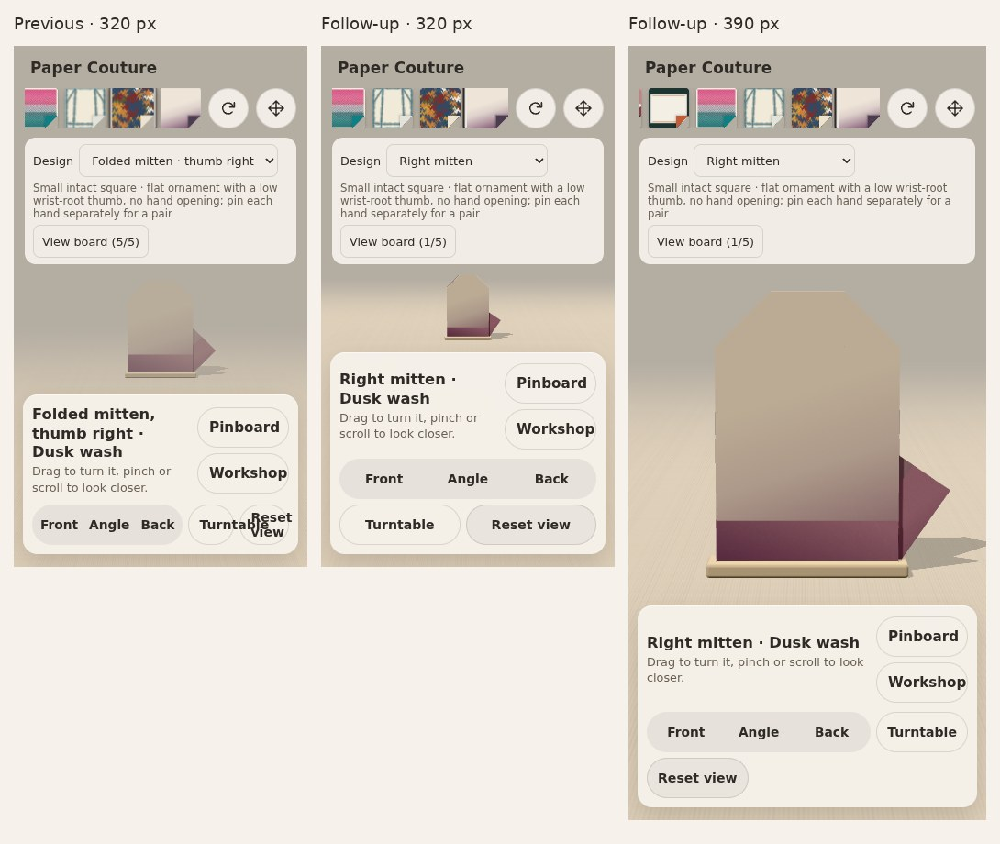
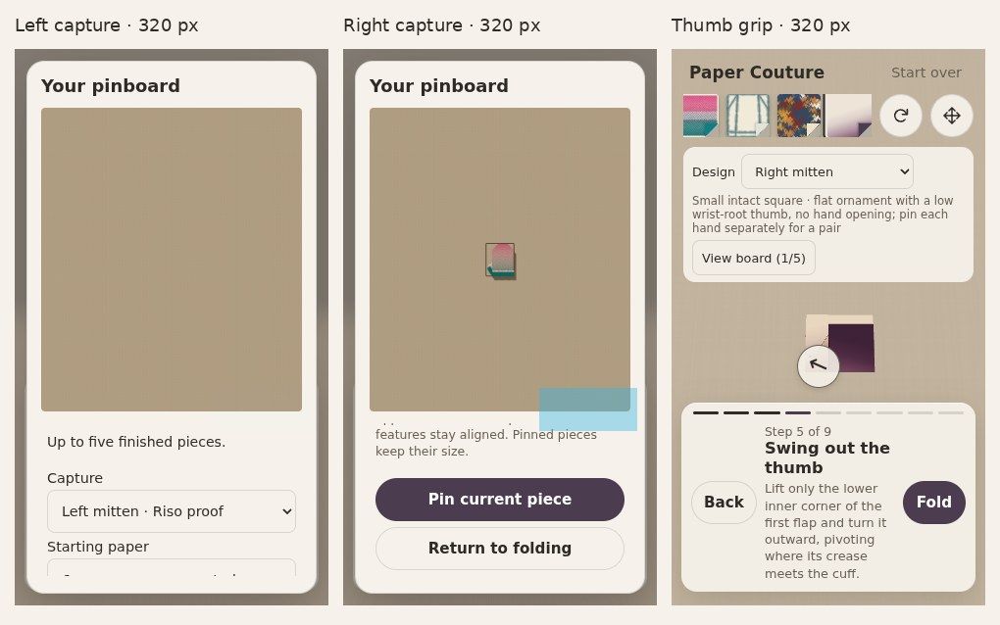

# External-review implementation follow-up

This completes the bounded follow-up to Claude and Grok's reviews of source
PR35 at `ceb324d050efb15b16cbc358be112369d17d02fe`. Current main was authenticated
as `cedf65c8e71624b8d3cdbcd09f3422f21666dec3` before work. Source and website remain
separate; no merge, website import or deployment was performed.

## Decisions and corrections

- Adopt the [independently compared narrower mitten cuff](../thumb-followup/NOTES.md):
  cuff `.25`, thumb endpoint `.20`, retained top `.75`. Both hands finish about
  **3.85 × 4.50 cm** from their own 6 cm squares. The extra 3.21 mm of thumb
  clearance mostly comes from lowering the cuff edge, not raising the thumb.
- Use **Left mitten / Right mitten** in the design registry and new capture
  titles. IDs and old saved captures remain unchanged. Board selects use the
  available mobile width, so hand identity and starting-square labels have room.
- Let display controls wrap; at 320 px the viewpoint group has its own row.
  Button text stays within its hit area instead of overflowing into its neighbour.
- Fix a visibility failure exposed by actually folding at phone width. The
  fixed fog ended at distance 22, but fitting the paper between controls on a
  short screen put the display camera about 23 units away. The entire paper
  could fade into the room colour. Fog now follows the framing distance with
  foreground clearance, retaining the old minimum 9..22 range at close range.
  This changes background haze where the camera retreats, not geometry, UVs,
  texture generation, fold timing or the saved-board renderer.
- Preserve all four paper artworks. A coloured Marble reverse is an optional
  editorial alternative, not a demonstrated correction. Keep the beret parked.

## Phone-width evidence





[Full phone results](phone-results.json): both widths pass, with zero page errors
or source-module requests. Both reloads preserve the exact 1800×2100 PNG bytes.

The new `scripts/check-phone-journey.cjs` runs against the **production build**.
Each fresh 320×568 / 390×844 context starts at an unfolded sheet with the default
paper. It selects each hand, reaches the new papers by real horizontal touch
swipes, completes all nine operations with touch input, goes Back/refolds, uses
the display controls, pins both pieces, reloads, and compares exported PNG bytes.
There are no `step=99` shortcuts or controller mutations in this journey.

On the short 320 px screen both small thumbs have 44 px grips. The test cancels
a real touch drag and then taps the grip to complete the fold. At 390 px the
larger flap can use the ordinary Fold control. Other gestures and assertions
read diagnostic state, but do not advance it directly. Capture/export buttons
use Playwright's normal locator scrolling within the board tool area; only the
paper-discovery path explicitly proves touch scrolling without auto-reveal.

The gate checks button rectangle collisions, text-range overflow, viewport
bounds and centre hit targets. It also measures actual posed vertices in camera
space to ensure the paper stays in front of the fog and far clipping plane.
This addresses failures that a document-width assertion missed.

The default-to-Riso path takes about ten swipes at 320 px. That establishes
reachability, not good discoverability. A small curated set of combinations is
still a better next product experiment than adding many more choices.

## Regression scope and remaining limits

Node **24.19.0** is used. The full numerical test suite and typecheck pass.
The [frozen-main comparison](published-geometry.json) preserves all **47**
published garment variants' exact states and 41 sampled poses per operation.
The independent thumb comparison covers both versions before the selected
parameters are installed; selected parameters pass the same existing guards.
Synthetic connector intersections remain, and zero sampled facet crossings
does not prove continuous collision freedom or finite-thickness foldability.

The new phone gate is included in the exact-PR-head October integration workflow,
alongside the existing production gallery, state/UV, pinboard persistence/Undo,
legacy-save and paper-material tests. Raw phone captures and exports go into
the CI artifact; only compact review images and result summaries belong here.

Headless Chromium touch emulation is **not** a real iPhone/Safari test. No
physical-paper trial occurred. A physical trial of layer access and fingertip
closure remains the most useful mechanism check. The five-slot board and
two-slot mitten pair are unchanged.

## Reproduce

Use Node 24 and `npm ci`, then `npm run typecheck`, `npm test`, `npm run build`.
Run a production preview on port 5365 and:

```sh
BASE_URL=http://127.0.0.1:5365 CAPTURE_DIR=.october-qa/phone \
node scripts/check-phone-journey.cjs
```

`PLAYWRIGHT_MODULE` and `CHROMIUM_EXECUTABLE_PATH` can identify external browser
installations. The check ends with a separate cold/warm paper-selection timing
probe. It measures the real selection event to two animation frames; a 4× CPU
slowdown is a desktop sensitivity test, not a named-phone performance estimate.
It includes the selection handler and intervening frame work, unlike a raw
drawing-function timer; it does not isolate GPU completion or display latency.
Timing is informational rather than a hardware-dependent CI threshold.

## First-selection timing

One local sample per condition, Chromium 153 with SwiftShader; another browser
regression was running concurrently, so these are diagnostic measurements under
load, not stable device benchmarks. Values below are selection-event to two
animation frames, rounded to milliseconds.

| Paper | CPU setting | Cold | Warm |
| --- | --- | ---: | ---: |
| Crease bloom | Normal | 587 ms | 256 ms |
| Marbled endpaper | Normal | 855 ms | 147 ms |
| Crease bloom | 4× slowdown | 1,613 ms | 157 ms |
| Marbled endpaper | 4× slowdown | 1,961 ms | 140 ms |

The existing raster caches help repeat selection; first-draw work still merits a
separate performance pass. No real-phone duration is inferred. No artwork was
baked, recoloured, resampled or moved to a worker in this bounded follow-up.
Use `LATENCY_ONLY=1` to repeat the timing probe without the full phone journey;
compare several isolated samples before choosing an implementation strategy.

An independent read-only review of the UI/fog diff and phone gate found no blocker.
It prompted a more precise timing description and a visibility assertion after
each display camera control. GitHub's exact-head run is authoritative for those
final added assertions and the complete production regression gallery.
