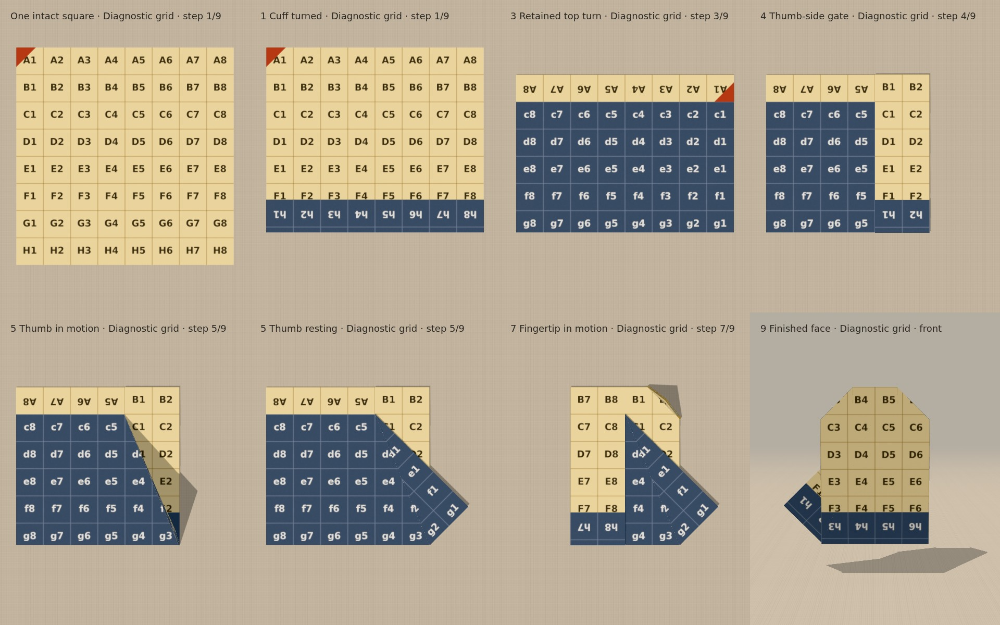
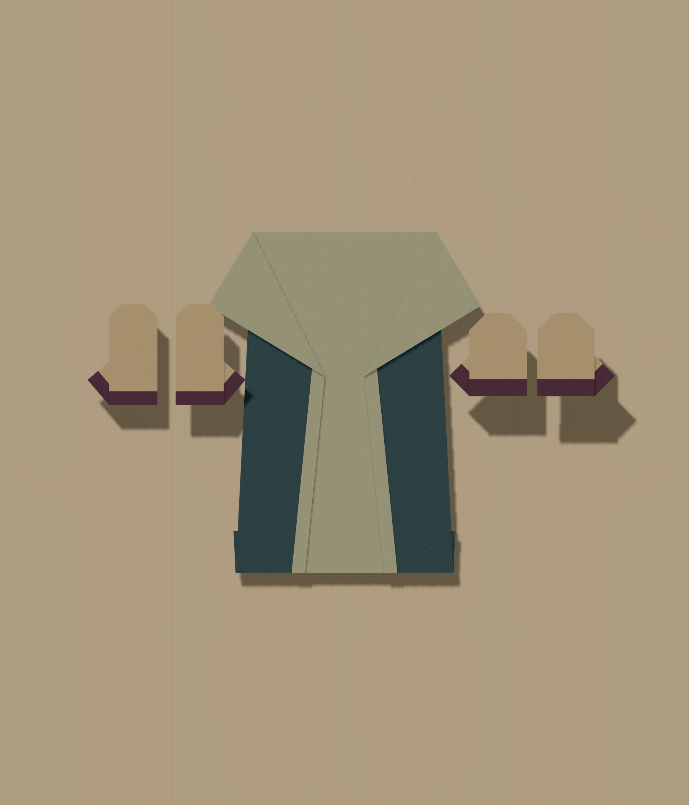
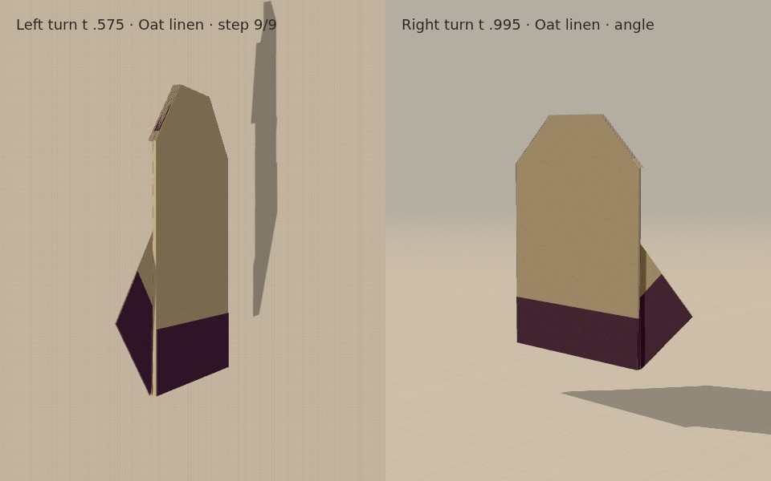

# Recovered mitten study — integration review

Adapted from Claude’s unregistered October mitten on PR34, based on current
source main `cedf65c`. Source and website repositories remain separate. No
engine, renderer, registry, paper, or saved-capture changes are included here.
The parent integration review decides whether to register the candidate.

## Selection

**Recommend the recovered construction for experimental review as a flat mitten
ornament.** The long, narrow original reads partly like a boot. A retained top
turn and a slightly wider palm make it more recognizably mitten-shaped without
inventing a mid-hand swivel, squash, cavity, or cloth behavior. The independent
visual and integration review remains responsible for accepting the residual
rendered-edge limits below.


The selected construction is `buildMitten('left' | 'right')` in
`src/fold/mitten.ts`. Each hand starts with its own intact square. Handedness
comes from mirrored crease coordinates, not negative display scaling.

1. Turn a 0.30 strip into the cuff.
2. Turn over.
3. Fold the top down at y = 0.75, retaining the whole upper strip.
4. Fold the thumb side in at x = 0.50.
5. Fold only the free lower corner of that flap outward, on the crease from
   (0.50, −0.70) to (0, 0.50). The crease meets the existing boundary at the cuff.
6. Fold the other side in at x = −0.50. The sides meet on the back rather than
   overlap centrally.
7. Fold one 0.30 fingertip corner.
8. Fold the other fingertip corner.
9. Turn over.

Every operation is a simple valley fold or whole-sheet turn. The wrist-root
thumb is deliberately retained; it has not been relabeled a mid-hand thumb.
There is no hand opening. The actual reverse paper forms the cuff and thumb;
those areas are not painted overlays.

### Why this version

- Retaining the original 0.42 side creases while adding a top turn makes an
  unnecessarily thick overlapping stack and exceeds the existing hinge guard.
  Moving the side creases to 0.50 avoids that central overlap.
- The first compact top at y = 0.65 looked promising, but the actual rendered
  connector audit found a worst endpoint-to-plane depth near 0.0577. That
  candidate was rejected before registration.
- A shallower retained turn at y = 0.75 gives a slightly taller, still improved
  palm and avoids that larger connector case. All final images and the geometry
  and rendered reports use this version. Initial comparison sheets retain the
  earlier alternatives with their parameter labels.
- No hinge tolerance, layer offset, collision threshold, geometry engine, or
  renderer was changed to make it pass.



## Starting-paper size

**6 cm per mitten** remains a reasonable suggested size for the existing board
scale. The recovered outline is 1.352071 × 1.45 model units, so a 6 cm square
makes a 4.06 × 4.35 cm silhouette. Claude’s original is approximately
3.7 × 5.3 cm from the same square. This reduces the especially tall appearance
beside a 20 cm Swing coat while keeping the cuff and thumb readable.



The board harness instantiates the real `Pinboard`, `SheetView`, procedural
textures, capture schema, size selector and PNG exporter. It provides these
unregistered constructions as test sources rather than altering app registries.
The image is the actual 1800 × 2100 Save PNG output, with a 20 cm coat between
original and recovered 6 cm pairs. Five captures survive reload. The 390 px
browser viewport has no document overflow. This does not establish real-phone
behavior. Details are in `evidence/board-results.json`; desktop and phone
screenshots are retained beside the export.

## Geometry and renderer results

Both hands pass `scripts/check-mitten.ts`:

- 9 operations, 19 final facets and 28 crease segments.
- Material area 4 at every state; all vertices stay in the original square;
  no holes or disconnected material; shared original edges coincide.
- Each resting transform remains rigid; sampled edge-length error below 7e−16.
- Every operation boundary is position-continuous to 1e−9.
- Local finished crease-pattern Maekawa/Kawasaki checks pass.
- 161 samples per operation: no strict facet triangle piercing, table minimum
  z = 0.0015, maximum rendered hinge separation 0.044 (the existing eight-layer
  limit, allowing only floating-point epsilon).
- The same authored paths with artificial layer offsets set to zero preserve
  hinge coincidence to numerical precision. This diagnostic does not change
  the actual construction or renderer.
- Material front/reverse exposure and true mirrored geometry are asserted.
- Reversal, cancelled scrubbing and repeated controller steps pass.

`check-mitten-rendered.ts` evaluates the actual Float32 `SheetView` buffers at
201 poses per operation, including their synthetic connecting strips. It runs
Claude’s original and the recovered pair with the same audit:

| Version | Hand | Facet/facet crossings | Facet/connector pair hits | Connector/connector pair hits | Worst facet/connector depth metric |
| --- | --- | ---: | ---: | ---: | ---: |
| Original | Left | 0 | 2,193 | 3,887 | 0.0055001 |
| Original | Right | 0 | 3,029 | 3,859 | 0.0109997 |
| Recovered | Left | 0 | 3,782 | 4,798 | 0.0165000 |
| Recovered | Right | 0 | 3,223 | 3,617 | 0.0219990 |

Counts are triangle-pair hits accumulated across sampled poses, not counts of
independent physical defects. The original has eight operations and the
recovered construction has nine; the totals have different sample counts.
The existing committed Swing coat report’s maximum comparable metric is about
0.011. That comparison is context, not an acceptance threshold for a new shape.

**The depth metric is the smaller absolute distance of a crossing edge’s two
endpoints to the other triangle’s normalized plane, in model units.** It is not
barycentric and does not measure the spatial width of an intersection or prove
physical penetration. At the 6 cm square scale, multiplying by 3 cm/model unit
converts this numerical distance; it does not convert the synthetic connector
into actual paper. The hinge guard is a different quantity and does not excuse
a connector crossing.

For the recovered left mitten, the worst-depth hit at final turn t = 0.575
lies only 3.26e−8 model units inside the target triangle’s edge, at the stacked
crown boundary. For the right, the worst at t = 0.995 lies 1.58e−6 inside its
edge, at the outer cuff crease. These are the worst-depth hits only; do not infer
that every reported connector contact has the same clearance. The report
records actual triangle coordinates, barycentrics and clearance for inspection.



Those renders show the stacked-edge seam, with no gross crossing of the main
paper faces. The shared-edge material model and the artificial bridges are
separate: thin material facets pass the sampled audit, while the finite strips
inserted to bridge rendering layer gaps intersect. These strips are not a
physical crease-thickness model. **Do not call the complete rendered mesh
collision-free.** No final turn has been removed or replaced by a camera trick.

## Limits and decision

This is a plausible simple-fold route for a flat ornament, with a clearer
silhouette and scale than the submitted study. The connectivity and material
arguments are stronger than a mesh morph, but numerical checks still do not
establish practical paper folding, finite-thickness clearance, continuous
collision freedom, easy layer access, or a wearable glove. A physical-paper
trial remains useful. The thumb stays a stylized wrist-root triangular flap.

The 0.65-top option is parked; the 0.75 option is the integration candidate.
Whether the remaining thin rendered-edge artifacts are acceptable is a visual
review judgment. Do not silently promote it to a proven physical construction.

## Reproduction

Use Node 24 with the project dependencies installed:

```sh
node --import tsx scripts/check-mitten.ts --dump
MITTEN_RENDER_REPORT=docs/october-integration/mitten/evidence/rendered.json node --import tsx scripts/check-mitten-rendered.ts
npm run typecheck
```

For render evidence, start Vite on 127.0.0.1:5631 and run
`node docs/october-integration/mitten/capture.cjs` and
`node docs/october-integration/mitten/capture-board.cjs` in that server’s network
namespace. The harnesses use Playwright from `CODEX_PRIMARY_RUNTIME_NODE_MODULES`
and explicit local Chromium; adjust `executablePath` when reproducing elsewhere.
The study page accepts `design=original|selected`, `hand=right`, `paper`, `view`,
`step`, and `progress`. The two connector views are step 8 at progress .575
(left, table view) and .995 (right, angle view). Broad app regressions and any
registry integration are handled by the parent integration pass.
