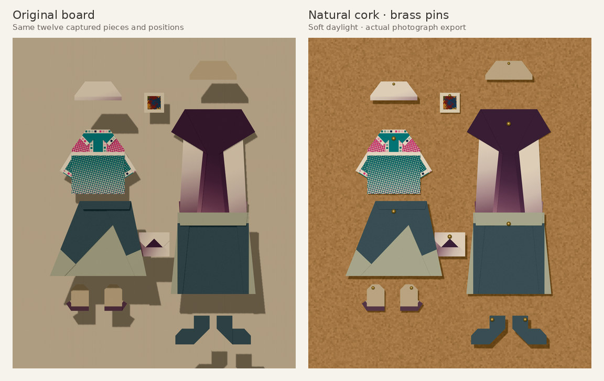
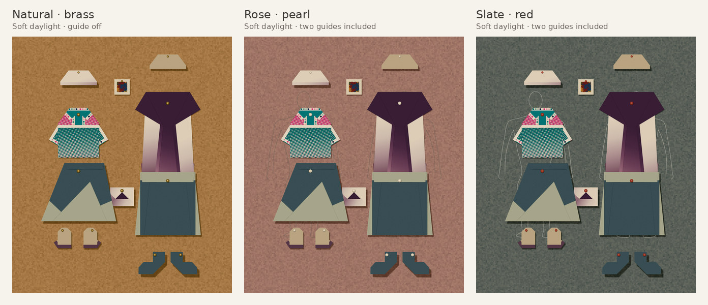
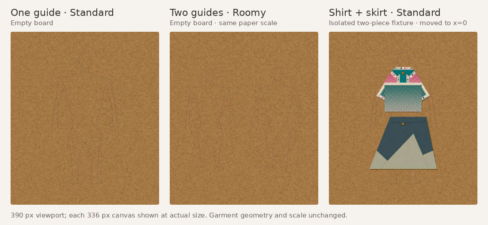

# A corkboard for the finished craft

This follow-up builds on the reviewed twelve-piece branch at `87a089d`, whose
eight GitHub workflows passed. It adds a finishing surface, not new folds.
Source PR35 remains for owner review; the separate website has not been changed.

## Using it

Open **View board**, then **Finish & photograph**. Choose Natural cork, Rose cork,
Slate cork, or Linen cloth. **Original board** restores the earlier backing and
lighting. Existing saves keep their original appearance until a surface is chosen.

Choose Brass, Pearl, Red, or No pins. **Place pin** lets you tap visible paper on
the selected piece. **Reset pin** finds a point near its upper edge automatically.
A pin follows the piece when moved or tilted; a covered pin remains under the
covering paper. Pins are decorative and do not add a board slot or stop dragging.

The optional one- or two-figure guide is a thin flat dressing reference beneath
the clothes. It neither scales nor snaps garments. Guides normally stay out of
photographs; **Keep guide in photograph** makes inclusion explicit.

Soft daylight, Clear daylight, and Warm afternoon are bounded scene-light choices.
They do not rewrite paper artwork, material coordinates, or captured geometry.
The near-frontal light keeps shadows closer to their paper than the original
side light, particularly on a full twelve-piece board.

**Photograph** hides editing tools and the selection outline. **Save photograph**
and the ordinary **Save PNG** use the same scene, crop, resolution, lighting and
inclusion choices. Standard exports at 1800 × 2100; Roomy at 2400 × 2800. Escape
returns from Photograph to arranging. Photo view itself is not a saved edit.

## Save and rendering boundaries

The optional bounded `appearance` object extends board v1 without migrating old
records. Optional per-piece pin anchors use item-local XY. Undo clones these small
mutable objects while sharing immutable snapshots. Missing appearance retains the
legacy rendered result. A pre-existing background Undo bug is fixed: rendering
now reads saved state rather than a stale select control.

Decor lives outside garment groups, bounds, layer intervals, picking and frozen
snapshots. Automatic anchors/radii derive from immutable local geometry, making
tilt and reload deterministic. Placement and occlusion raycast actual facets,
not an empty neckline or box centre. Invalid manual anchors render no pin rather
than inventing paper. No fold engine, authored paper or physical construction changes.

## Review focus

Claude would be useful for visual critique of the actual matched renders:

- Does the natural cork read as fine cork at both phone and export size?
- Do pins support the paper-craft impression without dominating small accessories?
- Are the one/two figure guides helpful, and where do their proportions mislead?
- Are shadows close enough to read as pinned collage while retaining paper depth?
- Is the finishing drawer easy to discover after arranging a wardrobe?

Color grading sliders, editable guide proportions, free camera crops and decorative
frames are deliberately left for a later round after this surface is reviewed.
Do not infer physical-paper or actual-phone/Safari validation from browser images.

## Verification

Results and selected actual renders are recorded with this candidate. Full PNGs,
phone captures and machine results are emitted by the CI phone-and-board artifact;
only small review images belong in source history. The production regression is
`scripts/check-presentation-browser.cjs`, following `scripts/check-roomy-board.cjs`
so it can use the actual twelve-piece fixture rather than a stress substitute.

Local Node 24 verification:

- `npm ci`, `npm run typecheck`, the full `npm test`, and `npm run build` pass.
- The Roomy regression passes with twelve actual captures, phone drag/Undo,
  no-loss shrink refusal, bounded movement and reload/export identity. Its legacy
  twelve-piece PNG still has SHA-256
  `89072c5c589aec8c5bb6cc8ec5c1ef3fecdbe65166f289eecc142bd059c6a30b`,
  exactly matching the preceding twelve-piece revision.
- The final presentation production regression passes. It covers untouched legacy
  save bytes on open, appearance/background Undo PNG identity, stable automatic
  pins after tilt/reload, actual paper-click placement/reset/Undo, no decor in
  garment bounds, explicit guide inclusion, photograph/export pixel parity,
  Save-button focus, Escape, all twelve saved pieces, and 320/390px reachability.
- Four surface/pin/guide replacement cycles stabilize at 80 GPU geometries and
  26 textures for the tested twelve-piece scene. This is a bounded replacement
  check, not a long-duration memory benchmark.

See [machine results](results.json). Browser checks use headless Chromium 153 with
SwiftShader, not a physical phone or Safari. Cork's isolated CPU raster generation
was about 115–160 ms in this environment; this is not end-to-end interaction
latency and does not establish acceptable performance on a slower phone.

The final production phone journey also passes at 320/390px: both mitten hands
start unfolded, papers are touch-scrolled, all nine operations run, Back/refold and
small-flap controls work, and pin/reload exports match. See
[phone results](phone-results.json). Its single-sample CPU-throttled paper latency
measurements retain the known cold-draw issue; this presentation pass does not
claim to resolve it.

## Actual rendered comparison

The first comparisons retain exactly the same twelve captured items and positions.
The guide study uses isolated empty boards and then the original shirt and wrap
skirt translated to x=0; geometry, scale and y coordinates are unchanged. It is an
arrangement reference, not automatic fitting. These are resized actual browser
renders/exports, with labels added for review. The portable
[render study](render-study.cjs) reproduces the source views; run it after the
Roomy regression creates its fixture.
