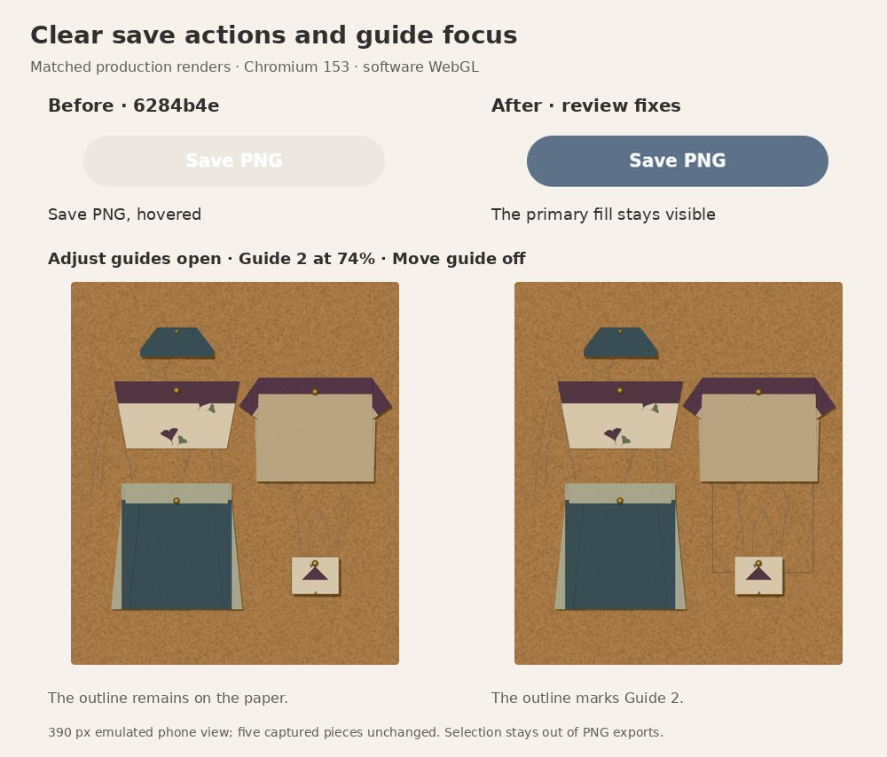
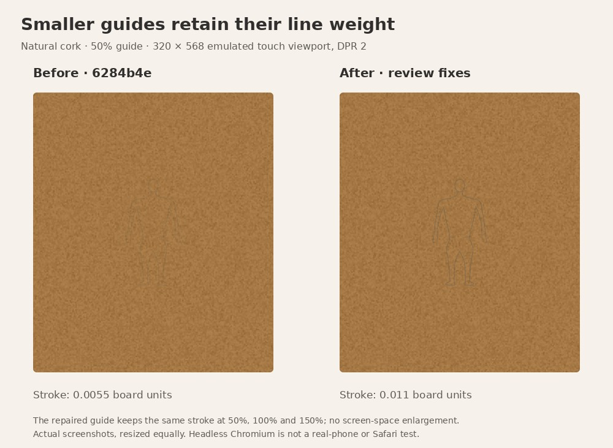

# Follow-up to Claude's board review

This pass responds to Charlie's supplied review of
`6284b4e19358bf77b8a442010cddb546654150ce`. The source PR remains #35; nothing
is merged or deployed, and the separate website repository is untouched.

The review's CI report was independently verified through GitHub: all 17 jobs
across eight workflows succeeded on that exact reviewed commit. Those results
belong to the predecessor, not automatically to this follow-up.

## Decisions

| Finding | Decision |
| --- | --- |
| Primary board buttons lose their fill on hover/sticky touch hover | Repair. The quiet-button hover background was overriding the primary background while retaining white text. Explicitly retain the accent background in the primary hover rule. |
| The paper outline remains visible while adjusting a guide | Repair. Show the chosen guide's outline whenever Adjust guides is open, even without Move guide. Selecting or manipulating paper returns focus to paper and closes Adjust guides. |
| Shrinking guides also thins their strokes | Repair. Keep stroke weight constant in board units across guide pose sizes. Preserve 100% guide rendering, and include the compensated stroke in movement bounds. |
| Clear and Soft look very similar | Retain for now. A separate matched-lighting study should decide whether Clear offers a useful difference; this pass does not alter existing photograph color. |
| Fresh boards start with Original board and disabled finishing controls | Retain the current default for this repair. Natural cork is the preferred reviewed finish, but changing first-run defaults deserves a separate decision from preserving legacy saves. |
| Empty vertical space in the 390px photograph view | Defer a focused composition/control-layout study with a real phone. The export crop and dimensions remain correct. |
| Touch slider swipes and a ghost rectangle | Do not diagnose a device defect from software-rendered emulation alone. Confirm on a real phone/Safari; keep Undo and accessible alternatives. |

The pin attachment/occlusion model, independent guide poses, full-board Move
guide drag target and explicit guide inclusion in photographs remain. None of
these repairs changes garment captures, paper artwork, fold geometry or sizing.

## Scope of the stroke repair

The compensation keeps the existing 100% stroke weight at the same board size
and camera. It does not introduce a screen-space minimum or make reference
lines heavier in the exported photograph. At small phone preview sizes the
stencil is still deliberately subtle, especially on natural cork. A real-device
legibility check remains useful.

## Actual before/after renders

These are actual production-browser screenshots, equally resized with labels
added. The guide-selection comparison retains the same five garment records.
The isolated small-guide comparison uses an empty board for visibility. The
montages can be regenerated with `render-review-comparison.py` from the before
and after captures produced by the focused browser script. Full PNGs stay in
the ignored capture directory/CI artifacts; only these compressed comparisons
are added to source history (226 KB total). [Machine results](review-results.json)
keep the frozen before observations separate from the repaired after checks.

## Reproduction

Use Node 24, `npm ci`, `npm run typecheck`, `npm test` and `npm run build`.
Serve the production build and run `scripts/check-board-review-browser.cjs`;
`BASE_URL`, `CAPTURE_DIR`, `PLAYWRIGHT_MODULE` and `CHROMIUM_EXECUTABLE_PATH`
follow the existing browser scripts. The new check is included in October's
phone-and-board CI job. Existing guide and presentation regressions still apply.

Headless Chromium and emulated touch do not establish real-phone, Safari or
physical-paper behavior.

## Verification and limits

The frozen before build is `6284b4e`, bundle `index-BKsNFhhs.js`; the repaired
production build is `index-DK6t6UXC.js`. Both use the same local Chromium
153.0.8010.0 and SwiftShader runtime. All three old desktop primary buttons
reproduce the reported `rgba(46,42,37,.05)` hover defect. At
390/320px, our fresh Photograph tap does not leave Save photograph hovered;
Claude's Chromium 141 sticky-hover observation is not reproduced in this
runtime. Desktop hover covers the affected CSS selector explicitly, and the
touch check separately requires that the revealed save action remains filled.

Node 24.19.0 install, typecheck, full numerical suite, focused board checks and
production build pass. The new geometry check measures 20,560 actual ribbon
cross-sections (worst width error `1.23e-7` board units), 540 constrained poses,
exact frozen default buffers after a size round trip, and buffer reuse during
movement. An independent read-only check covered 240 further fractional-scale,
board-format and cache cases with exact actual/predicted bounds.

The existing production guide regression also passes with the retained-606
default PNG check enabled: `6388bd984eb309afdc1fde429db32dce07e9c72a32eeac95eaa5fb8f6613be40`.
Independent poses, Off/On, Reset/Undo, format fitting without save rewrites,
exact garment records, excluded-guide export invariance, reload identity and
320/390px touch cancellation/commit/keyboard controls remain covered.

The complete existing presentation regression passes on the repaired build:
legacy/no-write and twelve-piece fixtures, background/appearance Undo, pin
placement/cancellation/reset, reload/export identity, photograph parity,
mobile controls, and resource replacement checks. Its real twelve-capture
fixture comes from the retained Roomy regression output, not the stress fallback.

The focused production repair check passes at 1280/390/320px. All three primary
board buttons retain their accent background on desktop hover. Guide bounds
match the selection box while using Size/arrows outside Move mode; closing the
drawer or selecting paper returns to the garment box. Open/closed guide controls
produce the same PNG, and every garment record stays exact. Measured stroke
widths at 50/100/150% are approximately `.011/.011/.011`, versus the predecessor's
`.0055/.011/.0165` board units.

No fold-engine, material-coordinate, authored-paper, garment-size or pin changes
were made. Non-100% guides intentionally render with different stroke widths;
default guides and photographs with guides excluded retain their appearance.

A later approved website import will also need `scripts/check-guide-geometry.ts`
in its numerical-check allowlist, alongside the earlier October additions. No
website files or deployment settings were modified in this source repair.
