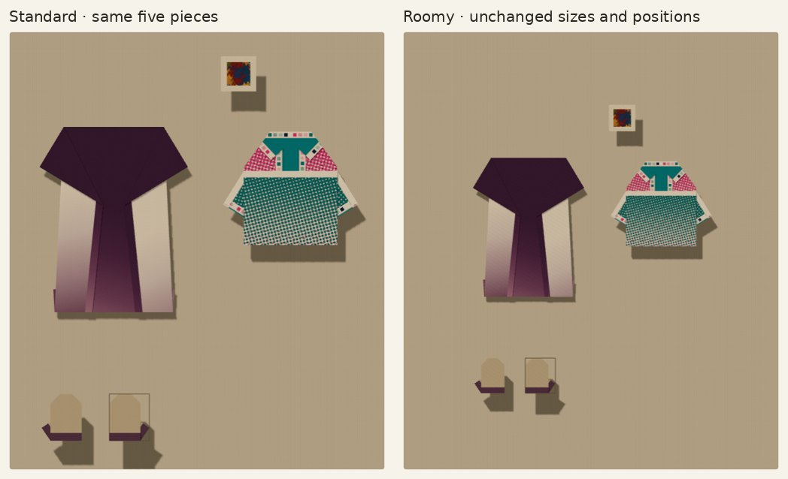
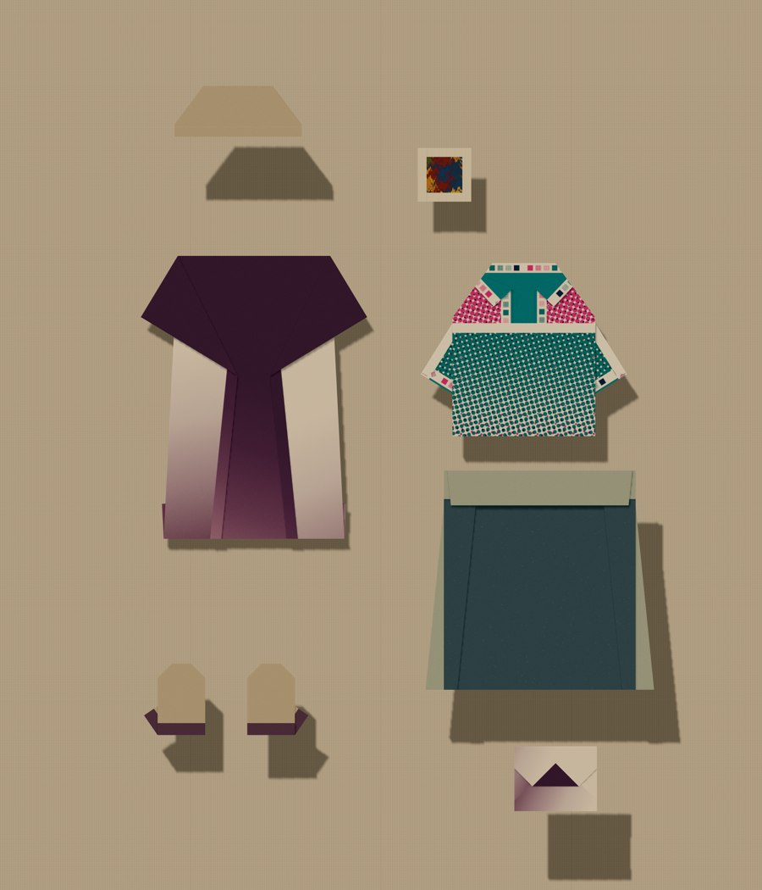
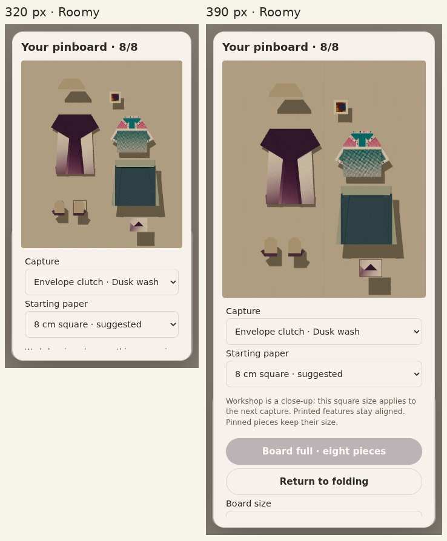

# More room to arrange

Owner-review follow-up to `753b8e6`, continuing PR35 on main `cedf65c`.
No merge, website import or publication. No new design, fold, paper, material
coordinate or capture-scale changes.

## What changes

- Eight separately captured pieces, so two mittens need not displace the skirt
  and brooch. The ninth capture is blocked; no paired-square shortcut.
- Standard stays 3.6 × 4.2 with its 1800 × 2100 export. Roomy is optional,
  4.8 × 5.6 with a 2400 × 2800 export: 33⅓% more in each direction, 77.8% more
  area, and the same exported pixels per world unit. The preview aspect stays
  unchanged. A piece appears 25% smaller in the fitted Roomy overview; its actual
  geometry, starting-square size and placement do not change.
- One layout drives the backing, camera, pointer mapping, movement bounds and
  export. Edge margin stays .08, nudges .08, tilt ±12°. Format changes support Undo.
- Returning to Standard is refused if a posed piece extends past its margins.
  The message asks you to move outer pieces inward; the app never silently packs,
  shrinks, clips or drops the arrangement to make it fit.
- The capacity count moves into the heading. Removing the redundant paragraph
  above Capture restores initially visible 44px Starting paper controls at 320 px
  while keeping the full-width labels and the previous paper-preview dimensions.

## Saves

The v1 record retains its original key. Optional `format: "roomy"` describes
only the board. Missing format means Standard; opening an old record neither
adds the field nor writes the record. Captured matrices, vertices, materials,
UVs, starting-square descriptions and coordinates remain immutable. The parser
rejects unknown/non-string formats and more than eight items. The existing
2,000,000-character limit, quota warning/retry and cross-tab protection remain.
Eight slots do not override a browser quota or promise every possible heavy
accessory combination fits that byte budget.

An older five-slot application rejects records with six–eight pieces without
replacing them. An old build can read a Roomy record with five or fewer pieces
but does not know its larger camera; outer pieces may be offscreen. Do not use
a downgrade as an editing workflow. No migration or backwards rendering claim.

## Why the previous CI was red

At `753b8e6`, Outfit proportions / outfit-composition and Companion studies /
companion-composition both caught the Starting paper control below the initial
320px tools viewport. This was a real regression caused by the stacked labels,
not an assertion to remove. Both original reachability assertions remain.

The October job completed numerical checks, frozen geometry/paper preservation
and the complete 128-view production regression, then hit its 45-minute limit
while running the phone gate. Phone + Roomy now run in a separate 30-minute job;
no coverage is dropped and the gallery time limit remains 45 minutes.

Existing five-piece styling fixtures retain their contents and screenshot/export
comparisons. Their shared capacity helper really pins through eight, checks the
ninth is disabled and cannot mutate the save, then undoes those additional pins
and verifies exact restoration. The dedicated board lifetime check keeps all
eight through remove/Undo/open/close, reload and storage failures.

## Evidence and checks

Node 24.19.0: full `npm test`, typecheck and production build pass. The Roomy
production gate passes on `index-BcgzI2BQ.js`, including:

- Existing fixture loads without a write; Standard → Roomy → Undo reproduces the
  exact original 1800 × 2100 PNG.
- Eight real captures, ninth blocked, shrink refusal retains the entire save,
  remove/Undo and exact reload. The 2400 × 2800 export is byte-identical after
  reload (`8226dd4f3a1c9dd391dd6f9e80f0f2503ca6fe2169d2d2e5cdb960efbb274976`).
  This eight-piece save is 200,079 characters, below the unchanged 2,000,000 limit.
- The tilted mitten reaches the new right margin at x=2.32. Camera, backing,
  aspect and all eight posed bounds agree at 1280/390/320 px.
- Real mitten touch cancellation, committed movement and Undo at both phone
  widths; starting-square control initially visible and at least 44px tall.
- The full unfolded-sheet phone journey passes again at 320/390px: both nine-step
  hands, manual swatch discovery, real thumb grip/cancellation where present,
  readable display controls, pin/reload and identical Standard PNG.
- The previously failing full Outfit production check passes, retaining its
  original 320px reachability assertion and five-piece arrangement.

The Roomy mittens occupy about 50 × 59px on the desktop preview, 27 × 32px at
390px and 21 × 25px at 320px. The Selected menu and movement buttons provide an
alternative to precise direct dragging. Touch emulation passing is not proof
that these smaller targets feel good to use with a finger.

Production browser
checks use fresh isolated contexts and real Pin/format/size/move/Undo/export
controls. Only repeatable outfit styling coordinates use the diagnostic hook.
The saved fixture is temporary test data, never the owner's browser storage.

Browser emulation does not establish real-phone/Safari feel or physical-paper
feasibility. The 320px Roomy overview especially needs owner judgment: it offers
more composition space, not larger on-screen pieces. Standard is always available.
The existing layer-dependent shadows are retained; additional pieces can make
these visibly heavier. Shadow/presentation refinement is a separate visual pass.
