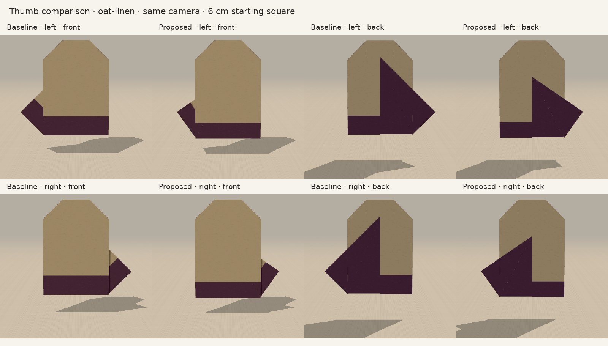
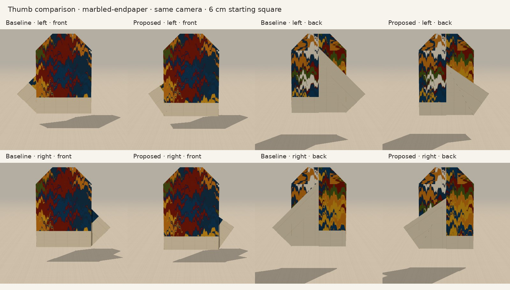
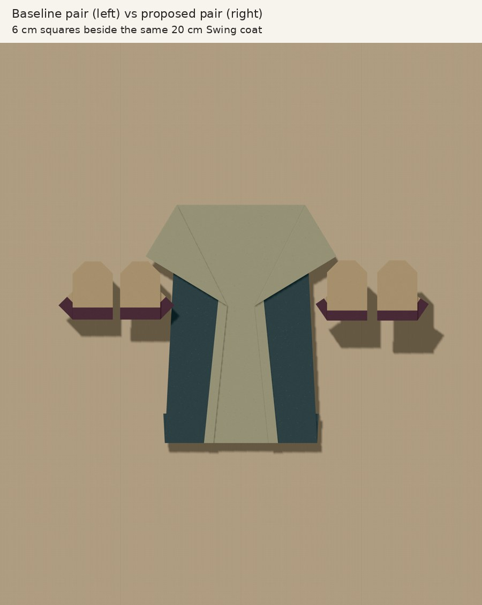

# Mitten thumb follow-up — 13 October 2026

## Decision

Adopt Claude's bounded proposal: cuff depth **.25**, thumb hinge endpoint
**y=.20**, keeping retained top **y=.75**, side **.50**, and fingertip **.30**.
The nine operations and free-flap ordering are unchanged. Both hands now have
short titles, **Left mitten** / **Right mitten**, so capture menus retain the
handedness at narrow widths. Registry IDs and the 6 cm starting square stay stable.

This is a small silhouette refinement. The narrower cuff makes the reverse-colour
thumb stand clearer above it; the reverse triangular flap is less dominant from
the back. Both versions still read as flat ornaments with a low wrist-root thumb.
The difference is subtle at actual board scale, and no hand opening is implied.

## Actual rendered comparison

Same application `Stage`, `SheetView`, textures and camera for 16 views: baseline
and proposed, both hands, front/back, Oat linen and Marbled endpaper. The board
uses the actual `Pinboard` capture and PNG exporter, four 6 cm mitten squares
beside the same 20 cm Swing coat. Its placement is a size comparison, not a
recommended outfit. No page exceptions occurred.







## What the geometric gain means

| Quantity at a 6 cm square | PR35 baseline | Selected proposal |
| --- | ---: | ---: |
| Finished width | 4.056 cm | 3.849 cm |
| Finished height | 4.350 cm | 4.500 cm |
| Thumb tip above cuff top | 1.651 mm | 4.864 mm |
| Thumb tip y (model) | -.3449704 | -.3378525 |
| Cuff top y (model) | -.40 | -.50 |

**Most of the additional clearance comes from lowering the cuff top by 3 mm.**
The thumb tip itself rises only **.214 mm**. It would overstate this proposal to
say it moves the thumb much farther up the palm. The front still exposes the
true reverse on the cuff and thumb; changing the cuff does not change the paper.

## Independently reproduced checks

Started from source PR35 **ceb324d050efb15b16cbc358be112369d17d02fe**.
Ran on Node **24.19.0**, separately with baseline parameters and the proposed
parameters, then reran after adoption and the cuff-sample correction:

- `node --import tsx scripts/check-mitten.ts` — passes for both hands: 19 connected
  facets retaining area 4, nine operations, original material bounds, local
  Kawasaki/Maekawa, reversible controller, 161 poses per operation, rigid edges,
  shared crease continuity, floor clearance and the existing .044 hinge guard.
- `node --import tsx scripts/check-mitten-rendered.ts` — actual Float32 `SheetView`
  geometry at 201 poses per operation: **zero material-facet crossings** in either
  version. Synthetic connector strips still intersect. Worst facet/connector
  metric remains approximately **.0165 left / .022 right**. Counts change slightly;
  it is the worst metric and zero material-facet result that are unchanged.
- `npm run typecheck` — passes after the selected code/test change.

[Compact numerical comparison](numerical.json), [dimensions and material-face
samples](dimensions.jsonl), and [render/capture results](browser.json) retain the
results without committing raw meshes or all individual screenshot frames.

The connector metric measures edge-endpoint distance to a triangle's plane; it
is not a physical penetration width. Neither successful numerical checks nor
these browser images establish a collision-free continuous finite-thickness
fold. No physical sheet or real phone was tested in this study.

## Cuff assertion investigation

Claude was right that the .20 cuff experiment exposes a fixed sample location.
The old `y=-.55` point is above that cuff's top at `y=-.60`, on the printed palm.
At the actual cuff midpoint (`y=-1+1.5*cuff`, hence -.70), the visible face is still
the reverse. The test now samples the authored cuff midpoint. This preserves its
material-side assertion rather than deleting or weakening it. **The .20 variant
is not selected or fully validated**; this investigation only resolves why that
particular assertion failed.

## Reproduce

For selected numerical checks, use the two commands above. For the frozen
baseline, use a separate checkout of the source SHA above and run the same two
scripts. Optional `MITTEN_RENDER_REPORT=/tmp/rendered.json` saves full crossing
results outside source history.

The comparison helper explicitly sets both cuff/hinge parameters for each version,
so baseline screenshots remain reproducible even after adopting the proposal.
Start Vite on port 5639, then run:

```sh
CHROMIUM_PATH=/path/to/chromium \
CODEX_PRIMARY_RUNTIME_NODE_MODULES=/path/to/node_modules \
node docs/october-integration/thumb-followup/capture.cjs
```

Captures go to `/tmp/thumb-followup/captures` unless `THUMB_CAPTURE_DIR` overrides
it. The browser script produces 16 raw views and a native 1800×2100 board export.
The compact comparisons crop only the duplicate long screenshot captions and
add concise headings; garment pixels and camera scale are preserved. The board
comparison downsamples the native export to fit the review page.

The full physical trial remains the next useful mechanism check: can the thumb
flap lift freely and can fingertip folds close without catching the retained top
strip on an ordinary paper square? Folding through several layers is not
universally possible merely because all layers have a shared crease in this
zero-thickness model.
