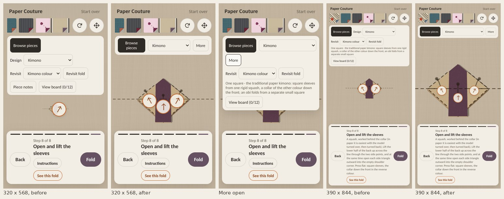
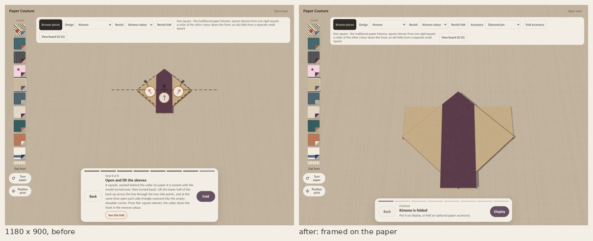

# Room for the paper on phones

The follow-up from Astra's review of the usability pass: "Make room for the paper
next, including portrait. In the 320 × 568 screenshot the handle nearly covers
the whole kimono." Branch `claude/phone-layout`, on top of `claude/usability-pass`.

## What made the paper small

Two things, measured in the app (the paper's width on screen at the waiting pose):

1. **The camera always framed the whole unfolded square.** A nearly finished
   kimono covers about a third of that frame, so it stayed small on every screen,
   even on a desktop.
2. **On a narrow screen the top controls took four rows.** Browse pieces, Design,
   Revisit, the construction note and View board, about 190 px at 320 × 568. That
   left a 110 px band for the paper.

## What changed

**The workshop camera frames the paper the step involves** (`src/app/workFrame.ts`,
all screens).
- Each step's frame covers that step's paper through its whole motion, sampled at
  21 poses.
- Every design starts on exactly the old whole-sheet view. The camera comes closer
  as the piece gets smaller, by up to about 2.2× (the zori; the kimono 2×), and is
  never wider than the whole sheet.
- The camera holds still while a step waits and while a fold is dragged. It moves to
  the next step's frame only in the last 40% of the fold's own motion, so it has
  arrived when the fold has, and Back retraces it.
- No glide runs on a timer, so "the fold has settled" still means "the view has
  settled".
- Twenty of the 27 designs come closer at some step.

**On narrow screens (under 720 px) the top controls fold to one row in the
workshop:** Browse pieces, the design list and **More**.
- More opens the rest over the paper without moving it: Revisit, the construction
  notes, View board, and the accessory controls on a finished piece.
- It closes on a press outside, on Escape, and once a choice is made. It and
  Instructions close each other, and grips step aside while it is open.
- Folding an accessory brings back the full controls, with Back to garment.
- On a small phone on its side (568 × 320), the bar takes the title's row (Start
  over stays) and the dock's buttons sit beside the step title.

**Revisit no longer disappears while a fold moves.** It stays in place, disabled.
Hiding it changed the height of the top controls mid-fold, so the view zoomed a
little at the start of every fold in designs with a colour or shape choice. That
also happens on main.

## The numbers

Kimono step 8 (waiting to open the sleeves), paper width × height on screen in CSS
px, before (main + usability pass) and after:

| Screen | Before | After |
|---|---|---|
| 320 × 568 | 41 × 34 | 159 × 137 |
| 390 × 844 | 110 × 93 | 279 × 242 |
| 568 × 320 | 37 × 31 | 73 × 63 |
| 844 × 390 | 64 × 54 | 112 × 97 |
| 1180 × 900 | 220 × 184 | 369 × 321 |

Other steps at 320 × 568: the dress at step 3 grows from 76 to 156 px wide, the
zori at step 7 from 26 to 98, and the fit-and-flare at step 6 from 83 to 172. The
gown's cap sleeve (step 9) goes from 41 to 100 px. It is floor-length, so its frame
stays the whole sheet, and the gain there is the bar alone.

## Checks

- `scripts/check-work-frame.ts` (`npm run check:work-frame`, in `npm test`):
  - every design starts on the whole sheet;
  - no frame is wider than the whole sheet or closer than the limit;
  - every step's paper stays inside its frame at 41 poses (twice as fine as the
    frame is computed);
  - the blend between steps is still up to 60% of a fold and arrives exactly at the
    next frame.
- `scripts/check-phone-layout-browser.cjs` (CI: `.github/workflows/phone-layout.yml`):
  - 1180 × 900: the kimono at step 8 is at least 330 px wide. The camera is still
    while waiting and during a short drag, settled after the fold, and Back
    retraces it. The paper is in view at every kimono step.
  - 320 × 568 and 390 × 844: one row; the kimono at least 140 and 250 px wide,
    between the bar and the dock. More shows Revisit and View board without moving
    the paper, and closes on a press outside, Escape and a choice. Revisit works
    from it. The finished piece keeps the bar, with accessories under More. Folding
    the obi brings back the full controls.
- Existing checks updated:
  - `check-usability-browser.cjs` uses More for the notes on narrow screens.
  - `check-phone-journey.cjs` accepts the mitten's thumb being big enough to drag
    by its own paper at 320 px (it is now 28 px or more, so no separate grip is
    made). It drags it to prove it: a cancelled touch restores the step, a full
    drag folds it.

Existing browser checks rerun on this branch, in Chromium with software WebGL on a
two-core machine:
- **Pass:** usability, phone journey, design picker, camp-collar shirt, coat-dress,
  framed brooch, gown, kimono, outfit production, roomy board, swing coat (both),
  zori and fan, board and sizing (the last two on the dev server, which they import
  from).
- **October:** passed its three UI checks, then ran out of a 25-minute local limit
  while rendering every paper. No failure was recorded.
- **Presentation:** fails on a -0 versus 0 difference after a reload, and fails
  identically on main, so it is not from this branch.
- Checks that need an older baseline build were not rerun here; CI runs them.

## Still to do

- **Small phones on their side** gain the least (568 × 320: 37 → 73 px). The dock
  under the paper is the limit there. A landscape layout with the dock beside the
  paper would be the next step.
- **A newcomer on a real phone**, starting with the dress as Astra suggests, to see
  whether people understand what moved and how to undo it.
- Not tested on a real phone or in mobile Safari.
