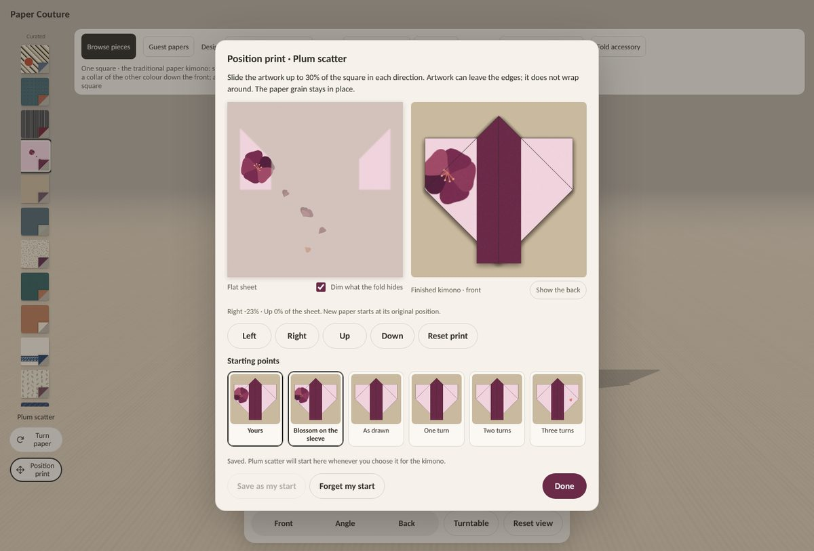
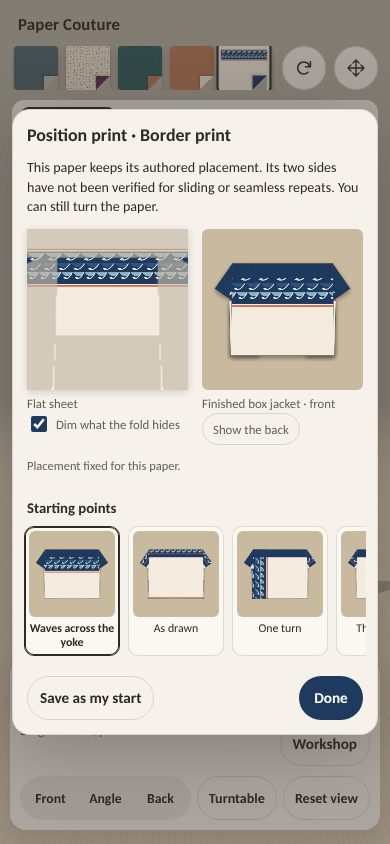

# Placement review and starting points (Claude, 2026-11-21)

Branch `claude/starting-points` from main `b522124`, at Charlie's request in a Claude
chat. He asked for an outside look at where papers and folds could be better, a way to
look through the options, and a way for one paper to begin differently on different
pieces. No fold, engine, renderer, paper drawing, default, link or saved board changes.
Not merged or deployed.

## What changed in the app

**Position print shows the finished piece.** The dialog used to cover the piece and show
only the flat sheet. It now draws the finished piece beside the sheet (front, or back on
request) and redraws it as the print slides or the sheet turns, before or after folding.
The flat sheet dims what the fold hides; a checkbox turns that off and is remembered.
The existing controls and their names are unchanged.

**Starting points.** A row of small finished pieces under the two pictures:

- the four turns, for every paper;
- for a sparse print that slides, the position that keeps the most of it in view, and a
  centred one when that is different (measured in the browser for the current piece and
  its current shape);
- 27 suggestions chosen by eye in this review, by name (`src/papers/startingPoints.ts`);
- **Yours**: *Save as my start* keeps the current turn and position for this paper on
  this piece. Choosing that paper for that piece then begins there, including on a
  reload. Each piece and each colourway keeps its own. *Forget my start* removes it.

Only a saved start is ever applied without being pressed. A link that names a turn or
print position still wins. Saved starts live in this browser's local storage under
`paper-couture:starting-points:v1`, apart from the board's own storage.

Phone width (headless, 390 px): 

## The review page

`docs/placement-review/review.html` opens by double-click. It draws every paper on every
piece at every turn, with the found and suggested placements, from the same code as the
app. Four tabs: **Findings** (what I would change and the choices that are yours),
**By paper**, **By piece**, and **Folds** (every piece front and back in one paper, with
a note on each). Press any picture for a larger front and back and the address that
opens it in the app.

To work on it: `npm run dev`, then open `/experiments/placement/`. To rebuild the single
file: `npm run build:placement && python3 scripts/package-placement-review.py`. It is a
sketch-lane page: nothing in `src/` depends on it and it has no CI.

After changing a fold or a paper, open **By piece** or **By paper** to see all of its
landings again before deciding.

## Files

- `src/render/flatPreview.ts`: a flat 2D drawing of a finished piece from the engine's
  own facets and the paper's own drawing, with the 3D sheet's quarter-turn mapping.
- `src/papers/landing.ts`: the sheet map (which cells of the printed face are seen on
  the finished front), the veil drawn from it, and the placement search.
- `src/papers/startingPoints.ts`: the suggestions and the saved starts.
- `src/ui/printPositionPanel.ts`, `src/styles.css`: the panel. `src/main.ts`: wiring,
  and applying a saved start when a paper or design is chosen.
- `src/render/textures.ts`: `paperCanvas` takes an optional size (default unchanged).
- `experiments/placement/`, `vite.placement.config.ts`: the review page.

## Checks

Node 22.23 in a cloud container; browser checks in headless Chrome with software WebGL.
**No real phone and no physical paper.**

- `npm run typecheck`, `npm test`, `npm run build`: passed.
- `scripts/check-starting-points.ts` (new, in `npm test`): the sheet map agrees with the
  existing landing diagnostic (`scripts/paperLanding.ts`) on all 32 finished pieces and
  colourways, 131,072 sheet cells; the flat preview's canvas mapping equals the
  diagnostic's; all 27 suggestions name a visible paper and a real design and sit
  exactly inside the paper's own limits.
- `scripts/check-starting-points-browser.cjs` (new, optional, not in CI), on a served
  production build at 1400 and 390 px: finished preview drawn; a suggestion is offered
  and not applied until pressed; the old nudges and reset give the same positions as
  before; the veil choice is remembered; a saved start returns when the paper is chosen
  again and on a bare reload, does not override a link that names a turn, is separate
  per piece and per colourway, and can be forgotten; no page errors; no sideways scroll.
- Existing browser checks run here on this branch, all passed:
  `check-positioning-browser.cjs` (dev server; real drags, nudges, reset, snap, reload,
  pixels at all four turns, board and exports), `check-swing-coat-phone.cjs` (served
  build; taps Position print, Right and Done at phone width) and
  `check-twice-folded-browser.cjs` (served build). The other browser checks need their
  frozen baseline builds and were not run here; CI on a pull request runs them.

Limits. The flat preview has no lighting, layer thickness or camera tilt, so a few
cells at raised flap edges can differ from the Display view (the same limit the landing
diagnostic records). "Ink" is measured against each face's most common colour, so the
percentages mean little for all-over prints and are shown only for sparse ones. The
measure ranks what to show; it does not know what looks good. Suggestions were chosen on
each design's default shape and default colourway and are offered only on the default
colourway.

## Choices left to Charlie

They are set out with pictures in the review page's Findings tab. In short:

1. Whether a paper should *begin* from a suggestion on pieces that hide it as drawn
   (33 paper-and-piece pairs lose a motif as drawn).
2. Border print: half a turn on pieces cut from the top of the square.
3. Plain reverses on 13 of the 17 curated papers, which make the reverse colourways flat.
4. Letting Midnight orchard (and perhaps Reverse garden and Open stems) slide.
5. Open stems' reverse and Oat linen's face are close to the board's colour.
6. Accessory positions for the coat-dress, gown, fit-and-flare, camp shirt, swing coat
   and capelet, which have none.
7. Refolds for the hat, boots, boat-neck top, apron and tunic; pleat depth on the
   pleated skirt.
