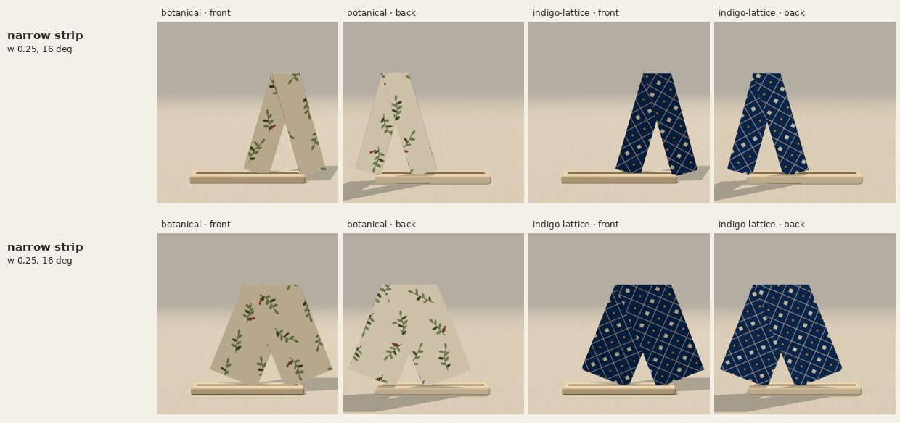

# Strip trousers — TEST STUDY (not a garment)

**This is a test, parked for a later look at bottoms.** It is not in the Design
list and the app does not import it. Nothing in `src/` changes on this branch.

The renders above came from a temporary local registration in the real app (not
committed). Top: slim strip at 16°. Bottom: wide strip at 22°.

## What works

The earlier trousers attempt ([`../geometry-collection/trousers-centre/NOTES.md`](../geometry-collection/trousers-centre/NOTES.md))
was parked because the backing paper filled the space between the legs. This
study gets a genuinely empty gap with a trick from folded dollar-bill trousers:

1. Turn over, fold both sides to the centre, fold in half lengthwise: a
   four-layer strip that shows the print on **both** faces.
2. (Slim version) fold in half lengthwise again.
3. Fold the strip in half across its middle along a line tilted by β.

The fold is the waist. The two halves of the strip become the two legs, joined
only along the waist fold, so below it they are separate paper and the gap is
empty. Because both faces of the strip are print, both legs show the print. It
is four or five simple folds and would be very easy to fold in real paper.

`stripTrousersStudy.ts` builds it; `check.ts` (`node --import tsx docs/strip-trousers-test/check.ts`)
checks every resting state, the crease pattern (Maekawa/Kawasaki), retained
area, that the gap below the crotch is empty, that both legs show the same side,
and that the study is not registered as a garment. It is not part of `npm test`.

## Why it is parked

Both legs run up to the full waist, so there are no separate hips: the shape is
a "∧". The inner edges cross (the crotch) at (w/2)/sin β below the waist, for a
strip of width w and legs splayed by ±β:

| strip | β | crotch, fraction of leg length | reads as |
| --- | ---: | ---: | --- |
| 0.5 (wide) | 22° | 0.67 | culottes / harem, low crotch |
| 0.25 (slim) | 16° | 0.45 | slim legs in a stride |

Wide legs with a high crotch would need β near 40°, a splits pose. Palazzo
proportions are out of reach this way.

## The open problem: hips that span both legs

Real trousers have hips about two legs wide with the gap starting at the crotch.
For a single uncut square, the paper between the legs must then fold away, and
it is attached to both legs along the inner seams. Working through the
flat-folding conditions at the crotch corners:

- A gate-fold layout (side panels folded in, raw edges as the inseams) always
  leaves the centre panel visible in the gap, because the gap lies over it.
- Flipping that panel's lower part up behind the hips needs the transition
  between a leg (reflected across a near-vertical line) and the flipped panel
  (reflected across the horizontal crotch line): a net half turn, which at a
  single crotch vertex forces a ~90° gusset that stays roughly in place and
  fills the gap.
- Any face at a vertex must span less than 180°, so the hips-plus-leg face at a
  crotch corner (about 265°) must itself be split by creases into the hips: in
  practice a front pleat, a hip pleat and a gusset meeting at each corner.

No arrangement of that kind was found in this session. A future attempt should
start from a multi-pleat crotch vertex (front pleat + hip yoke pleat + gusset),
ideally searched numerically for a pattern whose loops close
(`src/fold/collapse.ts`'s `planCollapse` checks this), rather than more
single-vertex variants.

## Not tested

Not folded in paper, not tested on a phone, and not taken through the app's
board, controls or browser suites (it is not registered).
