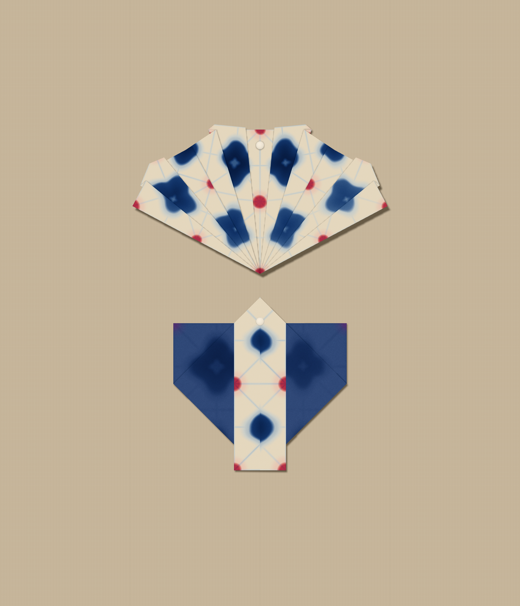
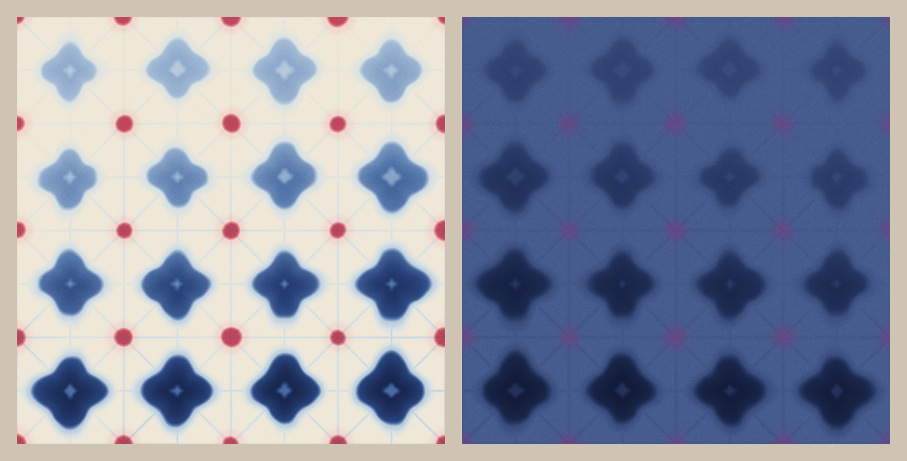
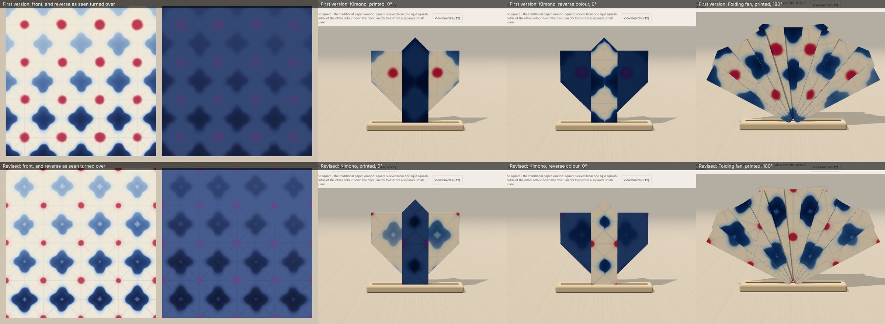
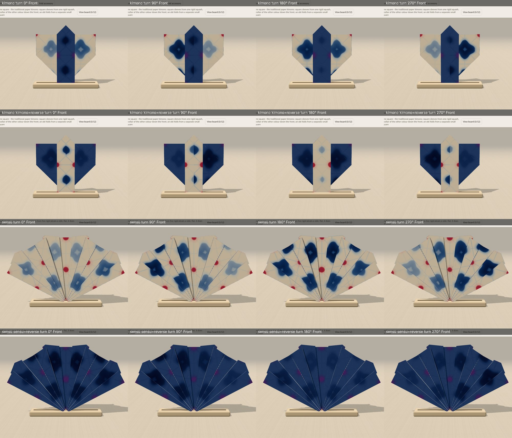
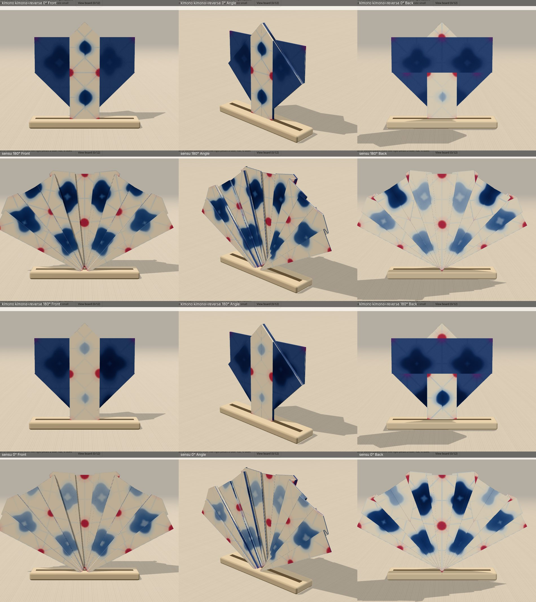

# Twice folded — one commissioned two-sided paper

Branch `experiment/claude-paper-commission` from `f33415b`, at Charlie's request in a
Claude chat (2026-11-10). One paper, styled on two existing pieces. No garment, fold
engine, renderer, default or existing paper changes. Draft PR only; not merged or deployed.

`pinboard.png` is the app's own Save photograph output, 1800 × 2100, unedited.

## The paper

Left: the front. Right: the reverse, as seen when the sheet is turned over
side to side. Both are the app's own textures at 1024 px, grain included.

**Twice folded** (`twice-folded`, Experimental) is fold-and-clamp resist dyeing
(itajime), which is itself made by folding. The sheet is imagined pleated into a stack
of right triangles, clamped, and dipped twice: one corner of the stack in indigo, the
opposite corner in safflower red. Opened out, every fold of that first folding is a
mirror line of the print, and a little dye has crept along each one as a pale vein.
Folding it in the app is the second folding.

- **Front:** indigo blossoms and small red dips on undyed paper, four repeats across.
  The indigo is dipped deepest at the bottom edge at 0°, a little askew, so a turn of
  the sheet decides where the strong end goes.
- **Reverse:** the side that lay in the vat. Indigo all over, darker where the front is
  dyed, violet where the red sank into the blue. It is quiet on purpose. The two faces
  hold the same dye at every sheet point, so the reverse is not a second design; it is
  the same one read from the other side.
- **Why the reverse earns its place:** a crease on one of the first folding's lines
  (any eighth of the sheet) turns the reverse over in register. A dip cut by the flap's
  edge carries on in its other colour, red into violet. The Framed brooch and the Bib
  apron show this at their borders; neither is part of this commission's board.

Implementation: `src/papers/twiceFolded.ts`, registered in `src/papers/index.ts` after
Dusk wash. Fixed placement, no print sliding. Each face is computed once per size and
kept (as Marbled endpaper does), so turns and board restoration reuse the pixels.

## The two pieces

| | Piece | Fold choice | Starting square | Sheet turn |
| --- | --- | --- | --- | --- |
| Top | Folding fan | Printed fan (the default) | 20 cm | 180° |
| Bottom | Kimono | Reverse-colour kimono | 24 cm | 0° |

**Kimono: where the artwork lands.** The kimono shows the vat side, so each sleeve
carries one whole blossom as a darker shape in the blue, where a crest would sit. The
collar is the paper's front: two indigo blossoms down the centre line, and a red dip on
each collar edge at the waist.

**Folding fan: what the fold did.** Every pleat tucks a narrow wedge away and swings the
rest of the leaf in toward the middle about the rivet. The square lattice does not
survive that as a lattice. The blossoms lean and pinch into petals around the rivet,
and the red dips, which sit on the sheet's centre line, stay in a straight row up the
middle panel: rivet, centre, rim. A fan pleat is not one of the dye's own fold lines,
so nothing registers; the pattern is re-cut instead.

### Recreate the board

1. `npm ci && npm run dev`, then open
   `/?design=kimono&paper=twice-folded&turn=0&kimono=reverse&step=99&view=display`.
   Pinboard → Starting paper **24 cm square** → Pin current piece.
2. Open `/?design=sensu&paper=twice-folded&turn=2&step=99&view=display`.
   Pinboard → Starting paper **20 cm square** → Pin current piece.
3. On the board (Standard size): select the kimono, Reset selected, **Move down × 7**.
   Select the fan, Reset selected, **Move up × 9**. No tilt.
4. Finish & photograph: Surface **Linen cloth**, Pins **Slim white**, Light
   **Clear daylight**, no guide. Photograph → Save photograph.

By hand instead of by link: choose Twice folded at the end of the paper scroll, choose
the design, pick the fold choice at step 1, and use Turn paper twice for the fan.

## What folding changed

The kimono made me change the artwork. In the first version an indigo blossom sat on
the sheet's centre and on every quarter, with the red dips between. On the kimono that
put a lone red dot in the middle of each sleeve and cut every blossom at a sleeve edge,
and the collar, a long strip of reverse, read as flat navy with nothing in it.

Changes, all in `twiceFolded.ts`:

- The whole dye lattice moved half a repeat. Red dips now sit on the quarters of the
  sheet (centre and corners included) and blossoms on the odd eighths. One whole blossom
  lands on each kimono sleeve, and a red dip lands on the fan's rivet.
- The reverse was lightened and given more range (it had been almost one tone), with a
  faint trace of the fold veins, so the vat side shows its blossoms on a folded piece.
- The red dips were made smaller with a pale fringe. At folded size the first version
  read as red polka dots with some blue behind them.
- Each blossom got a small pale heart, and the pale end of the dip was raised slightly
  so the weak end of the sheet still reads once folded.

## Rotations and views looked at

Each piece is framed on its own by the app's display camera, so these sheets do not
compare sizes. The kimono at 180° has stronger blossoms on the sleeves and weaker ones
on the collar; 0° was kept for the collar. The fan at 0° shows the pale half of the
sheet; 180° was kept.

## Checks

Run on Node 24.22.2 in a cloud container. Browser checks used headless Chromium with
software WebGL. **No real phone and no physical paper.**

- `npm run typecheck`, `npm test`, `npm run build`: passed.
- `scripts/check-design-pass.ts` (in `npm test`) now lists the paper in the registry
  after the four design-pass papers, Experimental, fixed placement, and asserts the
  placement the two pieces rely on: a red dip on every quarter of the sheet on both
  faces, a blossom on every odd eighth on both faces, and the dip deepest at the bottom.
- `scripts/check-companion-papers.cjs` (CI) has the new id added to its list of papers
  newer than its frozen baseline. Not run here: it needs the frozen baseline build.
- `scripts/check-twice-folded-browser.cjs`, against the production preview
  ([result](evidence/browser-checks.json)): paper chosen from its swatch under
  Experiments; kimono folded with the real Fold button, two Back, refolded; four
  quarter-turns on the finished kimono; fan folded at 180° with three Back and refolded;
  both pinned at their sizes; arranged with the board's buttons; photographed and saved
  at 1800 × 2100; page reloaded; board restored; second PNG **byte-identical** to the
  first; no page exceptions or console errors. The script is optional and not in CI.

Limits: an older build cannot read a board that holds this paper (the same rule as
Plum seed). The first selection of the paper computes two 1024 px faces, about half a
second in this container, then reuses them. Colours in the workshop and display views
are darker than on the board because those scenes are lit differently; the board is
closest to the flat sheet.
