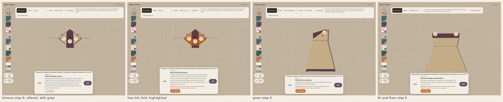

# Usability pass: hidden folds, short screens, no WebGL

Astra's review of main (`f33415b`, 28 October 2026) found three problems a newcomer
meets before any question of geometry. This pass addresses them. The fold
constructions, material coordinates, saved captures and the camera are unchanged.

Short screens: [landscape](evidence/short-screens-landscape.jpg),
[portrait](evidence/short-screens-portrait.jpg), [highlight and instructions together](evidence/combined-small.jpg) · [no WebGL and a lost
context](evidence/no-webgl.jpg) · [browser check results](evidence/results.json)

## 1. Folds that happen out of sight

**What was wrong.** Some steps move paper that lies under other layers. From the
workshop camera, 0% of the moving paper shows at the kimono's sleeves (step 8), the
gown's cap sleeve (step 9) and the fit-and-flare's shoulders (step 6). Astra's ray
test found 0 to 3.6%; my measure in `src/fold/visibility.ts` agrees. The canvas
grip takes the topmost paper, which does not move, and grips were made only for
small flaps of ordinary folds, never for collapses.

**What changed.**
- The app measures, for the waiting pose of each step, how much of the moving paper
  the actual camera sees. It casts rays from points spread over every moving
  triangle toward the camera, area-weighted.
- Below 25%, the dock offers **See this fold**. It draws the moving paper on top of
  everything, as a tinted shape with its outline, and says so: "Highlighted: the
  paper this step moves, drawn through the layers above it. The paper and the view
  are unchanged." The camera does not move and nothing is turned over.
- The highlight stays on for that step through Fold and Back, so a difficult step
  can be replayed and watched as often as needed, without finishing the piece.
- Hidden paper gets a grip of its own, one per moving part (the kimono's collapse
  has three), labelled "Fold the hidden paper" or "Move the hidden paper". Each is
  44 px and drags along the fold's arrow like the small-flap grips.
- Grips step aside while opened Instructions or Piece notes lie over the paper.
  They otherwise stay above the panels: on a phone a panel can cover a grip's
  paper (the mitten's thumb), and the grip must still be reachable.

From the default distance, five steps in the collection are offered the highlight:
kimono 7 and 8, gown 9, fit-and-flare 6 and zori 7. `check-usability.ts` records
that list.

**Why a highlight, and not another camera angle.** I measured the obvious
alternative, a view from underneath. It shows the gown's cap sleeve completely
halfway through the fold. But the kimono's squash moves paper sandwiched between
layers: from below, 40% of it shows at the waiting pose and 29% halfway, so no
single angle shows that step. The highlight works for every case and every
viewport. Keeping the camera fixed also keeps the instructions' left and right
true. A labelled "from underneath" view could still be added as an option.

**Why Display still waits for the finished piece.** Display's stand, framing and
camera presets are built around the finished outline, and the pinboard reads from
it. The highlight and the replay cover the need: inspecting a step before
finishing.

## 2. Instructions on short screens

**What was wrong.** At a height of 540 px or less (phone landscape), the step's
instructions were hidden with no way to read them. The construction notes were
kept visible instead. Checking 320 × 568 also showed the opposite problem, on main
too: the kimono's long instructions made the dock run into the top controls and
cover the paper.

**What changed.**
- A dock is **compact** when the screen is 540 px tall or less, or when the full
  dock would take more than 40% of the screen. A compact dock keeps the step title
  as the action cue, and the full text sits behind an **Instructions** button
  (`aria-expanded`). Once compact at a screen size, it stays so until the size
  changes, so the dock does not switch back and forth between steps.
- Opened, the instructions lie over the paper, held between the top controls and
  the screen edge, and scroll if they are longer. The paper keeps its framing
  instead of shrinking into what is left. The highlight's one-line note opens with
  them and is counted in that room. When less than about 72 px is left below the
  top controls (a small phone on its side, or 320 × 568 with the highlight on), the
  open dock covers the controls while it is read, then gives the space back when
  closed.
- With a compact dock, the piece's construction notes sit behind **Piece notes**.
  The two close each other, so they never stack.
- At 390 × 844 nothing changes: instructions and notes show as before.

## 3. No WebGL

**What was wrong.** Without WebGL (turned off, blocked for the graphics card, or
not offered), the renderer threw at startup and the page showed only its title.

**What changed.** A readable alert: the folding table could not start, why that
happens, and what to try. It has a **Try again** button and the finished pieces
drawn flat (the chooser's previews). The underlying error still goes to the
console. While the app is running, a lost graphics context shows a notice with
**Reload**, and the notice goes away when the context returns. It says only what a
reload really keeps. The address holds the piece, its options, paper and step, and
the board is saved in the browser. An accessory being folded or attached is held in
memory only, so in those states the notice says it would be lost. (Astra caught the
first version promising that all progress was in the address.)

## Checks

- `scripts/check-usability.ts` (`npm run check:usability`, in `npm test`): the
  three steps under 5% visible at camera distances 5, 8 and 12; a grip per hidden
  part; ordinary dress folds not flagged; the cap sleeve visible from underneath (a
  ground truth for the ray test); and the recorded list of steps offered the
  highlight.
- `scripts/check-usability-browser.cjs` (CI: `.github/workflows/usability.yml`), in
  Chromium with software WebGL:
  - The three hidden steps: offered (not at a dress fold). The highlight draws
    without moving the camera or the paper, and stays through Fold and Back. Grips
    are labelled, 44 px and inside the screen, and dragging one folds the step.
  - 844 × 390 and 320 × 568: the title stays; Instructions opens the text between
    the top controls and the screen edge; the two disclosures close each other;
    Fold works; no horizontal scroll. 390 × 844: everything shows, and the dock and
    top controls stay apart.
  - Both together at 320 × 568: See this fold and Instructions open. The
    instructions and the highlight's note are uncovered and on screen, and every
    dock control is on screen and is what a tap at its centre reaches. This holds
    through Fold and Back (both stay open) and after rotating to 568 × 320 and back.
  - No WebGL: an alert, Try again, and 27 finished pieces.
  - A lost context: the notice appears and goes again. On the piece it promises the
    piece, paper and step; while folding an accessory, and with one attached, it
    says the accessory is not kept. A reload then keeps exactly the piece, paper
    and step.
- `check-integrated-browser.cjs` opens Piece notes at 844 × 390 before reading the
  note. (That check is stale on main: its first assertion still expects the original
  nine designs. It is not in CI, so it was left as it is.)
- Existing browser checks rerun on the build: design picker, camp-collar shirt,
  phone journey, kimono and gown all pass. The phone journey caught one regression
  on the way: I had moved the grips under the panels, which covered the mitten's
  thumb grip on a phone. Grips now stay on top and step aside only while opened
  Instructions or Piece notes lie over the paper.

## Not done here

- **A curated first project and a newcomer test on a real phone**, from Astra's
  proposal. These need Charlie's choice of project and a person to watch. See the
  reply in the chat.
- **The paper is small on phones.** At 844 × 390 and 568 × 320 the top controls and
  the dock leave a thin band for the table, and at 320 × 568 a grip can nearly
  cover the whole piece. That predates this pass and is the follow-up
  (`claude/phone-layout`).
- **Not tested on a real phone or in mobile Safari.** No physical paper.
