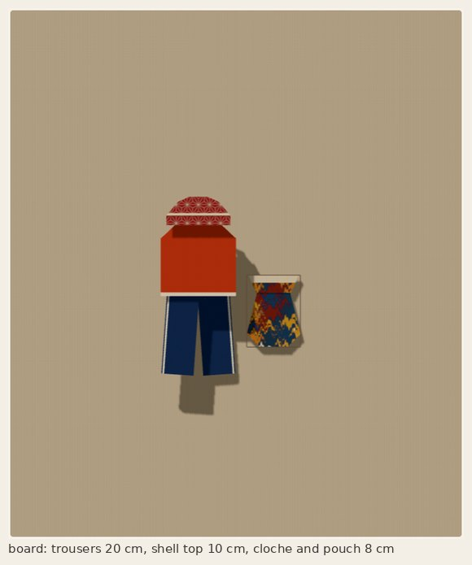

# Wardrobe gaps: trousers, a cloche, a shell top, a kinchaku pouch, plain kami

A pass over the collection after the five-design integration: fill the clearest
gaps, rework or retire pieces that do not read as what they are, and round out the
papers. Every piece still folds from one uncut square with honest folds.

| | Piece | Square | Finished | Colour choice |
|---|---|---|---|---|
| new | **Trousers** (`?design=trousers`) | 20 cm | 5.9 × 7.7 cm | `&trousers=reverse` |
| new | **Cloche** (`?design=cloche`), replaces the folded hat | 10 cm | 6.4 × 2.9 cm | `&cloche=reverse` |
| new | **Shell top** (`?design=shell-top`), replaces the boat-neck top | 10 cm | 6.0 × 6.0 cm | `&shell-top=reverse` |
| new | **Kinchaku pouch** (`?design=kinchaku`) | 10 cm | 5.4 × 7.2 cm | none |

[Front, angle and back, and the reverse colourways](evidence/views.jpg) ·
[every step](evidence/steps.jpg) · [the chooser](evidence/chooser.jpg) ·
[the four papers](evidence/papers.jpg) · [phone widths](evidence/phones.jpg) ·
[browser check results](evidence/browser/results.json) ·
[geometry and measurements](evidence/geometry.json) ·
crease patterns: [trousers](../crease-patterns/trousers.svg), [cloche](../crease-patterns/cloche.svg),
[shell top](../crease-patterns/shell-top.svg), [kinchaku](../crease-patterns/kinchaku.svg) ·
sheet maps: [trousers](../paper-studies/sheet-map-trousers.png), [cloche](../paper-studies/sheet-map-cloche.png),
[shell top](../paper-studies/sheet-map-shell-top.png), [kinchaku](../paper-studies/sheet-map-kinchaku.png)

All four are my own constructions. The trousers start from the folded-dollar-bill
trousers' strip; the kinchaku reuses this app's fit-and-flare waist move.

## Trousers

Wide-leg trousers with a waistband across both legs, hips joined down to the
crotch, an empty gap between the legs below it, and a stripe of the paper's other
side just inside each outer seam. This was the long-parked problem: a single square
gives hips that span both legs only if the paper turns a corner at the waist.

**The strip.** The sides fold to the middle (behind, for the printed trousers),
stopping 0.8% of the side short so a narrow band of the other side shows between
them; the strip folds in half lengthwise, and again. It is a quarter of the square
wide and shows one side on both faces, with the band down one edge.

**The U-turn.** The strip runs up the first leg, turns across the waist and down
the second leg. Each turn is a square corner of two folds: straight back along the
waist line, then 45 degrees (and for the second leg the same in reverse). Four
folds between the legs is an even number, so both legs show the same face and the
band runs down both outer seams.

**The crotch.** At exactly 45 degrees the second leg would lie against the first all
the way down. Its 45 degree fold is turned 4 degrees (41 degrees to the waist),
which splays the leg 8 degrees; the turn is placed (solved by bisection) so the
second leg's inner edge crosses the first leg's at the crotch point, 11% of the side
below the waist. Above it the legs overlap; below it there is no paper between them.
The waist's height on the strip is solved so both inseams are the same length
(0.554 of the sheet), and the piece is displayed turned 4 degrees so the legs lean
out equally.

All the folds after the first two are valley folds made from the back. An early
version folded the strip edge with a mountain fold through the whole stack, and the
sampled motion pierced paper; turning over first and folding a valley removed it.

**What shows.** Only a strip along one edge of the square shows on the front (see
the sheet map); small prints and plain kami read best. The strip's folded edge
leaves a hairline of the leg colour outside each stripe, and where the strip turns
across the waist its band shows along part of the waist's top edge.

**Scale.** One-square trousers come out about a third of their square: the strip
is a quarter of the square wide, and its length has to cover both legs and the
waist. From 20 cm they are 5.9 × 7.7 cm, small beside the 20 cm skirts and dresses
(about 16 cm wide). So the shell top's suggested square is 10 cm (6 × 6 cm), its
pairing with the trousers; the board outfit folds the cloche and the pouch at 8 cm.
Fold the shell top at 20 cm to wear it with a skirt.

**Thickness.** Most of the trousers are 8 layers, but the waist corners stack up to
40 (about 1% of the area, 4% at 32 or more). The fold that turns the second leg up
goes through 16 layers. This is the honest cost of a one-square U-turn: fold from
thin paper, at the full 20 cm.

## Cloche

A bell-shaped hat seen from the front: a rounded crown, a ribbon of the other side
round its base, and a short brim.

Narrow bands fold along the top and bottom edges and the square folds in half, lower
half behind, so the back half carries its band on the outside. The top of the doubled
sheet folds down in front: that flap is the crown, and its lower edge carries the
back half's band, a ribbon across the hat, with the brim below. It is the kimono's
collar fold done straight across. From the back the sides fold in, the crown tapers
from the ribbon's lower edge to its top, and the top corners fold in to round it.

**Why the brim is not wider.** A brim wider than the crown needs a notch at each end
of the ribbon: paper joined on two sides that has to turn in. Flat simple folds
cannot make it from one uncut square, so the brim is as wide as the crown's base, as
on a cloche. This is also why it replaces the folded hat, whose crown and brim read
as two separate shapes.

**Thickness.** The sides, the taper and the rounding each fold the whole stack, so
the crown's top corners reach 32 layers (under 1% of the area; 17% of it is 16
layers), and the rounding creases go through 16. The renderer's layer offsets grow
with each fold (38 levels at the end), and in Display's Angle and Back views the
thick sides show as a fanned edge with small gaps between layers. The front view is
clean. A renderer that offsets by real layer count would fix this; it is the same
class of issue as the zori's 19-level allowance, much larger here.

I corrected one line before committing: the taper was meant to start at the
ribbon's lower edge but started one band width below it, because the crown flap's
edge lands at 2k − 1 + b (the doubled sheet's top is 1 − b once its bands are
folded), not 2k − 1. The check now reads the ribbon's position off the folded paper.

## Shell top

A short sleeveless top: a neckband and a hem band of the other side, shoulders that
slope out from the neckband, and a straight body. It replaces the boat-neck top,
whose wide band over an inverted trapezoid read as a flowerpot.

The bands fold along the top and bottom edges. From the back, a pleat shortens the
square to a top's length (6 × 6 cm from the suggested 10 cm square): the bottom folds up along the hem line, then only that
flap folds back down, placed so its edge, with its band, lands just below the hem
line. From the front the top ends in the band. Then the sides fold in and the top
corners fold in from the ends of the neckband to slope the shoulders. At most 8
layers anywhere.

I tried sleeves, a V neck and armholes and dropped them: each is a notch into the
outline that needs paper joined on two sides to turn in. The collection already has
sleeved tops (camp-collar shirt, cross-wrap top, kimono, coat-dress).

## Kinchaku pouch

A drawstring pouch: a full body, a neck gathered in, and a rim of the other side
flaring out above it. The neck is a notch on each side, which simple folds cannot
make, so the pouch is the fit-and-flare dress's construction with the waist raised
to a neck (a small pleat and a hidden gusset each side folding in one rigid move),
the collar kept as the rim, and the shoulder points tucked; then, from the back,
the bottom corners fold in at 45 degrees to round the base. Many parameter sets
fail the collapse's loop closure or its layer planning; the one used (waist at
y = 0.5, half-width 0.35, side edges 0.4, swivel −5 degrees) was found by sweeping.

There is no colour choice: the rim is the collar, folded once, so it is always the
reverse. The waist collapse puts its hinges 13 levels apart in the renderer, one
more than the fit-and-flare's twelve. At most 14 paper layers. The collapse has a
14 degree corner and a 0.49 mm crease segment at 10 cm, the most delicate spots of
these four.

## Retired designs

**Folded hat, boat-neck top, bib apron, one-shoulder tunic, pointed tabard** leave
the chooser and the Design list (`RETIRED_DESIGNS` in `src/ui/designOrder.ts`).
They stay in the registry: old links, saved boards and checks still open them, and
the Design list keeps them as hidden options so such a link still selects them.

The bib apron is retired without a replacement. I tried three: a half apron (it
read as a skirt), a waist apron with ties (the ties would be flaps hinged along the
side, which cannot swing out without a cut), and a bib apron with a contrast
waistband (a stripe across the middle needs a tucked pleat; a valley-valley pleat
hides it). A convincing apron needs ties or concave armholes, so it needs a collapse
of its own, like the kimono's sleeves. I would scope that separately.

The wrap skirt is unchanged.

## Papers

**Kami vermilion** and **Kami indigo**: plain two-sided kami, a solid colour with a
white reverse, after Houndstooth in the curated row. Every fold reads as colour,
which suits the trousers and cloche best. **Marbled endpaper** and **Woven checks**
move to curated. No paper is retired: the experiments are deliberate studies with
their own tests. The paper row now lists the curated group first and the
experiments after it, so a promoted paper does not open a second Curated label.

## Checks

- `scripts/check-wardrobe-gaps.ts` (`npm run check:wardrobe-gaps`, in `npm test`):
  registration, the colour choices at the first fold, URL round trips, the retired
  designs; motion with sampled piercing, rigidity, continuity and the controller, for
  both colourways; crease patterns (Maekawa and Kawasaki); what shows where (the
  trousers' waist, crotch, widening gap, stripes and splay; the cloche's ribbon,
  brim, taper and rounding; the shell's bands, sides, shoulders and neckband; the
  pouch's rim, gathered neck, full body and rounded base); every measurement written
  in a step's hint read back against its crease; paper layers per crease and per
  point. `--dump` writes [evidence/geometry.json](evidence/geometry.json).
- `scripts/hingeCheck.ts` takes a per-operation bound (`opLevels`); each piece's
  `*_LEVELS` lists only the steps that need more than the ordinary bound, each at
  its measured gap, and the check fails if a listed bound drifts from the measurement.
- `scripts/check.ts` and `check-collection.ts` include all new constructions and
  colourways; `check-design-pass.ts` knows the kami pair and the promotions.
- `scripts/check-wardrobe-gaps-browser.cjs`: the chooser, hidden retired options,
  retired designs by link, each piece's choice, every step, revisit, Display views,
  the four papers in the curated group, a board outfit at the suggested sizes, and
  phones at 390 × 844 and 320 × 568 by tapping (CI: `.github/workflows/wardrobe-gaps.yml`).
  The design-picker, fit-and-flare and zori/fan browser checks are updated for 31
  designs, 26 of them in the chooser.

Mutation tests: reintroducing the old hem measurement, the old ribbon line, or a
smaller trousers allowance each fails the check.

## Limits

Thin rigid facets and sampled motion; Chromium with software WebGL and emulated
touch. Not tested on a real phone or in physical paper. The layer counts say where
a physical fold will be stiff: the trousers' waist corners and the cloche's crown
corners first.
